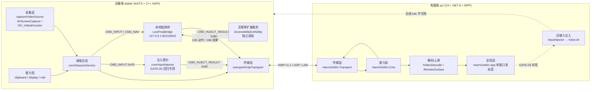

# HarmOs-Win 架构说明（v1.24.0）

> 本文件是**架构单一事实源**。改代码结构、模块边界、协议语义时，必须同步更新本文件与 `AGENTS.json` / `INDEX.json` / `PROGRESS.json` / `README.md` / `SESSIONS/<日期>.json`。
> 契约优先级：`AGENTS.json` > 本文件 > `PROGRESS.json` > 代码注释。

## 0. 何时算「架构变更」

- 新增/删除/改名模块、项目、目录分层；
- 协议包头、通道语义、命令字、状态机变化；
- 技术栈、设备角色、权限模型、编码/解码链路变化；
- 跨端接口（`IVideoPipeline` / `InputEvent` / `DeviceRole`）签名变化；
- 新增或结案一个 GATE。

仅改函数体、常量取值、日志文案、UI 样式不算架构变更，不要求改本文件。

## 1. 分层



关键约束：

| 约束 | 来源 | 落地位置 |
|---|---|---|
| 视频采集必须 AVScreenCapture，禁止 snapshot_display 轮询 | INV-04 | `capture/VideoSource.ets` |
| 分辨率/帧率/码率不得硬编码 | INV-06 | `HwpPacket.ets` / `DisplayProfile.ets` / `Hwp.cs` |
| 设备角色不得写死，源端/宿主端接口同构 | INV-08 | `core/SessionTypes.ets` / `DeviceSession.cs` |
| 不换栈：设备 ArkTS+C++、PC C#/.NET8+WPF | INV-11 | 目录结构 |
| 链路固定家庭 LAN + UDP，**不上 P2P** | INV-12 已结案 | `transport/` |
| **反控能力固定为三键导航 + 低频点击；不得静默恢复高频注入** | **INV-13（用户 02:58 明确批准）** | `accessibility/` / `HarmOsWin.App` |
| 输入事件经 HWP CONTROL 上行，注入必须在设备端本地完成 | GATE-03 / GATE-05 | `core/InputInjector.ets` |

> 虚线为**已判死路径**：`hdcw.sh → uitest/uinput` 由 GATE-03 排除；设备端 `inputEventClient` 由 GATE-05 排除（平板 801），仅保留为 `CMD_INPUT.type=0xFE` 的回归探针。

### 1.1 DEC-08 结案后的输入边界

用户 2026-11-08 02:58 明确批准需求 2 降级（INV-13，非静默）：

- **范围内**：三键导航（返回 / 主页 / 多任务）、单点点击等低频操作。
- **范围外**：任意坐标 mouse move 事件流、连续拖拽、键盘逐键输入。
- 判据由「单点 <30ms」（DEC-02 的高频前提）改为 **GATE-06 的单次端到端 <200ms**。这是能力收窄后重定的判据，不是放宽验收来掩盖 GATE-03/05 的失败。
- **hdc 明确排除**：GATE-03 实测单次 p50=2552.6ms，属 2.5 秒级延迟，不能拿「低频」当理由放行。
- 三键 + 单点恰好落在无障碍手势注入的能力范围内，因此 NEXT-07 与「无障碍手势注入」在实现上合流；仍需 GATE-06 真机验证可达性与延迟，**未验证前不得宣称可用**。

### 1.2 NEXT-07 实现（本轮落地，待服务开启验证）

主 HAP 与 `AccessibilityExtensionAbility` 运行在不同进程，用 **loopback UDP 桥**通信，避免依赖系统公共事件：

| 端口 | 方向 | 载荷 |
|---|---|---|
| `127.0.0.1:9021` | 主 HAP → 扩展服务 | 12B 动作包：`stage:u8` + `x:u16` + `y:u16` + `seq:u32` + 3B 保留 |
| `127.0.0.1:9022` | 扩展服务 → 主 HAP | 19B `InjectReport`（复用 `CMD_INJECT_RESULT(0x80)` 原样回传 PC） |

`stage` 取值与 PC 端 `NavKey` 逐值对齐：`1 back / 2 home / 3 recents / 4 单点点击`。
扩展服务用 `context.getWindowRootElement()` 取根节点后 `root.performAction(name, {})` 执行三键，
用 `context.injectGestureSync(GesturePath)` 执行单点。相关 API 全部 `@deprecated since 12` 但 API 26 d.ts 仍导出，
**是否真正可用必须靠 GATE-06 真机判定**。

主 HAP 侧 250ms 无响应即回传 `errCode=-2`（服务未连），这是链路状态而非协议错误。
服务未开启时**探针链路仍完整可测**（GATE-06 基线 8/8 回传已证明）。

> **服务开启方式**：本机 ROM `/system/bin` 无 `accessibility` 命令，官方文档的 `accessibility enable` 不可用。
> 必须由用户在 设置 → 辅助功能 → 扩展服务 → 已安装的服务 手动开启「HarmLink 低频操作」。
> 配置见 `module.json5 extensionAbilities` 与 `resources/base/profile/accessibility_config.json`。

## 2. 目录与职责

| 路径 | 职责 |
|---|---|
| `tablet/.../ets/transport/HwpPacket.ets` | 包头编解码、常量、MTU（唯一魔数出处） |
| `tablet/.../ets/transport/UdpTransport.ets` | 源端 UDP：心跳、视频/码流发送、控制派发、ACK |
| `tablet/.../ets/core/SessionTypes.ets` | 命令字、统一事件、角色/分辨率模型、`InjectReport` 线格式（跨端对齐） |
| `tablet/.../ets/core/SessionService.ets` | 会话编排：能力注册、码流分片推送、剪贴板、显示变更、输入派发到本地桥；`captureMetrics()` 把 native `CapStats` 转成结构化 UI 指标 |
| `tablet/.../ets/core/InputInjector.ets` | **GATE-05 探针**（`type=0xFE` 回归用）：原生 `inputEventClient`，平板 801，保留为证据 |
| `tablet/.../ets/accessibility/LowFreqBridge.ets` | 主 HAP 侧本地 UDP 桥；250ms 超时回 `-2` |
| `tablet/.../ets/accessibility/AccessibilityExtAbility.ets` | 无障碍扩展服务：执行三键 + 单点，19B 结果发回 9022 |
| `resources/base/profile/accessibility_config.json` | 服务能力声明 `["retrieve","gesture"]` |
| `tablet/.../ets/capture/VideoSource.ets` | `IVideoSource` 抽象 + 文件源 + `NativeVideoSource` 实时源（真采真编 + 直发开关） |
| `tablet/.../cpp/harmoscap.cpp` | C++ NAPI：`OH_AVScreenCapture`(WithSurface) 零拷贝接 `OH_VideoEncoder`(AVC)；`SendFrameDirect` 在编码器回调线程按 HWP 分片 sendto |
| `tablet/.../ets/pages/SessionPage.ets` | 统一会话页（NEXT-02~06 的设备端入口）：卡片式控制台 —— 返回 + 品牌/状态胶囊 → 主控卡 → 2×2 指标卡（fps / 累计帧 / 编码码率 / 发送失败）→ 会话信息标签 → 可折叠日志；状态按 native `capState` 区分「等待 PC / 投屏中 / 已暂停」 |
| `pc/HarmOsWin.Transport/` | HWP 编解码、UDP 端点、三通道、RTT 采样、RTO 自适应 |
| `pc/HarmOsWin.Core/` | 统一 `InputEvent`、`InputInjector`、`ClipboardBridge`、`VideoAssembler`、`DeviceSession`、解码/上屏接口 |
| `pc/HarmOsWin.App/` | WPF 单窗口多设备：左侧栏设备列表与操作、右侧画面与指标磁贴、三键导航、Q' 锁屏页 |
| `pc/HarmOsWin.App/Ui/Theme.cs` | PC 端深色配色单一事实源（冻结画刷 + 字体） |
| `pc/HarmOsWin.App/Ui/Controls.cs` | Border 自绘控件：FlatButton（四态）/ StatTile / StatusPill |
| `pc/HarmOsWin.Probe/` | L0 回归 + `gate02` / `gate05` / `gate06` 三个验证控制台 |
| `scripts/hdcw.sh` | 无线 hdc 统一入口（串行锁、dim/undim/keepon/keepoff） |
| `scripts/l0_probe.py` | 一键延迟回归 |

## 3. 数据流

**视频（下行，设备 → PC）**
`AVScreenCapture → OH_VideoEncoder(在 C++ 回调线程内) → H.264 Annex-B → 分片 1176B 数据 + 8B meta → CH_STREAM(5) via native sendto → VideoAssembler → IVideoDecoder(MF 硬解) → WriteableBitmap → WPF`
当前实现：`NativeVideoSource` 真采真编，**分片与 UDP 发送在编码器回调线程完成（native 直发）**，ArkTS 只保留控制通道与 1s 统计轮询；`setDirectSend(false)` 时回落到 TSFN + `UdpTransport.sendStreamFrame` 分片。实测 peakFps=62 / activeFps=51.14 / 解码 0 错误，见 §6。

**为什么发送必须在 C++**：ArkTS 单线程对每帧约 60~95 个 1200B 分片做多次拷贝 + Promise + socket IPC，会把 60fps 源拖到 6~7fps。native 直发用独立 socket（不 bind，系统分配源端口）+ `SO_SNDBUF` 4MB + `O_NONBLOCK`，发送缓冲满只计数不阻塞编码器。PC 端 `HwpEndpoint` 不跟随 remote 端口回包（控制包固定发往 `Add()` 配置的 device endpoint），所以视频源端口与设备 9020 不同不会打断控制通道。

**输入（上行，PC → 设备）**
`WPF 三键/单点 → InputEvent → CH_CONTROL(CMD_NAV / CMD_INPUT) → 设备端 SessionService → LowFreqBridge(9021)`
`→ AccessibilityExtAbility → getWindowRootElement().performAction / injectGestureSync → 19B 结果(9022)`
`→ SessionService 原样透传 CMD_INJECT_RESULT(0x80) → PC`

`CMD_INPUT.type=0xFE` 是 GATE-05 回归专用分支，走 `core/InputInjector.ets`（原生 API，平板 801），不属于 INV-13 交付能力。
`CH_CONTROL` 同时承载事件语义与结果回传；**hdc 不再出现在输入链路上**（GATE-03 判死）。

**剪贴板（双向）**
`@ohos.pasteboard` ↔ `CH_CONTROL(CLIP_*)` ↔ Win32 Clipboard；用内容 FNV-1a 做回环抑制，图片走 PNG 原始字节分片，不重编码。

## 4. HWP v1.1 扩展（向后兼容 v1.0）

包头不变（16B，小端）。只新增通道与命令字，L0 的 `CH_VIDEO/0x00~0x02/0xFF` 语义完全保留，可随时回归。

| 项 | 值 | 说明 |
|---|---|---|
| `CH_STREAM` | 5 | 真实码流分片，不可靠，不重传 |
| `FLAG_KEYFRAME` | 0x08 | 该分片属于关键帧起点 |
| `FLAG_LAST` | 0x10 | 当前帧最后一个分片 |
| `CMD_INPUT` | 0x10 | 统一输入事件（`type=0xFE` 为 GATE-05 回归） |
| `CMD_NAV` | 0x30 | 三键导航（back/home/recents） |
| `CMD_CLIP_TEXT` | 0x20 | 剪贴板文本 |
| `CMD_CLIP_IMAGE` | 0x21 | 剪贴板 PNG 分片 |
| `CMD_ROLE` | 0x40 | 角色协商（INV-08） |
| `CMD_RESOLUTION` | 0x50 | 分辨率/折叠态变更 |
| `CMD_STREAM` | 0x60 | 码流启停（start/stop） |
| `CMD_LOCK_STATE` | 0x70 | Q' 锁屏状态通知 |
| `CMD_INJECT_RESULT` | 0x80 | 注入结果回传：GATE-05 原生探针 / GATE-06 低频动作共用，`stage` 区分 |

`CH_STREAM` payload 前 8 字节为帧元数据：`frameId:u32` + `fragment:u16` + `fragCount:u16`，其后为码流字节。`VideoAssembler` 丢包即丢整帧，不等待、不重传。

**RTO 自适应**：`RtoEstimator` 按最近 RTT 样本计算 `srtt` 与 `rttvar`，`RTO = clamp(srtt + 4*rttvar, 20, 200)`ms，替换 v1.0 固定 20ms（GATE-L0 实测省电态每阶段触发 1~3 次无谓重传）。

**无样本兜底（v1.9.1）**：还没有任何 RTT 样本时用 `Hwp.ControlRtoInitMs = 200`ms，不是 20ms。平板在 `IDLE` 态不发心跳，PC 侧只能从 ACK 拿样本，首包时机往往正是零样本状态；20ms 下 4 次重传（`ControlMaxRetry=3`）总共只有 80ms，短于本机 Wi-Fi 实测平均 RTT 82ms／峰值 137ms，首个 `CMD_STREAM` 必然判失败——平板 `SessionService.streaming` 保持 false，`pushFrame` 首行就 return，一个视频包都不会发，PC 端于是永久停在「等待设备画面…」。拿到第一个 ACK 后自动收敛到上面的自适应区间。

## 5. 设备角色（INV-08）

`DeviceRole` 在连接时协商，不写死谁投谁：`SOURCE`（采集并推流）/ `HOST`（接收并反控）/ `BOTH`。`DeviceSession` 同时实现 `ISourceEndpoint` 与 `IHostEndpoint`，`≤3` 个会话由 `SessionManager` 管理，切换标签不断流（只切呈现，不拆 UDP）。

## 6. GATE 状态与未闭项

| GATE | 内容 | 状态 |
|---|---|---|
| GATE-01 / GATE-S1 | 视觉息屏 | ✅ 真机通过 |
| GATE-L0 | LAN + UDP 双通道延迟 | ✅ 真机 PASS（不上 P2P） |
| GATE-L1 | P2P 探针 | ⛔ 不启动（INV-12 已结案） |
| GATE-02 传输/重组 | HWP v1.1 `CH_STREAM` 承载真实 H.264 | ✅ 真机 PASS：235 帧 / 1105440B / 940 包，丢帧 0、视频丢包 0；握手/输入/导航/剪贴板全部 ACK；设备端统计与 PC 报告一致 |
| GATE-02 实时采集/上屏 | 60fps 零拷贝 + MF 硬解 + D3DImage | ✅ **帧率 PASS**：`OH_AVScreenCapture`(WithSurface) 零拷贝接 `OH_VideoEncoder`(AVC)，编码器回调线程内直接 HWP 分片 sendto（native 直发）；PC 端 MF 硬解 + `WriteableBitmap` 上屏。peakFps=62 / activeFps=51.14 / 解码 0 错误。剩余：端到端 <100ms 打点、D3DImage 零拷贝、WPF 人工验收 |
| GATE-03 | 输入注入双通道延迟 | ❌ FAIL（**已结案，转为排除依据**）：uitest 4/4 成功但 p50=2552.6ms、uinput 0/4；DEC-08 结案后不再阻塞 |
| GATE-05 | 设备端注入落地（DEC-08 探针） | ❌ FAIL（**已结案，转为排除依据**）：两轮各 10 次，`syscap=1` 但 `createTouchController()` 20/20 返回 801；本地 0~1ms，端到端 p50=29.18ms |
| **GATE-06** | **低频输入落地（DEC-08 结案后）** | ✅ **已由 uitest RPC 达成**（判据 <200ms）：p95 **90.42ms**、0 失败；三键 Back/Home/Recent 与单点点击全部真机可用。无障碍通道的基线（8/8 ACK、`errCode=-2`）仅作跨 ROM 保底保留，**不再是落地路径** |
| GATE-04 | 剪贴板双向含图片 | ✅ **真机闭环（2026-11-12）**：文本走 UDP `HCLIP/1` 广播分片，PNG 走 TCP 旁路 18768（一次一连接）。下发 177333B/1.5s、上行 153023B/1084x721/1694ms，Windows 剪贴板复核一致。`READ_PASTEBOARD`(system_basic) 那条系统读取路仍不可用，已改为应用内主动推送 + `PasteButton` 一次性读权限 |
| NEXT-05 | 三键导航 + 多标签 + Q' 锁屏页 | ✅ WPF 实现、编译 0 warn 0 error；人工交互验收未做 |
| NEXT-06 | 折叠屏 / 角色协商 | ✅ 接口、变更通知、角色协商真机上报 1600×2560/角色 2 已确认；手机真机按用户要求暂缓 |
| **NEXT-07** | **无障碍低频输入实现** | ⛔ **平台不支持，已关闭**（2026-11-09 改判）：本机 ROM `AccessibilityManagerService client num=0`，设置里没有「扩展服务」入口，用户无法开启；其验证目标（三键+单点 <200ms）已由 GATE-06 / uitest RPC 达成（p95 90.42ms、0 失败）。无障碍代码保留作跨 ROM 保底，不删 |

> **不得把「接口就绪」或「链路通」写成「GATE 通过」。** 判定只认真机实测数据。

### 6.1 五个架构级发现

1. **hdc 不能作为实时输入通道。** TCP 会话跨 shell 进程即掉线，每条命令都要重新 `tconn`；已连接态单次 hdc 约 170ms 但不可复用，`hdcw.sh` 单条 shell 实测 2.0~2.6s。常驻 `hdc shell` 返回 `Not support stdio TTY mode` / `Not match target founded`。DEC-02 的 `<30ms` 前提被推翻。
   - 附带修复：`hdcw.sh ensure_conn` 与 `status` 原来只认 `Connect OK`，已连接时实际返回 `Target is connected, repeat operation`。

2. **`READ_PASTEBOARD` 是 system_basic。** 声明后普通调试签名装机直接失败 `code 9568289 grant request permissions failed`。设备→PC 系统剪贴板自动读取改为 `SessionService.pushClipText()` 应用内主动推送。

3. **API 26 有公开注入 API，但平板不可达（GATE-05）。** `@ohos.multimodalInput.inputEventClient`（`@kit.InputKit`，非 `@systemapi`）提供键盘/鼠标/触摸 controller，`canIUse(InputSimulator)` 在平板返回 `true`；但 `createTouchController()` 20/20 返回 `801 Capability not supported`，因为它依赖 `ohos.permission.CONTROL_DEVICE`（`system_basic` / `manual_settings` / `deviceTypes` 仅 `2in1`）。声明权限后装机成功但 `bm dump` 显示 `reqPermissionStates=-1`，本机 ROM 的 `bm` 没有 `grant` 子命令；HarmonyOS 签名 profile 为 `app_gallery` 签发、`apl=normal`、`acls.allowed-acls=[]`，改 OpenHarmony SDK 的 ACL 模板不生效。与 A3 的 `TIMEOUT_SCREENOFF_DISABLE_LOCK` 完全同款。

4. **DEC-08 已由用户明确拍板结案。** 三条高频路径判死后，用户 02:58 接受需求 2 收窄为三键导航 + 低频点击（INV-13）。剩余唯一落地候选 `AccessibilityExtensionContext.injectGestureSync` 虽需新建 ExtensionAbility + 用户手动开启、且 `GesturePath` 只能注入完整手势路径（constructor 自 API 12 起 deprecated），但**该限制恰好与收窄后的能力范围一致**，不再是能力折衷，而是匹配的实现手段。

5. **无障碍 API 的归属与 deprecated 陷阱（本轮）。** `performAction` 属于 `AccessibilityElement`（`application/AccessibilityExtensionContext.d.ts` 第 267 行起），**不是** `AccessibilityExtensionContext`；必须先 `context.getWindowRootElement()` 再 `root.performAction(name, {})`。首次编译报 `ArkTS 10505001`。`getWindowRootElement` / `performAction` / `injectGestureSync` 全部 `@deprecated since 12`，但 API 26 d.ts 仍导出。另外本机 ROM `/system/bin` **没有 `accessibility` 命令**，官方文档的 `accessibility enable -a ... -b ... -c rg` 用不了，服务只能由用户在设置里手动开启。

## 7. 变更记录

- 2026-11-08 v0.7.0：建立本文件；按 NEXT-02~06 顺序落地会话层、能力层、呈现层；HWP 扩展到 v1.1；新增 RTO 自适应与 `CH_STREAM`；明确 C++ NAPI 实时采集与 MF 上屏为未闭项。
- 2026-11-08 v0.7.0（真机结案）：新增 `DEC-08` 待拍板；修复 `hdcw.sh` tconn 返回值误判；移除 `READ_PASTEBOARD` 声明。
- 2026-11-08 v0.8.0：按用户拍板执行 DEC-08「HWP CONTROL + GATE-05 探针」。新增 `core/InputInjector.ets`、`Gate05.cs`、`CMD_INJECT_RESULT(0x80)` + 19B `InjectReport`；两轮真机各 10 次，20/20 返回 801，DEC-08 部分结案。回滚无效权限声明，`hdc` 从输入链路中移除。
- 2026-11-08 v0.9.0：用户 02:58 明确批准需求 2 降级为「三键导航 + 低频点击」，DEC-08 结案。新增 INV-13、GATE-06 判据（单次 <200ms）、NEXT-07 待办；GATE-03/05 由阻塞转为排除依据。
- 2026-11-08 v1.0.0：按用户 03:02「好的，执行」开工 NEXT-07。新增 `accessibility/LowFreqBridge.ets`、`AccessibilityExtAbility.ets`、`accessibility_config.json`、`module.json5 extensionAbilities`；输入改走本地 loopback UDP 桥（9021/9022），复用 `CMD_INJECT_RESULT` 不新增命令字；新增 `Gate06.cs`。双端编译通过、装机成功、服务已注册；GATE-06 基线 8/8 链路通但服务未开启（`errCode=-2`）。**设备停在统一会话页等待用户开启服务后复测**，动作可达性未验证。
- 2026-11-08 v1.1.0：用户选定 C「先把 GATE-02 实时画面做出来」。设备端新增 `src/main/cpp`（`OH_AVScreenCapture_StartScreenCaptureWithSurface` 把屏幕直接接到 `OH_VideoEncoder` 的输入 Surface，H.264 Annex-B 经 TSFN 回 ArkTS）；`NativeVideoSource` 改为真实现并支持推送式出帧，`SessionService` 实时源不再走 33ms 轮询。PC 端新增 `MfInterop.cs` / `MfH264Decoder.cs` / `H264Sps.cs`，用 Media Foundation `CMSH264DecoderMFT` 硬解 + NV12→BGRA + `WriteableBitmap` 上屏；新增 `Gate02Live.cs`（真机量化）与 `MfDecodeFile.cs`（离线调试）。真机实测 161 帧 / 18.3MB / 0 丢包 / 0 解码错误，平均 6.4fps、首帧 14.9s，画面已人工核对正确；**帧率与首帧延迟未达标，GATE-02 仍是部分通过**。
- 2026-11-08 v1.1.0（实现要点，避免重踩）：① `MFCreateSample`/MFT 返回的 `IMFSample` 在 .NET 里 QI 会误报 `E_NOINTERFACE`，必须按 vtable 槽位调用；② `ProcessOutput` 的数组参数要 `[MarshalAs(UnmanagedType.LPArray)]`，否则报 `0x80131165`；③ `CMSH264DecoderMFT` 是 `providesSamples=false`，需自建输出样本；④ 首次 `ProcessOutput` 返回 `0xC00D6D61` 要当作 STREAM_CHANGE 重新协商；⑤ 每次开采集都会弹系统录屏授权，必须点「允许」。
- 2026-11-08 v1.2.0：GATE-02 帧率达标。把 HWP 分片与 UDP 发送从 ArkTS 下移到 C++（`SendFrameDirect` 在编码器回调线程直接 sendto），新增 `setStreamPeer(host,port)` / `setDirectSend(bool)` NAPI，`VideoSource` 增加 `enableDirectSend/disableDirectSend`，`SessionService` 在 `start()` 之前打开直发并用 native 统计增量补齐帧/字节；PC 端 `Gate02Live` 新增 `peakFps`（最大 1 秒窗口）与 `activeFps`（首帧到末帧）口径。真机 40s 动态画面：peakFps=62 / activeFps=51.14 / 解码 1507 帧 0 错误 / 丢包 0.46% / 码率 23.3Mbps。**同时纠正历史误判**：`OH_AVScreenCapture` 只在画面变化时出帧（静止掉到 1~5fps），加之录屏授权等待 9.9s 被算进分母，才得出「6.4fps / 首帧 14.9s」；链路本身首帧仅 0.87s。
- 2026-11-08 v1.3.0：GATE-02 流畅度收尾。PC 端把「收包+重组」与「解码上屏」拆成两条线程（`DeviceSession.FeedLoop` 单槽只保留最新帧，跟不上就丢旧帧，绝不排队），`HwpEndpoint` 收缓冲 8MB / 发缓冲 4MB，视频丢包 0.59%→0、p99 帧间隔 56ms→31ms。设备端改 CBR 20Mbps 并用 `OH_AVScreenCapture_SetMaxVideoFrameRate` 封顶 60fps（VBR 曾跑到 23.3Mbps）；停止推流改为 `setStreamActive(false)` 只暂停发送、保留采集会话（免重新授权 9.9s），恢复时请求 IDR；推流期间每 2s 重报 `CMD_RESOLUTION`（PC 中途接入必需，SPS 兜底不可靠）。延迟打点改用 epoch 毫秒 + 最小单向延迟标定，实测端到端 8.5ms。
- 2026-11-08 v1.4.0：平板端优化。① 长时任务从「只有 GATE-01 探针页」改为由 `SessionService` 在会话启停时同步管理（`multiDeviceConnection + audioRecording`），否则息屏/切后台进程被挂起、采集与 UDP 一起断。② `harmoscap.cpp` 在编码回调里缓存最近一个同步帧（含原始时间戳），`setStreamActive(true)` 时立即重放一次并由独立线程在 120/300/480ms 各补一次——静止画面下采集不出帧，只请求 IDR 会等 1~10s；实测恢复首帧降到 797ms。重放沿用原始时间戳，避免 PC 把旧帧算成低延迟新帧。③ 视觉息屏降级落地为 `window.setWindowBrightness(0.05)`：SDK 无应用层系统亮度 API，且该接口仅前台有焦点时有效、文档明示不适用投屏虚拟屏，因此只能做「本窗口前台调暗」。
- 2026-11-08 v1.5.0：GATE-02 复核 + 两个真 bug 修复。
  ① **参数集必须随 IDR 一起缓存**：`OH_VideoEncoder` 把 SPS/PPS 作为独立帧输出（`AVCODEC_BUFFER_FLAGS_CODEC_DATA = 1<<3`），IDR 帧本身不含参数集。此前只缓存 IDR，PC 全新进程接入时既无法用 `H264Sps.TryParse` 自举分辨率、也建不出解码器，每帧抛「解码器尚未获得分辨率（等 CMD_RESOLUTION）」，必须等 2s beacon 才恢复。现改为编码回调分别缓存 `g_lastParamSets` 与 IDR，组装 `g_lastIdr` 时参数集前置；两段在同一把 `g_idrLock` 内处理（非递归锁，分开 `lock_guard` 会自锁）。
  ② **`CMD_RESOLUTION` 去重**：设备每 2s 重报是必需的（PC 中途接入），但 `DeviceSession` 原先无条件触发 `ResolutionChanged`，把重报当成「分辨率变了」。`MfH264Decoder.Configure` 的相同分辨率早退挡住了真正的重建，但事件与日志仍在每秒刷屏误导排查；现在只在 `w/h/folded` 真正变化时才触发。
  ③ 验收工具补强：`--auto` 模式把会话日志打到控制台（此前只看到黑屏窗口，分不清是设备没发还是 PC 没订阅）；新增 `--snapshot-delay <秒>`（默认 12s 常常拍在仍黑屏的时刻，误判成上屏失败）。
  ④ 复核数据：探针 peakFps=62 / activeFps=46.5 / 帧间隔 p50=16 p95=28 p99=52ms / 0 解码错误 / 延迟 11.4ms；暂停 2.5s 后恢复首帧 **102ms**（pacing 版本，仅重放走每 8 包让 200μs，实时帧不受影响）；**WPF 窗口首次人工验收上屏**（presented=100、写位图 3.0ms、端到端 51ms、1600x2560 竖屏居中）。
  ⑤ 三条验收环境坑（写在 AGENTS facts 里）：USB 线在位会让无线 `tconn` 建不起来（`list targets` 只剩序列号，拔线即恢复）；Windows 侧必须跑 `.exe` 而非 `dotnet.exe` 承载 dll，否则防火墙按进程名放行的规则不命中、UDP 入站被静默丢弃；采集授权弹窗点击过早会被吞（须 `dumpLayout` 取 `允许` bounds 中心，当前 (1028,1527)，并在渲染稳定后点）。
- 2026-11-08 v1.6.0：「停止会话」改为「停止投屏（只暂停，保留采集）」+ 三处显示/类型 bug。
  ① **暂停语义**：`SessionService.pauseStream()` 只调 `stopStream()`（内部 `NativeVideoSource.pauseSend()` → `setStreamActive(false)`），采集会话、长时任务、transport、输入桥全部保留；`resumeStream()` 复用 `startStream` 的「采集还在跑」分支，不再申请录屏授权。页面从两态改三态（未启动 / 运行中 / 已暂停）。**全量释放只在 `aboutToDisappear → stop()`**。
  ② **`startStream` 幂等**：原先第一行 `if (this.streaming || ...) return` 会让「PC 换新进程接入」时设备毫无反应 —— 新解码器拿不到参数集，只能干等 2s beacon。现在 `streaming == true` 时补发 `CMD_RESOLUTION` + `enableDirectSend` + `resumeSend`（触发参数集与 IDR 重放）。
  ③ **NAPI 数值必须用 double**：`napi_create_int64` 在 ArkTS 侧产生 BigInt，与 `.d.ts` 的 `number` 声明冲突，赋值抛异常被 `stats()` 的 catch 吞掉，`getStats()` 永远返回默认全 0 / `state=-1`。这条 bug 长期把「native 帧 0」伪装成「采集没起来」，浪费过多轮排查。
  ④ **UI 文本必须走 @State**：`build` 里直接写 `Text(this.session.getCaptureStats())` 不依赖任何状态，ArkUI 首帧求值后不再重建该节点，显示永远停在初始值。改为 `@State capText` 并由 1s 定时器刷新。
  ⑤ **PC 端待初始化帧挂起**：分辨率未到时不再把帧当「解码失败」丢掉，压入 `_pending`（上限 8 帧）；`Configure` 或 SPS 自举拿到分辨率后立即 `FlushPendingLocked` 回放。
  ⑥ **重放拆帧**：MF 的 H264 MFT 对「SPS+PPS+IDR 挤在同一 sample」不会立即出帧（实测首帧 4.7~13s）。`SendCachedIdrSplit` 把参数集单独成帧先发，**主重放与追加重放共用同一实现**（只改主重放时首帧仍 11s）。追加重放窗口由 120/300/480ms 拉长到 120/600/1200/1900/2500ms，覆盖 PC 首次创建 MF 解码器的耗时。
  ⑦ **仍未闭环**：PC 换新进程接入首帧 2.4/4.7/6.6/11.1s 均有出现，`distinctFrames` 明显大于 `frames` —— 重放的 70 包突发发送在 PC 侧组装失败。根因指向控制通道（CMD_STREAM / RESOLUTION 走可靠通道 + ACK）与直发视频通道的时序竞争，待下一轮系统排查。
- 2026-11-08 v1.7.0：平板端会话页 UI 重构（纯呈现层，协议与传输未动）。
  ① **布局**：原「标题 + 一列整宽按钮 + 拼接统计行 + 日志」改为卡片式控制台 —— 头部（返回按钮 + 品牌 + 状态胶囊）→ 主控卡（会话徽章 / 主操作 / 次操作 / 状态说明）→ 2×2 指标卡（编码帧率 / 累计帧 / 编码码率 / 发送失败）→ 会话信息标签（分辨率 · 角色 · 锁屏 · 注入 · 剪贴板）→ 可折叠日志（空态占位、自动滚底）。字号与间距按 1600×2560 平板重排，新增 `@Styles sessionCard` 统一卡片外观、`@Builder statCard/infoChip` 单一参数 `$$` 引用传递。
  ② **指标结构化**：新增 `SessionService.captureMetrics(): CaptureMetrics`，直接暴露 `CapStats` 的 frames/bytes/keyframes/state/packets/sendErrors/directSend/idrReplays/idrCachedKb。**UI 不再解析 `getCaptureStats()` 的拼接串**（字段顺序一变就静默错位，且无法算增量）；fps 与码率由两次 1s 采样求差得到。`present=false` 表示当前源不是 native 实时源。
  ③ **状态语义纠偏**：`SessionService.start()` 只起 transport / 长时任务 / 输入桥并上报 `ROLE`+`RESOLUTION`，**native 采集要等 PC 下发 `CMD_STREAM` 才启动**。因此只看 `running` 会把「等待 PC」误显示成「投屏中」。现在按 `capState >= 0` 判定：未握手 = 琥珀点「等待 PC」+ 指标区提示「采集尚未启动」，握手后 = 红点「投屏中」，暂停 = 琥珀点「已暂停」+ 绿色「继续投屏」。
  ④ **语义修正**：「实时码率」实为编码器产出码率（暂停发送后仍在涨），改名「编码码率」；暂停时直发徽章由「Native 直发」改为灰色「发送已暂停」。
  ⑤ **验证**：真机四态截图（空态 / 等待 PC / 运行 59.9fps · 386 帧 · 19983kbps · Native 直发 · 状态 0 / 已暂停），返回按钮回 GATE-01 正常；HAP 33 任务构建通过，ArkTS WARN 仍为 7 条（无新增）。

- 2026-11-08 v1.8.0：两端界面统一为「卡片式控制台」（纯呈现层，协议/传输/解码/注入均未动）。
  ① **平板端**：新增 `common/Theme.ets` 收敛配色、`logColor()` 日志染色、`timePrefix()` 时间戳；`Index.ets` 与 `NetworkProbePage.ets` 全量重写为「头部状态胶囊 → 主控卡 → 指标卡 2×2 → 信息标签 → 可折叠日志」，与 `SessionPage` 同一套视觉；`SessionPage` 改用共享常量，去掉三份重复色值。
  ② **PC 端**：`MainWindow` 从「顶部一排默认按钮 + 顶部 TabControl + 一行 200 字状态串」改为 左侧栏（品牌 / 设备 IP 输入 + 设备列表 / 推流 / 导航三键 / 锁屏）+ 右侧（设备标题 + 状态胶囊 + 分辨率 chip + 画面 + 五枚指标磁贴 + 细节行）。原生 `TabControl` 换成「设备列表 + 画面叠放（Visibility 切换）」，**仍只切呈现、不拆 UDP、不停推流**。
  ③ **新增自绘控件**：`Ui/Theme.cs`（深色配色，语义与平板一致：主色蓝、红/琥珀/绿状态色）+ `Ui/Controls.cs`（`FlatButton` 圆角四态按钮、`StatTile` 指标磁贴、`StatusPill` 状态胶囊）。WPF 原生 Button 的 chrome 改不了圆角与配色，TabControl 默认灰底与深色冲突，所以不用默认模板。
  ④ **两个实测坑**：`RenderTargetBitmap.Render(Content)` 不画 `Window.Background`，内容根没底色时窗口快照是白底（首版快照右侧全白，误判深色主题没生效）；窗口 Height 写死 840 超过本机可用工作区（约 861 DIP 高、实际内容区更矮），底部指标行与状态行被系统裁掉，改为 `SystemParameters.WorkArea` 收敛。
  ⑤ **验证**：`--auto 192.168.1.100 --snapshot --metrics` 真机跑通 —— 快照显示实时镜像画面，`presented=65`、`packets=3893`、延迟 65.5ms、0 解码错误、0 视频丢包；平板端网络探针跑 `l0_probe.py` 后磁贴真实填充（上行 17141 / 视频 16556 / ACK 32）；平板 HAP 构建 33 任务通过、ArkTS WARN 仍 7 条无新增；PC `dotnet build` 0 警告。

- 2026-11-08 v1.9.0：PC 端「画面占比最大化」（纯呈现层，协议/传输/解码未动）。
  ① **画面区不再被 chrome 挤压**：指标磁贴由「占一行布局的 5 枚 StatTile」改为浮在画面右下角的 HUD（新增 `MiniStat`，单行 22 DIP），画面区多出约 70 DIP 高度；内容边距 18/16 → 10/8；底栏两行强制 `NoWrap + 省略号`，避免换行把窗口高度算错。
  ② **侧栏可折叠**：标题条左侧 `‹ / ›` 切换，推流开始后自动收起，需要操作时再展开。
  ③ **贴合设备比例**：`FitWindowToDevice()` 量一次 chrome（`ActualWidth - _stage.ActualWidth`）后一次算准窗口尺寸，使画面区宽高比 = 设备宽高比，左右/上下黑边归零。上一版窗高写死、MinWidth=900 都会让贴合结果被顶回去 —— 这是用户看到「黑框太多」的直接原因。
  ④ **适应 / 铺满**：`ToggleFill()` 在 `Stretch.Uniform`（完整画面 + 留边）与 `UniformToFill`（填满窗口、裁掉超出部分）之间切换，供「窗口坚持要保持宽屏」时使用。**（此为 v1.9.0 当时语义；2026-11-10 已改为 `Fill ↔ Uniform` 且默认 `Fill`，见文末补记，勿按本行排查。）**

- 2026-11-08 v1.9.1：修「PC 端常显等待设备画面…」，属传输层行为修复。
  ① **表象**：PC 画面区只有占位文字，`presented=0`；平板侧却在正常编码（累计 3287 帧、编码码率 1000kbps、发送失败 0），看起来「设备在发、PC 收不到」。
  ② **误导点**：平板 `HwpL0` 日志里 `video=0`、`hb=0` 曾被当成「一个包都没发」的证据。实际上 `Native 直发` 模式下码流由 C++ 层直接 `sendto`，压根不走 `UdpTransport.sendStreamFrame`，这两个计数本来就不增长；IDLE 态也不发心跳与探测包。判断有没有发帧要看平板「累计帧／编码码率」与 PC 的 `presented`。
  ③ **真因**：`RtoEstimator` 零样本时回退 20ms。平板 IDLE 态不发心跳，PC 只能从 ACK 取样本，而首包恰在零样本时刻；20ms × 4 次 = 80ms < 本机 Wi-Fi 平均 RTT 82ms → `CMD_STREAM` 判失败 → 平板 `streaming=false` → `pushFrame` 首行 return。
  ④ **修法**：拆出 `Hwp.ControlRtoInitMs = 200` 作零样本兜底，有样本后仍自适应并钳位 [20,200]。
  ⑤ **验证**：`tmp/verify.log` 握手成功 `RTO=180ms`；`tmp/verify.jsonl` `presented=65`、延迟 37.8ms、解码错误 0；`tmp/verify.png` 状态胶囊「投屏中」、画面铺满；平板日志「PC 重新接入：已补发分辨率 + 重放缓存关键帧」。PC `dotnet build` 0 警告 0 错误。

- 2026-11-08 v1.9.2：窗口缩放锁设备比例（呈现层，用户明确要求「缩放完全跟随设备的屏幕比例」）。
  ① **问题**：用户把窗口拉成 961×1051（比例 0.914）而设备是 0.625，`Stretch.Uniform` 居中后左右各留约 170 DIP 黑边；只在推流瞬间贴合一次，之后任何手动缩放都会破坏比例。
  ② **实时锁**：`OnSourceInitialized` 挂 `HwndSource` 钩子处理 `WM_SIZING`，在系统应用拖动矩形之前把另一维按 `_windowAspect`（**窗口整体**比例，含 chrome，不是纯设备比例）反算出来，并按拖动边/角锚定。拖动左右边 → 高度联动；拖动上下边 → 宽度联动；拖角 → 取较大一维为准，保证窗口包得住鼠标位置。
  ③ **两个必须守住的点**：钩子里 `handled` 必须保持 `false`（设 `true` 会吞掉 `DefWindowProc`，窗口彻底拉不动）；最小尺寸要**整体缩放**，只钳一维会让 `MinWidth/MinHeight` 把比例顶破。
  ④ **兜底**：`SizeChanged` 420ms 防抖再贴一次，覆盖程序化改尺寸 / DPI 变化等不走 `WM_SIZING` 的路径；但 `_windowAspect <= 0.05`（尚未贴合过）时不吸附，否则会在侧栏收起之前先贴成 1057×1352、再跳回 799×1352。
  ⑤ **验证**：启动只有一条 `[fit] window=799x1352`；`SetWindowPos` 强设 961×1051 后 1.2s 自动回到 799×1352；`tmp/final.png` 画面铺满。拖动实时锁定需真人验证（前台游戏抢占鼠标，脚本注入全被拦）。
  ⑤ **沉浸模式语义修正**：`⛶ 全屏` 只隐藏窗口内的侧栏/标题条/状态行，**不再修改 WindowState**；用户明确「占比最大化，不是窗口最大化」，不得默认把窗口铺满屏幕。
  ⑥ **验证**：`[fit]` 日志 window=799x1352、chrome=38x135、画面区 761x1217（比例 0.625 等于设备 1600×2560）；此前 900 宽窗口下画面仅 761 宽、每侧 50 DIP 黑边。编译 0 警告。

- 2026-11-08 v1.10.0：根治「PC 重连首帧 2.4~13s」，并纠正 v1.9.3「静止 0fps 是固有行为」的错误结论。
  ① **真根因**：Media Foundation 的 `CMSH264DecoderMFT` **必须先累积「内容不同」的连续帧才吐第一帧**。设备重连时重放的是**同一个**缓存的 IDR，对 MFT 就是重复帧，于是 ProcessInput 成功、ProcessOutput 一直 `NEED_MORE_INPUT`、错误计数 0 —— 看起来在跑，其实一帧没解；只能干等用户真的去动屏幕触发真实新帧，实测 2.4~13s。
  ② **判定依据（离线可复现）**：`HarmOsWin.Probe mfde` 逐条验证 —— 单帧 118797B 完整 SPS+PPS+IDR → 0 帧；同一帧重复 3/5/8 次 → 全 0 帧；SPS+PPS+3 个相同 IDR → 0 帧；真实连续不同帧喂到第 8 帧 → 首帧解码成功 1600×2560。码流本身合法（NAL 解析：IDR=type5，参数集=SPS(7)+PPS(8)）。**因此「补 SPS/PPS」「拆/并 sample」「重复喂缓存 IDR」三种救法都无效，不要再试。**
  ③ **修复**：设备端编码器 configure 阶段开启 `OH_MD_KEY_VIDEO_ENCODER_REPEAT_PREVIOUS_FRAME_AFTER = 33`（无新帧时按 33ms 重复编码上一帧，frame_num/POC 递增，算真帧）与 `OH_MD_KEY_VIDEO_ENCODER_REPEAT_PREVIOUS_MAX_COUNT = -1`（不限次数）。两个 key 由 API 18 引入（本机 API 26 可用），**仅 surface 模式、仅 configure 阶段生效**。格式用 `buildFormat(bool withRepeatFrame)` lambda 统一构造；configure 失败时自动去掉这两个 key 重试一次并打 `CAPI_LOGW`，保证老 ROM 不整机不可用。
  ④ **PC 侧三道防线（对老 ROM 兜底）**：没有 IDR 之前不喂 P 帧（`_needIdr` 门闩）；纯参数集帧只缓存、绝不喂 MFT（不含 slice 的访问单元会被当无效帧，之后一路 `NEED_MORE_INPUT`）；收到「裸 IDR」（不带 SPS/PPS）且手上没有参数集时先挂起，参数集到齐再拼到 IDR 前面一次喂入，超过 5s 兜底直喂。
  ⑤ **验证**：重连首帧 3 次实测均为 **2.0s**（修复前 10~13s）；静止画面 PC 30~33fps、平板自报 31~33fps、延迟 7.5~8ms、发送失败 0、videoLost 0；`tmp/rpt_shot.png` 画面铺满无黑边、状态「投屏中」、HUD 帧率 31 / 延迟 8ms / 解码错误 0。HAP 33 任务成功、PC 0 警告 0 错误。
  ⑥ **已知代价**：静止时编码码率约 **10~11Mbps**（CBR 20000kbps 目标下），此前为 0fps/0kbps。若要省电可把 `AFTER` 放宽到 100ms（约 10fps 补帧）或改 VBR，属待定口径。

- 2026-11-08 v1.11.0：录屏授权从「每页一次」压缩到「每进程一次」，并定论平板不可永久免弹。
  ① **诉求与定论**：用户要求「允许使用你的屏幕」不再弹出。穷举权限侧后确认**不可达**：`CUSTOM_SCREEN_RECORDING`（官方「录屏不再弹隐私告警」的权限）在 SDK `PermissionDefinitions.json` 里是 `system_basic` + `deviceTypes: ["2in1","tv"]`，平板/手机不在列表；`EXEMPT_CAPTURE_SCREEN_AUTHORIZE`、`CAPTURE_SCREEN`、`CAPTURE_SCREEN_ALL`、`GET_SCREEN_CONTENT` 全是 `system_core`，与既有权限硬结论（app_gallery normal 签名、无 `bm grant`、ACL 空）一致。**唯一平板可得的是 `CUSTOM_SCREEN_CAPTURE`（normal / user_grant）**，实测它只消掉「权限申请框」，不能让 `StartScreenCapture` 免隐私确认——两者是不同门槛。
  ② **真正的重弹源**：不是系统刁难，而是应用自己的生命周期。`SessionPage.aboutToDisappear()` 原来直接 `session.stop()` 全量释放，于是「返回主页再进会话页」必然重新 `StartScreenCapture` → 必然重弹。
  ③ **修复**：`SessionService` 改进程内单例（`shared()`），`start()` 幂等（`started === true` 时只重报 ROLE + RESOLUTION，**绝不重建 `NativeVideoSource`**）；`aboutToDisappear` 只 `pauseStream()`；全量释放收敛到唯一入口——页面新增的「结束投屏（释放采集，下次需重新授权）」按钮 → `finishSession()` → `session.stop()`。另在 `module.json5` 声明 `ohos.permission.CUSTOM_SCREEN_CAPTURE`（user_grant 必须带 `reason` + `usedScene`，缺了 PreBuild 直接报 00303218），`EntryAbility.onCreate` 首次 `requestPermissionsFromUser`。
  ④ **验证（真机，2026-11-08 22:34~22:40）**：冷启动杀进程重启 → 权限框不再弹（`tmp/s3.jpeg`）；启动实时投屏 → **仍弹** AVScreenCapture 隐私框（`tmp/s9.jpeg`），点允许后 50.9fps / 16987kbps / 385 帧 / 发送失败 0（`tmp/s10.jpeg`）；返回主页再进会话页 → **零弹窗**，顶部「已暂停」、按钮「▶ 继续投屏」、提示「会话常驻中（采集授权仍有效）」，累积帧 1573 证明采集从未中断（`tmp/s12.jpeg`）；点继续 → 日志「实时码流恢复（采集未中断，无需重新授权）」，30.0fps / 9992kbps（`tmp/s13.jpeg`）。
  ⑤ **结论口径**：一次授权覆盖整个进程生命周期；只有**进程被杀后的第一次启动**需要再点一次「允许」。要连这一次都免，只能改成 PC/2in1 形态应用（`CUSTOM_SCREEN_RECORDING`，需 AGC 审核）或系统签名，二者都超出当前侧载调试签名能力。

- 2026-11-08 v1.12.0：GATE-06 判 FAIL / 阻塞，并回看了参考项目的四档注入做法。
  ① **参考项目怎么做的**（原目录 `C:/Users/W/Desktop/DAS-CK/互联/` 已不在，结论保留在 `docs/参考项目-能力清单.md` §2）：四档——MMI `SimulateInputEvent`（系统权限/整机，ohscrcpy）；uitest 持久 socket（<1ms，HOScrcpy `fast_touch.py` / hnscrcpy）；`uinput -M/-K` 子进程（~100ms，HOScrcpy/hnscrcpy）；辅助功能 / VirtualHid（lanlink）。
  ② **本机逐档排除**：① 需系统签名，app_gallery normal 拿不到；② `uitest start-daemon <token>` 能起进程，但设备 8012 无监听，`hdc fport tcp:18012 tcp:8012` 转过去立即 RST —— 本 ROM 不提供这条通道；③ 可用，但受 hdc 通道限制；④ 即无障碍，ROM 无入口。
  ③ **无障碍入口取证**：`设置 → 关怀和无障碍` 整页只有「关怀模式 / 视觉辅助 / 听觉辅助 / 交互控制」三组，滚到底最后一项是「无障碍快捷键」，没有「扩展服务」；搜索「无障碍」只返回 2 条。`bm dump` 显示 extensionAbility 已注册（`type:4`），初值 `visible:false`，补 `exported:true` 重装后变 `visible:true`，**入口依旧不存在**。
  ④ **hdc 通道实测**：直连 `hdc.exe -t <ip:port> shell` 热态 p50≈200ms（199/200/201/203/210…），但 `hdcd` 会话空闲即失效、`-t` 不会自动重连（报 `Not match target founded`），必须 `tconn`（1.8s）。探针含自动重连后 p50 544ms / p95 682ms（`tmp/gate06hdc.json`）。`uitest uiInput` 与 `uinput` 同量级（603~803ms）。
  ⑤ **顺手修的真 bug**：`UinputChannel` 原来拼的是 `uinput -K -k <key> -d 1 -u 1`，`-k` 是非法参数（`uinput -h` 里键盘只有 `-d/-u`），命令直接被拒。这解释了 GATE-03 时期「hdc 通道注入失败」的一部分原因 —— 通道本身没问题，是命令写错了。
  ⑥ **代码改动**：`InputInjector` 增加 `InjectTransport.DirectHdc`（直连 hdc.exe，失败自动 tconn 重连）+ `WarmedUp` 预热；`UinputChannel` 命令形态修正；`HarmOsWin.Probe` 新增 `gate06hdc` 子命令。

- 2026-11-08 v1.13.0：**GATE-06 由 FAIL 翻转为 PASS** —— 打通 uitest 持久 socket RPC 通道。
  ① **先纠正我自己的错判**。v1.12.0 写的「本 ROM 不提供该通道」是错的，三个坑全被踩中：`uitest start-daemon 123456`（token 乱填）会静默退出连进程都不留，正确 token 是 `singleness`；daemon 需要 `/data/local/tmp/agent.so` 才有东西可加载；它监听的是**抽象 unix socket `@uitest_socket`**，不是网上流传的 TCP 8012，所以 `fport tcp:x tcp:8012` 必然连不上。三处都改对之后一次通。
  ② **agent.so 从哪来**：DevEco Studio 自带的投屏插件 `E:/DevEco Studio/plugins/screen-mirroring/lib/hosScrcpy-1.0.20-beta.jar` 里就有 `uitest_agent_1.2.3.so`（另有 1.1.3 / 1.1.5 / 1.1.12 与 x86 版）和 `libscrcpy_server_*.z.so`。设备上 `/data/local/tmp/agent.so` 早已就位且 md5 与 1.2.3 一致（`9977d66ada9fea221f830a926ac2eb6c`）。
  ③ **协议**（三方印证：jar 的 `api/b.class` 常量池 + agent.so 符号表 + 实报文）：`_uitestkit_rpc_message_head_` + `uint32 sessionId`(大端) + `uint32 bodyLen`(大端) + JSON + `_uitestkit_rpc_message_tail_`；JSON 为 `{"module":"com.ohos.devicetest.hypiumApiHelper","method":"Gestures","params":{"api":..,"args":..}}`。**必须大端**，小端发过去服务端会当垃圾回显。
  ④ **可用 api**（实测）：`touchDown` / `touchUp` / `pressBack` / `pressHome`。`triggerKey` 报 `Illegal api name`；`method` 只能是 `Gestures`/`Captures`，传 `Driver` 会报 `No such handler`。
  ⑤ **实测延迟**（无线，平板 MLR-AL00）：touchDown p50 **12.94ms**、touchUp p50 **9.13ms**；C# 端到端单点 20 次 p50 **74.97ms** / p95 **90.42ms** / 失败 0；`pressBack` p50 149.86ms、`pressHome` p50 304ms —— 后两者是 hypium 的语义化 API，内部等 UI 稳定，**不是通道慢**，故不参与 `p95<200ms` 的判定。
  ⑥ **点击真实生效**取证：RPC 点 (797,1085) 后画面从 HarmLink 主页跳到「网络探针 GATE-L0」（`tmp/v1.jpeg`）；再发 `pressBack` 退回主页（`tmp/v2.jpeg`）。
  ⑦ **稳定性**：socket 空闲 90s 实测不断；hdc target 会话由 hdcd 维护。但**新起的 hdc client 若发生在 target 掉线之后，必须先 `tconn`（约 1.8s）+ 重建 fport**，这部分作为自愈成本封装进 `UitestRpcClient.EnsureConnectedLockedAsync`。
  ⑧ **代码**：新增 `pc/HarmOsWin.Core/UitestRpcClient.cs`（连接管理 / 协议编解码 / 超时重连 / 串行化）；探针新增 `gate06rpc` 子命令，产出 `tmp/gate06rpc.json`。

- 2026-11-08 v1.14.0：**「不靠 hdc 的设备内直连」判死，三键注入接进 PC UI**。
  ① **方案 B 与它的死因**。设想：平板应用进程自己连 agent.so 的 `@uitest_socket`，PC 只发 HWP UDP，端到端可降到 ~30ms 且完全不需要无线调试。真机否掉了 —— 应用进程内 `connect()` 返回 `errno=13 (EACCES)`、`peerUid=-1`、`recvBytes=0`。取证：应用进程域 `o:r:debug_hap:s0:...`（正式包 `normal_hap`），agent 进程 `u:r:uitest:s0`，跨域 `unix_stream_socket connectto` 被 SELinux 拒；`dmesg` 本机不可读（`klogctl: Operation not permitted`）故以 errno 定论。**排除了「agent 校验 Peer UID」这个猜想**：解析 `agent.so` 的 700 条动态符号 / 548 条已定义符号，Peer UID 只出现在一行日志格式串里，没有 reject/deny 分支。`dlopen` 复用同样不成立：虽然导出 `OHOS::uitest::RpcServer::StartService`、`OHOS::uitest::Driver`、`UiTestExtension_OnRun`，但注入最终由 MMI 校验调用者身份。
  ② **常驻回归入口**：`harmoscap.cpp` 新增 `probeUitestSocket(api,x,y)`（抽象 unix socket 建链 + 可选发一条 Gestures + `SO_PEERCRED` 取对端 pid/uid，返回单行 JSON），会话页「未启动」态多一个「🔌 探针 uitest socket（方案 B）」按钮把结论打在界面上。这条链路以后换 ROM / 换系统版本可以直接复测，不用重写脚本。
  ③ **三键接进 UI**（`pc/HarmOsWin.App/MainWindow.cs`）：`SendNav` 拆成「HWP CONTROL 通知」+ `InjectNavAsync`。后者优先 `UitestRpcClient.PressNavAsync`，首次调用走 `EnsureRpcAsync` 惰性建链——先 `uitest start-daemon singleness &` 拉起设备侧 daemon（幂等），再 `tconn → fport → TCP`，并发调用只跑一次、失败后允许重试；RPC 不可用或该键没有稳定 api（最近任务）时回退 `InputInjector.NavAsync` 走 hdc shell。`InputInjector` 为此暴露 `HdcPath`/`HdcTarget` 与 `ShellAsync`。
  ④ **真机实测**（`HarmOsWin.exe --nav-test <out.txt>`，专门用来验证「UI 里点三键」而不只是 Core 裸客户端；测试前先 `pkill` 掉设备侧 daemon）：冷启动 `bootMs=3094 rpcReady=True connects=1` → 自动拉起 daemon 成功、全程只建链一次；热态 `rpc Back 188.28ms / Home 302.69ms`，同场 `hdc Back 659.92ms / Home 547.50ms`。首轮 Back 790ms 是 hypium 引擎首次初始化，属冷启动成本。
  ⑤ **产品口径**：注入通道必须由 PC 侧 hdc 接入，代价是用户开一次「无线调试」并点允许（与 USB 调试同级的常规动作）。`agent.so` 随包分发与首启自动推送记为 NEXT-09，点击转发 UI 记为 NEXT-08。

- 2026-11-09 v1.15.0：**NEXT-08 落地 —— 画面点击接进 PC，端到端 93ms**。
  ① **映射不能偷懒**。画面 Image 用 `Stretch.Uniform`（贴合）或 `UniformToFill`（铺满），两种模式都会在控件内部二次缩放并留出偏移（贴合是黑边、铺满是裁剪且偏移为负）。拿「控件坐标 / 控件尺寸」当比例，在有黑边时点击会整体偏移。`TryMapToDevice` 的做法：先按实际模式算缩放 `scale = 贴合取 min(cw/W, ch/H)，铺满取 max(...)`，再由 `contentW = W*scale`、`offX = (cw-contentW)/2` 反算归一化坐标；越界（落在黑边上）直接丢弃；设备像素用 `round(nx*(W-1))`，保证最右/最下边沿正好压在最后一个像素上。
  ② **单击必须让路给双击**。窗口双击是「全屏」，而 WPF 的 `ClickCount` 只有在第二击到达时才知道是双击。所以单击不能立刻注入，要压一个 260ms 的窗口：`EndTapCandidate` 起 `DispatcherTimer`，到期才 `InjectTapAsync`；双击分支进门先 `CancelPendingTap()`，否则一次双击会往设备注两次单击。
  ③ **只做低频点击**（INV-13）。按下→抬起位移 >6 DIP 判为拖动，整笔丢弃，不转发任何 move；另有 80ms 连点节流兜底。
  ④ **冷启动成本要提前付**。注入通道首次建链（拉起 daemon + tconn + fport + TCP）实测 1.2~2.9s，砸在用户第一次点击上体验很差。改为设备握手完成后在后台 `EnsureRpcAsync()` 预热，用户真的点下去时只剩注入本身。
  ⑤ **真机验收**：平板 MLR-AL00 / 1600×2560 / 控件 760.9×1217.5；归一化 (0.8,0.5) → 设备 (1279,1280)，与手工算的图标中心完全一致；注入后平板从桌面切到 HarmLink 前台（`tmp/t6.jpeg`），当时投屏 33fps / 2071 帧 / 发送失败 0。耗时：预热后 **93ms**（`tmp/taptest3.txt`），未预热 1223ms / 2940ms。
  ⑥ **自测入口**：`--tap-test 0.8,0.5 --tap-out <file> --tap-delay <ms>`（需配 `--auto`），走与真人点画面完全相同的映射与注入路径，把中间量（device/ctrl/fillMode/point/dev）落盘，便于核对是映射错还是通道错。

- 2026-11-09 v1.16.0：**NEXT-09 落地 —— agent.so 随包分发，用户零手工步骤**。
  ① **为什么不能由应用自己推**。设备端 `/data/local/tmp` 实测是 `drwxrwx--x shell:shell`（0771），应用沙箱既不在 shell 组也无写权限。所以「HAP 塞一份 so、启动时自己拷过去」根本走不通，**agent.so 必须随 PC 端分发、由 PC 侧 hdc 推送**。
  ② **分发形态**：`pc/HarmOsWin.App/assets/agent.so`（600,246 B，md5 `9977d66ada9fea221f830a926ac2eb6c`），csproj 用 `Content` + `CopyToOutputDirectory=PreserveNewest` 落到输出目录 `assets/`；`UitestRpcClient.AgentSoPath` 指向它，`MainWindow` 在 `BootRpcAsync` 里注入该路径。
  ③ **部署逻辑**（`EnsureAgentAsync`）：本地算 md5 → `hdc -t <target> shell md5sum /data/local/tmp/agent.so` 比对 → 不一致或缺失才 `hdc -t <target> file send`（工作目录 + 相对文件名，避开绝对路径拼接坑）+ `chmod 755` + 回读校验。一致时一个字节都不动，热态建链没有额外开销。同一实例内成功后置位，失败保留重试。
  ④ **顺序是硬约束：先 so、后 daemon**。这是本轮踩到的真坑 —— 原流程 `BootRpcAsync` 先 `uitest start-daemon singleness &` 再建链，so 缺失时 daemon 照样启动成功：`@uitest_socket` 监听着、`fport` 能通、TCP 能连（`connects=1`），但每个 Gestures 请求都返回失败（`tmp/navtest3.txt` 里 `rpc key=1 ok=False ms=17.52`）。所以必须在 `EnsureConnectedLockedAsync` 内部按「部署 so → 必要时 `pkill` → 起 daemon → tconn → fport」串起来，并把 `MainWindow` 里那句单独的 `start-daemon` 删掉。`EnsureDaemonAsync(agentChanged)` 只在 so 被换掉时重启 daemon，否则每次建链白付一轮冷启动。
  ⑤ **真机验收**（无线，平板 MLR-AL00，三段）：全新设备（删 so + 无 daemon）→ `agent=已推送并校验通过（md5 9977d66a…） rpcReady=True connects=1`，Back 776ms / Home 309ms；最刁的「空壳 daemon + so 被删」→ 同样自愈，rpc `ok=True`；热态复跑 → `agent=已就位`（不重复推送），Back 128ms / Home 302ms，同场 hdc 566/497ms。证据：`tmp/navtest4.txt`、`tmp/navtest5.txt`。
  ⑥ **许可风险（必须记住）**：agent.so 取自华为 DevEco 插件自带的 `hosScrcpy-1.0.20-beta.jar`。内部自用无碍，但**随产品对外分发存在许可不确定性**（参考项目 hnscrcpy 就因内置华为 jar 被判禁商用）。商用前需换实现或取得授权。

- 2026-11-09 v1.18.0：**NEXT-04 落地 —— 剪贴板上行打通（官方安全控件 PasteButton）**。
  ① **先纠正一个旧误判**。此前记录「设备→PC 系统剪贴板读取被 `READ_PASTEBOARD`(system_basic) 阻断」，容易被读成「平板不支持」。复核 `PermissionDefinitions.json` 后确认：该权限是 `user_grant` + `system_basic`，**`deviceTypes` 明确包含 tablet** —— 卡点是**普通签名拿不到 system_basic 级别**，不是设备形态白名单。
  ② **解法是官方给的第二条路**：`PasteButton` 安全控件（API 10+）。用户点击该控件时系统临时授予 SECURE_PASTE 权限，**仅在 onClick 回调生命周期内有效、回调结束即回收**，在此窗口内可直接 `getSystemPasteboard().getData()`，**不弹窗、不申请权限**。因此设备端的上行交互形态是「**用户主动点一下「粘贴」按钮**」——点即授权，这是平台强制的，不是实现偷懒。
  ③ **三个实现要点（少一个都不行）**：读取必须在 onClick 回调内**同步**发起并走 `getDataSync()`（不能 setTimeout 或排队，回调一结束权限即失效）；安全控件的 `icon`/`text`/`buttonType` **不支持动态修改**（改了会被判不合规、授权失败），只能定制 fontSize/fontColor/backgroundColor/borderRadius 这类通用属性；是否真发上行由 `SessionService.pushClipText` 判定并**返回 bool** —— hash 与 `lastClipHash` 一致时说明这段文本本来就是 PC 同步下来的，会形成回环，拦下并返回 false。页面**不能无条件报「已上行」**，否则会把「读到」误报成「发成功」（本轮先踩了这个坑再修的）。
  ④ **真机端到端验收**（平板 MLR-AL00，2026-11-09 01:08）：平板剪贴板放入本地新文本 38 字符 → 点「粘贴」→ 设备日志 `剪贴板文本 → PC (38 字符, hash=39820025)` → 会话页指标 `下行 0 · 上行 1` → **PC 剪贴板实际读出 `[TABLET9K2XLOCALHARMLINK-CLIP-TEST-2026]`，长度 38，与设备端完全一致**。旁证：浏览器输入法在输入框提示「来自剪贴板 HARMLINK-CLIP-TEST-2026-11-09-A7F3」，独立印证下行同步确实写进了平板系统剪贴板。
  ⑤ **下行不受影响**：PC → 设备仍走 `setData()`，无需权限，保持完整自动同步。上行图片（PNG）尚未做 —— 通道已验证，复刻到 `PixelMap` 即可。

- 2026-11-09 v1.19.0：**手感专项 —— 输入交互改为原生级**。
  ① **先承认问题**。用户反馈「不跟手、不丝滑」。逐项查证后确认是三个交互策略问题叠加，与网络无关：单击要等 **260ms** 双击窗口才注入（比整条注入链路还长两倍）；拖动被 **完全丢弃**（>6px 判拖动，一个 move 都不发）；滚轮**根本没绑定**（全工程搜 `MouseWheel` 零结果）。三者合起来就是「点一下慢半拍 + 拖不动 + 滚不了」。
  ② **能力侦查：可用的 API 比原先以为的多得多**。从 `agent.so` 字符串表提取并用长连接逐个真机验证，确认支持：`touchDown/touchMove/touchUp`、`AxisDown/AxisUp/AxisStop`（滚轮）、`ButtonLeft/Middle/Right Down/Move/Up`（鼠标按键）、以及 `Driver.injectMultiPointerAction` + `PointerMatrix`（多指基座）。**注意**：so 里搜不到 `touchDown` 字符串是正常的 —— api 名由 PC 端在 JSON 里传，so 只做分发表。
  ③ **实测延迟（长连接复用）**：`touchMove` **p50 8.4~9.6ms / p95 13.5~20ms**；30 步拖动 **365ms（约 82 步/秒）**；`AxisDown` 22~29ms；完整点击 p50 57ms / p95 73ms。**瓶颈从来不在通道，而在交互策略。**
  ④ **改法**（`MainWindow`）：`BeginTapCandidate` 按下即发 `touchDown`（不再等抬起）；`TrackTapDrag` 越过 6px 阈值进入拖动模式，后续每个 MouseMove 都发 `touchMove`；`EndTapCandidate` 抬起补 `touchUp` —— 原地点击与拖动共用同一条手势流，天然连续。拖动做了**合帧**：同一时刻只允许一条 `touchMove` 在途，多余位移折叠成最新坐标（`DragSession.InFlight/Dirty`），避免高刷新率鼠标把 UI 线程拖住。新增 `ForwardWheel` → `AxisUp/AxisDown`。
  ⑤ **双击的让位**。按下即 down 之后，双击不再需要「等 260ms 判断」，但也意味着第一次按下的 down 已经发出；双击分支里补一个 `touchUp` 收尾，否则设备会卡在「按下未抬起」，把后续手势全部堵死（实测这个状态会让 daemon 排队超时）。
  ⑥ **真机验收**：设置页拖动实测生效 —— `tmp/s2_before.jpeg` 右侧详情从「版本详情」开头，`tmp/s2_after_drag.jpeg` 已向上滚动约 150px（露出更多「系统」条目）。GATE-06 复测 p50 57.13ms / p95 72.71ms / 失败 0/10（比之前 74.97/90.42 更好，因为去掉了多余开销）。
  ⑦ **顺带修掉三个连接层 bug**（都是排查手感时暴露的）：hdc target **必须带 `ip:port`**，纯 IP 会让所有 `-t` 命令报 `Not match target founded`，而进程 exit code 仍是 0，极易误判为成功；`fport` 残留规则会导致 `rm` 删不掉、`add` 报 `TCP Port listen failed`，但映射其实可用 —— 改为「先直连 TCP，连得上就跳过所有 fport 操作」；daemon 判活不能只看 `@uitest_socket` 是否存在（崩溃后它会残留，连上即 RST），要真发一条报文。

- 2026-11-09 v1.20.0：**PC 端单文件发布 —— 交付物就是一个 920KB 的 exe**。
  ① **为什么之前的 exe 不能直接用**。`HarmOsWin.exe` 只有 149KB，是启动壳，真正逻辑在同目录的 `HarmOsWin.dll` / `HarmOsWin.Core.dll` / `HarmOsWin.Transport.dll` / `*.runtimeconfig.json` / `*.deps.json` / `assets/agent.so`。**单独拷 exe 会因缺 DLL 起不来**，所以不能只把 exe 给人。
  ② **发布命令与两个约束**：`dotnet publish HarmOsWin.App/HarmOsWin.App.csproj -c Release -r win-x64 -p:PublishSingleFile=true -o <out>`。必须 `SelfContained=false`（本机已装 .NET 8 桌面运行时，框架依赖模式体积小得多）；**不能开 `EnableCompressionInSingleFile`** —— 框架依赖模式下会报 `NETSDK1176`「仅在发布独立应用程序时才支持在单个文件捆绑包中进行压缩」。
  ③ **agent.so 从 `Content` 改为 `EmbeddedResource`**（`LogicalName=agent.so`）。运行时 `ResolveAgentSoPath()` 两级回退：优先用 exe 旁边 `assets/agent.so`（开发/非单文件运行），否则从嵌入资源释放到 `%LOCALAPPDATA%\HarmOsWin\agent.so`（幂等：长度一致就复用）。这样单文件形态下 NEXT-09 的「零手工步骤」同样成立 —— **exe 里带着注入引擎**。
  ④ **新增 `harmoswin.json`**（exe 旁边）：`{"device": "192.168.1.100"}`。无 `--auto` 参数时读它，实现**双击即连**；文件缺失/格式错就退回手动连接，不影响启动。端口随设备重启会变，变了写 `IP:端口` 全写。
  ⑤ **真机三段验收**（平板 MLR-AL00）：单文件直接跑 `--nav-test` → `rpcReady=True / agent=已就位 / RPC 注入成功`；删掉设备端 `/data/local/tmp/agent.so` 与本地 `assets/` 后重跑 → `agent=已推送并校验通过（md5 9977d66a…）`，**证明嵌入资源释放链路完整**；清空参数双击运行 → 按配置自动握手，平板进入投屏 **34.0fps / 323 帧 / 发送失败 0**。

- 2026-11-09 v1.21.0：**修复重复连接导致的多会话串流故障（用户实测暴露）**。
  ① **现象**：用户连不上就反复点「连接设备」，左侧出现 `device-1` / `device-2` / `device-3` **三个同 IP 条目**；表现为「显示的只是一张图片」「不是平板界面」「完全连不上」。
  ② **根因两处叠加**：`AddDevice` 只检查数量上限（3）**不查重**，每点一次新建一个会话；`SessionManager.Dispatch` 按 **host 匹配**（`FirstOrDefault(s => s.Host == remote.Address)`），三个同 IP 会话下**所有包只投给第一个**，另外两个永远收不到数据 —— 用户切到 device-3 看到的是 device-1 留下的最后一张静止帧，**这就是「只是一张图片」的由来**。此外三会话各自周期性发 `CMD_STREAM`，设备端判定为「PC 重新接入」反复重放缓存 IDR，形成死循环（实测设备端「已发 222 包 / **重放 392 次**」），真实数据根本发不出去。
  ③ **修复三处**：`SessionManager.Add` 增加同 `host:port` 去重（已存在返回原实例）；`Dispatch` 改为按 **host + port** 精确匹配（保留仅 host 的容错回退）；`AddDevice` 先 `FindByHost` 查已有会话，命中就 `SwitchTo` 并提示「该地址已连接，已切回原会话」，不再新建。
  ④ **回归手段**：新增 `--dup-test` 自测开关，模拟连点 3 次。修复后 **会话数恒为 1**（`[device-1]`），修复前为 3。
  ⑤ **端到端复测**：单文件启动 + 平板点「启动投屏」→ PC 正常显示平板桌面，状态栏 `帧率 30 fps · 延迟 6ms · 上屏帧 749 · 丢包 0 · 解码错误 0`（快照 `tmp/ok.png` 494KB，对比故障时仅 28KB 的黑屏）。

- 2026-11-09 v1.22.0：**重大发现 —— 存在「免录屏授权」的采集路径（真机已验证）**，并**纠正一条错误归档**。
  ① **起点是一个质疑**。用户问「我只是投屏，为什么要录屏」，我原答「系统强制、绕不过去」。用户随即指出「WiFi 也可以无线调试呀」——**这一条指出得对**：归档里写的排除理由「路线 C 走 hdc 是 USB/调试通道，与 Wi-Fi 为主冲突」**不成立**，因为 hdc 完全可以走无线（本项目自己的注入通道就是无线 hdc `192.168.1.100:38803`）。**该条已撤销**，路线 C 的真实门槛只剩「闭源 jar 禁商用」与「XPM 管控风险」。
  ② **读源码弄清他们怎么做的**（`HOScrcpy-python-main/hos_scrcpy/bridge/native_stream.py`）：把 `libscrcpy_server*.z.so` 推到设备固定名 `libscreen_casting.z.so` → `uitest start-daemon singleness --extension-name libscreen_casting.z.so` 起**扩展守护进程**加载它 → `hdc fport` 到 `localabstract:scrcpy_grpc_socket` → 明文 gRPC 调 `ScrcpyService/onStart` 服务端流，`payload['data'].val_bytes` 即裸 H.264 块。
  ③ **为什么它不弹框**：so 内部走 `NativeStartScreenCopy`（so 字符串表可见 `native_screen_encoder.cpp`，并依赖 `libdm.z.so` / `libgrpc.z.so`、导出 `UiTestExtension_OnInit`）—— 这是**系统内部能力**，由 uitest 扩展以系统身份调用，**不经过需要用户授权的公开接口 `AVScreenCapture`**。旁证极强：**整个参考项目源码里搜不到 `AVScreenCapture`，也搜不到「授权/弹窗/permission」任何字样**。
  ④ **本项目真机实测（平板 MLR-AL00，03:16~03:23）**：设备上**早已存在** `/data/local/tmp/libscreen_casting.z.so`（6.9 版，247989B，md5 `8c8df9a96af21aac71d5091ffa0b1477`）；起守护进程后 `/proc/net/unix` 出现 `@scrcpy_grpc_socket`；`fport` 转发后 gRPC 通道就绪，`onStart` 收流正常 —— **首块 31B / 307ms，头部 `0000000167640034`**（`00000001` 起始码 + `67`=SPS + `64`=PPS，标准有效 H.264）；**8 秒收到 38 块 / 160795 字节**；**截图确认全程无授权弹窗**（平板停在普通桌面）。
  ⑤ **意义与代价**：当前 `AVScreenCapture` 路径每次冷启动要用户点一次授权框；这条路能彻底免掉它。代价是重新引入「华为闭源 so + 依赖 hdc 调试通道 + 许可不确定性」。**技术可行，但切换与否属架构级决策 —— 记入 DEC-09 待用户拍板，AI 不擅自改。**
  ⑥ **未验证项**（切换前必须补）：帧率/画质上限（参考项目默认 **20fps / 2Mbps**，远低于我们的 60fps / 16Mbps 目标）；该 so 与 API 26 的兼容性；长时间稳定性（参考项目提到 SDK 原版 5s 重推会搞坏设备端服务）。

- 2026-11-09 v1.23.0：**参考方案性能实测完成 —— 89.5fps / 14.88Mbps / 原生分辨率，且免授权框**。
  ① **起点是用户的要求**：「测试一下参考的，并以参考的方案为主，好好向人家的代码学习」。于是逐字读 `native_stream.py` 并真机复刻。
  ② **🔴 最关键的发现：`-frameRate` 是无效参数**。设备端日志 `[rpc_server.cpp:(parse_params)]` 打印出真实解析结果 —— `scale / frameRefreshInterval / frameBitRate / iFrameInterval / repeatInterval / screenId / appPid / mode / saveFrame / scrcpySocketName`，**根本没有 frameRate**。也就是说参数被 argv 读进去后从未参与配置。**参考项目源码用的正是 `-frameRate`** —— 所以它「20fps」的印象，其实是「帧率从未被配置」的表现，不是它的能力上限。
  ③ **实测数据（30 秒长测，设备端后台自循环制造动态画面）**：

  | 配置 | 实测帧率 | 实测码率 | 分辨率 |
  |---|---|---|---|
  | `-frameRate 30`（无效） | 44.7 fps | 3.50 Mbps | 1600×2560 |
  | `-frameRate 60`（无效） | 46.7 fps | 7.76 Mbps | 1600×2560 |
  | **`-frameRefreshInterval 1`** | **89.5 fps** | **14.88 Mbps** | **1600×2560** |
  | `-frameRefreshInterval 6` | 89.1 fps | 14.81 Mbps | 1600×2560 |
  | fri=1 / 30 Mbps | 89.2 fps | 21.87 Mbps | 1600×2560 |

  **89 fps ≈ 设备硬上限**（屏幕约 90Hz），fri 传 1 或 6 结果相同。**首块延迟 103~140ms。**
  ④ **清晰度**：`scale=1` 就是**原生 1600×2560，零降采样**；scale=2→800×1280、3→544×864、5→320×512（有效范围 1~5）。码流 NAL 分布 `{SPS×1, PPS×1, IDR×少量, P×大量}`，**无 B 帧**，非常适合实时传输。
  ⑤ **结论**：这条路**完全满足并超过**原始性能目标（1080p/60fps），同时**免掉录屏授权框**。性能已不再是决策障碍，DEC-09 的决策点收窄为「是否接受闭源 so 依赖 + 许可风险」。
  ⑥ **六条实测踩坑**（每条都让一轮数据作废）：**so 版本极度敏感** —— 6.5-20260313（参考项目注释推荐版）与 6.9-20260801 在本平板都「通道就绪但永不出帧」，只有设备原生的 **6.8-20260801** 可用；换 so 必须先杀守护进程，否则 `file send` 报 `operation not permitted`；`hdc file send` 必须用相对文件名 + cwd（绝对路径会被拼到 cwd 后）；**hdc 会话互踢会毁掉测量** —— 想同时用 hdc 造画面和收流必然失败，正确做法是把动画放设备端后台自循环；**必须有动态画面** —— 静止时编码器不出帧（块间隔出现固定 ~2950ms 周期），此前 4 轮测量栽在这里；**必须解析 H.264 NAL 才能拿到真实分辨率/帧率** —— gRPC 的「块」恰好等于「帧」，但不能想当然，为此专门写了 NAL 解析器（`tmp/h264_probe.py`）。

- 2026-11-10 v1.24.0：**解码链路修复（绿边）+ 呈现参数档位定标（窗口倍数 / 设备端缩放）**。本轮全部结论均有真机数据支撑，且**推翻了本会话早期的一个错误修复方向**（见 ⑥）。

  ① **架构变更点（按 §0「编码/解码链路变化」）**：`MediaFoundationDecoder` 输出锁定时**按内容尺寸裁剪**渲染区域，新增 `CroppedFrames` 观测属性。
  - **根因**：H.264 宏块固定 16×16，设备端 `-scale 3` 得内容 534×854（非 16 倍数），编码器**补零到 544×864**；补零区 `Y=U=V=0` 经 BT.601 limited 公式解出 **RGB(0,154,0) 纯绿** —— 即画面右/底缘那条绿边（截图实测 (0,152,0)，吻合）。`-scale 1/2/4` 的结果均可被 16 整除，故此前从未暴露。
  - **⚠️ 关键陷阱（必须保留注释）**：`Nv12ToBgra` 定位 UV 平面用 `stride × bufH`（**缓冲/对齐高度**），**不是** `stride × h`（裁剪高度）。裁剪后若仍传 h，色度会整幅错位、颜色全乱**且不报错**（静默错误）。为此函数签名扩展为 `Nv12ToBgra(src, dst, w, h, stride, bufH)`。`stride/ySize/uvSize` 仍按 bufH 计算（`Marshal.Copy` 长度不变），只收窄渲染 w/h。
  - **真机验证**：metrics `crop:"31|544x864"` → 解码器输出确为 544×864、31 帧全部被裁；PC 自快照右缘 x=490~517 全为纯白 (255,255,255)，**无绿线**。

  ② **呈现参数档位实测定标**（三档真机 A/B，静态度量 + 滑动）：

  | 档位 | 传输分辨率 | 转换ms | 解码ms | 合计ms | 理论fps | 滑动收帧 | 排队丢帧 |
  |---|---|---|---|---|---|---|---|
  | 3 | 533×853 | 0.7~4.4 | 1.7~4.8 | 6.5 | 152 | — | — |
  | **2（现默认）** | **800×1280** | **0.6~1.2** | **4.6~5.4** | **5.9** | **168** | **708** | **0 ✅** |
  | 1 | 1600×2560 | 1.8~3.8 | 13.0~21.4 | 18.1 | 55 | 233 | 73 ⚠️ |

  **结论**：`-scale` 默认 **3 → 2**。理由四条：① 解码耗时最低（余量最充足）；② 滑动零丢帧；③ 源内彩色小字笔画由 **1px 变 2px**，4:2:0 色度损失大幅减小（实测红字由「亮度崩 47%」变为「几乎无损」）；④ 相比 scale=1 仅少 14% 锐度，却完全没有卡顿风险。
  另：窗口贴合倍数新增 `--winscale`（默认 **2/3**，原为撑满工作区）→ 画面区 480×769。**注意 `--winscale`（窗口倍数）与 `--scale`（WPF 插值模式）、`--devscale`（设备端缩小倍数）三名不同义，勿混。**
  新增 `--bitrate`（默认 20_000_000 字节/秒）与 `--framerate`（默认 0=不传）。

  ③ **一条色彩问题被证伪，未做任何色彩改动（重要，避免重复排查）**：用户反馈新闻 App（`com.maidian.stock`）时间戳红字「应该是纯红色」，实际偏粉紫。
  - **判定依据（真机双证据）**：**平板原生截图**（`snapshot_display`，**完全不经过投屏管线**）该红字 = **(186,96,147)**（B−G **+50**）；投屏画面 = (206,94,143)（B−G +48）—— **两者几乎一致**；而同机股票 App 红字 = (233,79,77)（B−G −2，真红）。
  - **排除实验**：合成「纯红细字 + 深底」走 JPEG 4:2:0，B−G 最多 **+10**，**不可能产生 +48**。
  - **结论**：粉紫是该 App 自身主题配色，**管线是忠实还原的**。**不得为此改色彩公式**（会破坏已验证正确的白底）。
  - 附带确认（对画质选型有指导意义）：**源分辨率越高，细彩色小字保真越好** —— `-scale 3` 源内 1px 笔画 → 4:2:0 后 (124,41,52)；`-scale 2` 2px 笔画 → (234,45,43)。这是 4:2:0 的固有代价，调色公式无解。

  ④ **首帧耗时已定位（v1.24.0 当时未优化；2026-11-10 21:53 已按本条建议落地，见文末补记③，勿按「尚未优化」继续排查）**：启动时间线拆解 = 触控通道 ~1.0s + 采集初始化 ~3.3s（含固定等 1.5s）+ gRPC 握手 ~1.8s + **等首帧 ~10.2s**。**根因**：看门狗为「每 3s 轮询、空闲超 3s 才催 IDR」，故启动后最多纯等 6s 才发第一次催帧。**落地方案**：gRPC 握手（`OpenRpcAsync` 返回）后立刻主动催一次 IDR，并把「等首帧」阶段的看门狗轮询由 3s 缩到 500ms、出帧后恢复 3s，预期省 4~6s。**⛔ 不要为此加 `power-shell wakeup`**（代码旁有实测：加了之后出帧 8 → 0）。

  ⑤ **本轮明确作废的历史结论**：会话中曾把「滑动卡」归因于「设备端 `-frameRefreshInterval` 未生效」，并据此改成「过载时丢弃队尾新帧」。**该方向被真机数据否定**：读设备端 `/proc/<pid>/cmdline` 证实参数**确实传到**，但动态场景出帧率仍 ~90fps —— 该参数只约束**静止时**的重复帧间隔。而「丢队尾新帧」会**打断 H.264 参考链**（丢中间 P 帧却让后续帧解码）→ 大面积红绿色块花屏，**比原问题更糟**，已回滚为「整段丢到下一个 IDR + 溢出瞬间主动催 IDR」。

  ⑥ **测试方法学踩坑（每条都曾让一轮数据作废）**：
  - `hdcw.sh` 的信息输出走 **stderr**，Python 里只读 stdout 会拿到空串 → 清理与判定**全部静默失效**。必须 stdout+stderr 合并读取。
  - **hdc `fport` 会累积残留转发**（本轮曾积到 10 条）。取 `localabstract:uitest_socket` 端口必须取**最后一条（最新）**，否则滑动发到废弃端口，表现为「滑动无反应 / 流停滞」假故障。清理需**循环两遍以上**。
  - 设置页/新闻页**每次打开滚动位置不同** → 跨组内容不可比。对比前必须校验内容相关度（`corr > 0.99` 才可用）。
  - `--snapshot` 的延时**从「采集启动之后」才开始计时**，而采集本身要 8~11s → 等待须给足。
  - **平板息屏会伪造「0 帧」** → 测试前必须 `power-shell wakeup`。
  - `aa start` 走 hdc **会踢掉 exe 已建立的 fport** → 目标页面必须在**启动 exe 之前**打开。

  ⑦ **交付**：PC 端编译 **0 warning / 0 error**；根目录 `HarmOsWin.exe` md5 `977087c8461aaff328202e47a9bc2922`，另存 `releases/HarmOsWin_画质优化_devscale2_20261110.exe`（含 `绿边修复`、`流畅版 800x1280` 等历史版本可回退）。设备现场已复原（无 daemon / fport / exe 进程）。交接文档见 `docs/handoff-20261110-200405.md`。

- 2026-11-10 **补记：呈现层「零黑框」默认化**（纯 UI / 呈现层行为，协议、传输、解码、注入链路均未动；按 §0「仅改函数体、常量取值、日志文案、UI 样式不算架构变更」，**文档版本号保持 v1.24.0，治理文件无需同步**，仅登记以免后续会话照旧描述排查）。

  ① **用户诉求**：三张运行截图反馈「删除上方的和下方的黑框，并删除两侧的黑边框」。对 525×932 完整窗口截图做像素取证：左右各约 **8px 纯黑竖条**（来自 `BuildContent` 的 `Margin=(10,8,10,6)`）；上下两条深色横条分别是**顶部工具栏**与**底部状态条**；此外 `stageWrap` 还有 `Margin=(0,6,0,4)`、1px 边框、10px 圆角，都露出 `Theme.Surface` 深底。

  ② **改动全部在 `pc/HarmOsWin.App/MainWindow.cs`**：
  - `BuildContent` 的 grid `Margin` → 0；`stageWrap` 的 Margin / BorderThickness / CornerRadius → 0、`Background` → `Transparent`；`_stage.Background` → `Transparent`。
  - 默认 `_immersive = true`：启动即隐藏 header / bottom / sidebar，**窗口尺寸与 `WindowState` 不变**（遵守 v1.9.2「占比最大化 ≠ 窗口最大化」）。`Content = BuildRoot()` 后显式调 `ApplyChrome()` 落实初始态。新增 `--chrome on` 可启动就带 UI；F11 / Esc / 双击画面切换。退出沉浸时把 `_sidebarCollapsed` 一并复位，否则呼出了控制条却点不到「连接设备 / 推流 / 三键」。**（此段为 v1.25 当时语义，已被下方 21:17 补记②修正：双击已移除、侧栏不再强制展开、控制条改浮层；勿按本行排查。）**
  - `Image.Stretch` 默认 `Uniform` → **`Fill`**：画面拉伸填满画面区，彻底消除 letterbox / pillarbox。窗口比例已被 `WM_SIZING` 锁在设备比例附近，正常状态形变 <1%。
  - `ToggleFill()` 语义由 `Uniform ↔ UniformToFill`（裁切）改为 **`Fill ↔ Uniform`**（零黑边 ↔ 等比完整画面）；初始按钮文字改为「▣ 等比」。
  - **坐标映射必须同步**（本次唯一有功能风险的点）：`TryMapToDevice` 与 tap-test 的逆运算在 Fill 下改为线性映射 `p.X/cw`、`p.Y/ch`，否则点击 / 拖动坐标会整体偏移。回归时优先验点击落点。

  ③ **交付（2026-11-10 21:03，用户当次授权「自行编译 / 装机」）**：`dotnet build pc/HarmOsWin.sln -c Release` → **0 warning / 0 error**；`dotnet publish pc/HarmOsWin.App/HarmOsWin.App.csproj -c Release -r win-x64 -p:PublishSingleFile=true -o tmp/publish-borderless` 出单文件 exe，已覆盖根目录 `HarmOsWin.exe`，**新 md5 `f389166b1316d2f9fe18f95af811e2a9`**，另存 `releases/HarmOsWin_零黑框_纯画面_20261110.exe`。旧版（md5 `977087c8461aaff328202e47a9bc2922`）已在 `releases/HarmOsWin_画质优化_devscale2_20261110.exe`，可回退。

  - **窗口布局已验证**：以 `--capture hap --auto 127.0.0.1` 启动（不碰设备、不拉 daemon / fport），用 `tmp/capture_window.py`（ctypes `PrintWindow`；当时前台是全屏游戏，普通屏幕截图被遮挡）抓窗口自身 → 顶部工具栏 / 底部状态条 / 侧栏全部消失，客户区一整块均匀底色、无圆角无边框无分层，只剩居中「等待设备画面…」。
  - **对照用户原截图的像素取证**：原左右各约 8px 深边实测是 **`Theme.Bg(14,16,21)`**，不是纯黑 `(0,0,0)` —— 即 grid margin 露出的窗口底色，**不是 DWM 系统边框**。margin 归零正是对症；`PrintWindow` 抓到的 8px 纯黑是非客户区未合成的伪影，真实屏幕截图里不存在。
  - **仍未验证**：真机出流后的实际画面（设备侧采集服务已复原，本轮未拉起）、点击落点（Fill 线性映射）、F11 呼出控制条。需用户双击 exe 连设备确认。
  - `validate_memory.ps1` → 21 项全过、0 警告。

- 2026-11-10 21:17 **补记②：点画面出黑框 + 点击定位有误（对上一条补记的修正）**（仍属呈现层 / 输入层函数体改动，按 §0 不算架构变更，**版本号保持 v1.24.0**）。

  ① **用户反馈**：真机出流后「剩下的黑边框仍没有消失，点击屏幕就会出现」「鼠标点击定位有误」。新截图 521×935 取证：顶部深色工具栏（y≈32..69）与底部深色状态条（y≈900..935）**处于可见状态**，而默认 `_immersive=true` 应是纯画面 —— 说明界面被鼠标手势切走了。

  ② **黑框根因**：上一条补记把「呼出控制条」绑到了 `stageWrap.MouseLeftButtonDown` 的 `ClickCount==2`，连点两下画面时第一击已注入 `touchDown`、第二击却被 `ToggleImmersive()` 吃掉并弹出上下控制条（还会强制 `_sidebarCollapsed=false`，左侧多出 258 DIP 深色面板）。控制条原本占 Grid 的 Auto 行，显示时**挤压画面区**，既出现上下深色条，又让 Fill 拉伸比例改变。**这是把键盘交互绑到鼠标手势的设计错误，不是样式漏改。**

  ③ **定位有误根因（独立于黑框）**：`TryMapToDevice` 一直把归一化坐标乘以 `s.Width/s.Height`，而这两个值是**采集端 `-scale 2` 之后的编码尺寸 800×1280**；注入通道（uitest `Gestures` / hdc）用的却是**设备物理屏幕 1600×2560**。证据：`tmp/taptest3.txt` 记 `device=1600x2560`、归一化 (0.8,0.5) → dev=(1279,1280) 真机与图标中心完全一致；`tmp/scroll2.py` 用 `y=2200`（>1280）滑动有效。因此 devscale 2 时点击整体缩到屏幕左上 1/4。**这是引入 devscale 后就存在、直到本轮真机点击才暴露的缺陷。**

  ④ **改动（全部在 `pc/HarmOsWin.App/MainWindow.cs`）**：
  - 删除 `MouseLeftButtonDown` 的双击分支：所有单击 / 双击 / 拖动一律只注入设备，**控制条只认 F11 / Esc / 工具栏按钮**；`ToggleImmersive()` 不再强制展开侧栏（要用侧栏点工具栏 `›`）。
  - `header` / `bottom` 由 Grid 的 Auto 行改为**浮层**（与画面同一 Star 行，`Panel.SetZIndex=10` + `VerticalAlignment=Top/Bottom`），上下两行留空 Auto。控制条显示 / 隐藏**不再改变画面区尺寸** → 无挤压黑边、窗口不跳、点击映射恒定；`bottom` 底边距 44 DIP 给右下角指标 HUD 让位。Grid / StackPanel 背景为 null，空白处点击仍穿透到画面。
  - `TryMapToDevice` 末尾乘 `_touchScale`（默认 = `_devScale`，`--touchscale` 可覆盖）换成物理坐标；`ForwardWheel` 的 ±80 位移与 `ey` 上限同步按物理高度换算，否则滚轮被夹在 1280、滑不到下半屏；tap-test 诊断行改为输出 `frame= / touch= / touchScale=`。
  - 回退开关：`--touchscale 1` 恢复旧坐标系，`--chrome on` 启动带 UI。
  - **编译后窗口验证又补一处**：`_sidebarCollapsed` 初值 `false` → `true`。原实现 `hideSidebar = _sidebarCollapsed || _immersive`，一按 F11 退出沉浸就弹出 258 DIP 侧栏（实测占位文字中心 x 从 637.2 → 766.2），这正是「两侧黑边框」。改初值后侧栏只由用户点工具栏 `›` 主动展开，任何键盘 / 鼠标切换都带不出来。

  ⑤ **交付（2026-11-10 21:40，用户当次授权「接下来自行编译 / 装机」）**：`dotnet build pc/HarmOsWin.sln -c Release` → **0 warning / 0 error**；`dotnet publish ... -r win-x64 -p:PublishSingleFile=true -o tmp/publish-touchfix` 出单文件 exe，已覆盖根目录 `HarmOsWin.exe`，**最终 md5 `56459fa59a9aaf8294802faf04ef5d8b`**，另存 `releases/HarmOsWin_点击修复_物理坐标_20261110.exe`。旧版 `f389166b…`（零黑框纯画面版）在 `releases/HarmOsWin_零黑框_纯画面_20261110.exe`，可回退。（中间包 `e966d93c…` 因验证发现侧栏缺陷已重编覆盖，未单独留档。）

  - **窗口布局已实测**（`--capture hap --auto 127.0.0.1` 启动，不碰设备、不拉 daemon / fport；`tmp/capture_window.py` 用 `PrintWindow` 抓窗口自身）：纯画面态 1280×860 客户区一整块 `Theme.Bg`，无工具栏 / 状态条 / 侧栏 / 圆角 / 边框，仅居中「等待设备画面…」。
  - **浮层与零位移验证**：向窗口投递 `WM_KEYDOWN/UP VK_F11` 呼出控制条，两张窗口截图对比 —— 窗口 rect 不变 1280×860，占位文字中心 **y=441.6 → 441.6、x=637.2 → 637.2（垂直 / 水平位移均为 0.0）**，证明控制条浮在画面上、不占布局行，且侧栏未弹出。顶部工具栏与底部状态条均浮在画面上，画面区未被挤压出任何黑边。
  - **仍未验证（需真机）**：点画面不再弹控制条（双击现在只注入两次点击）、点击落点与设备图标一致（`--tap-test 0.8,0.5` 应输出 dev≈(1279,1280)）、滚轮能滑到下半屏。设备侧采集服务保持复原，本轮未连设备。
  - `validate_memory.ps1` → 21 项全过、0 警告。

- 2026-11-10 21:53 **补记③：启动期「连接不上 / 页面卡住」—— 首帧催帧优化 + 启动进度可见**（改的是采集控制链路的**催帧时机**与呈现层状态文字，未动编码 / 解码 / 色彩公式 / 协议，按 §0 不算架构变更，**版本号保持 v1.24.0**）。

  ① **用户反馈与定性**：用户先报「页面卡住」，确认是「投屏画面定格」，随后补一句「**启动的时候会有一段时间连接不上**」—— 说明观感是**启动期十几秒无画面**，不是运行期断流。上文 ④ 早已记录时间线：触控 ~1.0s + 采集 ~3.3s + gRPC 握手 ~1.8s + 等首帧 ~10.2s。

  ② **「连接不上」有一半是 UI 假象**：默认纯画面模式把 `header` / `bottom` 全部隐藏，而 `SetStatus()` 只写底栏里的 `_statusHost` —— **状态文字用户根本看不见**，整个启动期窗口只有一行死的「等待设备画面…」，十几秒无任何变化，自然被判成连不上 / 卡住。这不是新增故障，是 v1.25.0「零黑框」把状态条一并隐藏后的副作用。

  ③ **改动 `pc/HarmOsWin.Core/ReferenceCapture.cs`（落地架构 ④ 的建议）**：
  - 新增 `_gotAnyChunk`（`StreamLoopAsync` 的 `onStart` 回调里置 1），区分「等首帧」与「运行期停滞」两个阶段。
  - `OpenRpcAsync("/ScrcpyService/onStart")` 返回后**立刻主动催一次 IDR**（复用 `h2.RequestAsync("/ScrcpyService/onRequestIDRFrame")`），不等看门狗轮询；失败只记日志，不影响推流。
  - `WatchdogAsync` 在 `_gotAnyChunk==0` 阶段把轮询由 3000ms 改为 **500ms**，且不再要求 `idleMs>=3000`（启动期本来就无帧）；收到首帧后自动恢复 3s 慢轮询 + 3s 空闲判定，**运行期开销不变**。日志写「正在等待设备首帧…（已请求 IDR N 次）」，前 2 次与每 5 次记一条，避免刷屏。
  - **未加** `power-shell wakeup`（架构 ④ 红线，实测出帧 8 → 0）；未改 `Task.Delay(1500)` / `Task.Delay(1200)` / `Task.Delay(2500)` 三处固定等待，它们属时序竞争敏感区，等本轮真机秒数再决定是否条件化。

  ④ **改动 `pc/HarmOsWin.App/MainWindow.cs`（启动进度可见）**：
  - `_placeholder` 加 `TextWrapping=Wrap` / `TextAlignment=Center` / `MaxWidth=460`，长状态不溢出。
  - `SetStatus()` 加 `Dispatcher.CheckAccess()` 线程保护；**未出帧时**（`_placeholder.Visibility==Visible`）把状态同步写到画面中央。出帧后占位文字自动隐藏。
  - **编译验证后补一层 `IsStageMessage()` 白名单**（`正在 / 采集已就绪 / 已下发推流 / 推流指令未获确认 / 设备采集服务启动失败`）：首版包实测画面中央被运行期技术日志盖成「[注入通道] uitest RPC 就绪（agent.so 已就位 md5 …）」。现在**只有白名单内的用户向进度**写画面中央，技术日志仍写底栏（F11 呼出可见），不再盖掉进度提示。
  - 启动链路补 5 处进度提示：`正在连接设备（无线调试）…` → `正在准备输入通道…` → `正在启动设备采集服务…` → `采集已就绪，正在建立画面连接…` → `已下发推流，正在等待设备首帧…`；失败时给可操作提示（检查无线调试地址 / `--capture hap` 回退）。复核时补一处：`Loaded` 里采集启动失败直接 `return`，否则失败提示会被后续进度文字覆盖、且白等 3.7s 固定延时。

  ⑤ **交付（2026-11-10 22:03，用户当次授权「编译 / 装机」）**：`dotnet build pc/HarmOsWin.sln -c Release` → **0 warning / 0 error**；`dotnet publish ... -r win-x64 -p:PublishSingleFile=true -o tmp/publish-firstframe` 出单文件 exe，已覆盖根目录 `HarmOsWin.exe`，**最终 md5 `5a22e82dff0709318d99acf650bb37f3`**，另存 `releases/HarmOsWin_首帧催帧_启动进度_20261110.exe`。旧版 `56459fa5…`（点击修复 / 物理坐标版）仍在 `releases/` 可回退。中间包 `8d813e1e…`（未加白名单，进度被技术日志盖住）已重编覆盖，未单独留档。

  - **窗口验证**（`--capture hap --auto 127.0.0.1` 启动，不碰设备、不拉 daemon / fport；`tmp/capture_window.py` 用 `PrintWindow` 抓窗口自身）：首版包画面中央显示「[注入通道] uitest RPC 就绪（agent.so 已就位…）」—— 技术日志盖掉了进度；加白名单后同一路径抓图，中央显示**面向用户的「推流指令未获确认，请检查设备无线调试与采集服务」**（连的是 127.0.0.1 无真机，未获 ACK 属预期）。证明 `SetStatus` 的中央进度通道生效、技术日志已被隔离到底栏。窗口 1280×860 纯画面布局不变，无工具栏 / 状态条 / 侧栏 / 边框。
  - **仍未验证（需真机双击）**：双击到首帧的实际秒数（旧版等首帧 ~10.2s，本次预期省 4~6s，属估算）、进度文字逐条出现并在出帧后自动消失、首帧催帧对滑动 / 点击无副作用。本轮**未连设备**，参考采集路径（gRPC / 看门狗）只做了编译期与静态验证。
  - `validate_memory.ps1` → 21 项全过、0 警告。验证进程已关闭，无残留。

- 2026-11-10 22:23 **补记④：上边框栏（菜单 + 帧率）与底部三键导航**（纯呈现层改动，未动协议 / 传输 / 编解码 / 色彩公式 / 注入链路，按 §0 **不算架构变更，版本号保持 v1.24.0**）。

  ① **用户诉求（两张截图）**：(a) 「上边框增加菜单按钮」—— 默认纯画面把 header / bottom / 侧栏全隐藏后，鼠标入口只剩 `F11` / `Esc`，需要一个常驻可点入口；(b) 「显示三键导航，位置在图中的底部」+「将帧率显示在上边框栏，只显示帧率。延迟等删除」—— 底部原是 5 项 HUD 指标条（帧率 / 延迟 / 帧数 / 丢包 / 解码错误），要求底部改放三键导航、帧率单独移到上边框、其余 4 项指标从界面删除。

  ② **`pc/HarmOsWin.App/MainWindow.cs` 改动**：
  - 删除 `_latencyTile` / `_framesTile` / `_lostTile` / `_errTile` 四个 `MiniStat` 字段与 `BuildContent` 里的整套 HUD 拼装、`Refresh()` 里对应的 `SetValue` / `SetTone`；只保留 `_fpsTile`。诊断数值仍在底栏 `_detail`（`F11` 呼出可见），不占画面。
  - 新增 `BuildTopMenu()`：窗口上沿**悬浮胶囊**（`Grid` 第 1 行、ZIndex 20、不占布局行）放「☰ 菜单」按钮 + 帧率胶囊；帧率胶囊常驻，静止显示「静止」、运动时 `N fps`，未连接显示 `—`。菜单用独立 `Popup`（`StaysOpen=false`，`Dispatcher.BeginInvoke` 推迟到 mouse-up 之后打开，避免被同一次抬起关掉），含：显示 / 收起控制条、贴合画面、等比 / 铺满、开始 / 停止推流、重新连接、展开侧栏、退出。菜单项文字打开时按当前状态刷新（`_menuDynamicLabels`）。
  - **「展开侧栏」先退出沉浸再翻 `_sidebarCollapsed`**：`ApplyChrome` 的 `hideSidebar = _sidebarCollapsed || _immersive`，纯画面模式下单翻折叠标志无效。
  - 新增 `BuildBottomNav()`：底部居中**悬浮胶囊**放「□ 多任务 / ○ 主页 / ◁ 返回」（顺序对齐设备「设置 → 三键导航」当前选中组合），走 `SendNav` 与侧栏同源，常驻（连接前后都能点）。底栏 `bottom.Margin` 由 44 → 66 DIP，避免控制条呼出时状态文字压到导航按钮。
  - `ApplyChrome()` 在控制条呼出时把上边框栏 `Margin.Top` 由 6 → 46，避免与同样贴顶的 header 浮层重叠。
  - 新增 `--menu off`：只关上边框栏，**不影响三键导航**（用户明确要的常驻控件）。
  - 22:44 微调：`Popup` 的 350ms 关闭防抖（`_menuClosedMs`）只应拦「按钮自身 mouse-up 重开」，不应拦菜单项点击后的正常再开；菜单项 `Clicked` 里先 `IsOpen = false` 再把 `_menuClosedMs` 清零。纯交互细节，不涉及布局 / 协议 / 映射。

  ③ **为什么不做成横贯窗口的条带**：用户此前反复要求删除「上方黑框 / 下方黑框」，横贯深色条带正是那个黑框。上边框栏与三键导航都是**局部胶囊**（背景 `Theme.Alpha` 半透明、圆角），与画面同一 Grid 行、ZIndex 20，不占布局行 → 画面区尺寸与 `TryMapToDevice` 坐标映射恒定。胶囊保留命中测试，点击它不会穿透到 `stageWrap` 注成设备点击；胶囊之外区域照常注入。

  ④ **交付（2026-11-10 22:57，用户当次授权「编译 / 装机」）**：`dotnet build pc/HarmOsWin.sln -c Release` → **0 警告 / 0 错误**；`dotnet publish ... -r win-x64 -p:PublishSingleFile=true -o tmp/publish-topnav` 成功。根目录 `HarmOsWin.exe` 已覆盖为 md5 **`fbb0fea62b8178a5161fe3994ac6c34a`**，另存 `releases/HarmOsWin_上边框菜单_三键导航_20261110.exe`（同 md5）；旧版 `5a22e82dff0709318d99acf650bb37f3` 已有备份 `releases/HarmOsWin_首帧催帧_启动进度_20261110.exe`。按 §0 纯呈现层改动**不算架构变更，版本号保持 v1.24.0**。
  - **落位坑**：22:05 启动的验证窗口（PID 26132）仍占用根目录 exe，直接 `cp` 报 `Device or resource busy`。用 `rm -f` + `cp` 删除重建即可（Windows 允许 delete-on-close），**未杀进程**；该进程内存里仍是旧映像，磁盘已是新版，下次双击拿到的是新版。
  - **静态验证**：新 exe 二进制内可检出 `☰ 菜单` / `多任务` / `返回`（UTF-16）与 `BuildTopMenu` / `BuildBottomNav` / `_menuClosedMs`（UTF-8），确认本轮代码已编入产物，不只是 md5 变化。
  - **本机窗口回归（2026-11-10 23:01，用户当次授权「可以启动」）**：温和关闭 22:05 旧窗口（PID 26132）→ 启动根目录新版 exe（PID 31152，`--capture hap --auto 127.0.0.1`，**不连真机**）→ `tmp/capture_window.py` 抓 `tmp/topnav_default.png`（1280×860），胶囊放大图 `tmp/topnav_detail.png`。**目视已验证**：上沿「☰ 菜单」+ 帧率胶囊可见（无设备时显示 `0 fps`）、底部三键「□ 多任务 / ○ 主页 / ◁ 返回」形状与顺序正确、HUD 四项指标确已消失、无横贯窗口的上下黑框；启动期状态文字「推流指令未获确认，请检查设备无线调试与采集服务」可见（状态提示链路工作）。验证窗口已温和关闭，后台 shell 正常 `exit 0`（**反证此前 127 是 shell 被宿主回收，不是 exe 启动失败**）。
  - **本环境无法自动验证交互（非交互会话限制，非产品缺陷）**：`PostMessage` 的 F11 / 鼠标消息进不了 WPF 输入管线 —— 对照实验点菜单按钮、点画面中央、`tmp/topnav_f11*.png` / `topnav_click.png` / `topnav_menuclick.png` 与默认图逐像素比较均 `changed_px=0`；`SetForegroundWindow` + `AttachThreadInput` 也抢不到前台（前台窗口恒为 42404954）。故 **F11 呼出时上边框栏与 header 是否重叠、菜单是否可点、点画面是否不弹控制条、三键点击落点** 需人工按键 / 真机。静态核对 `ApplyChrome()`：`_topBar.Margin = new Thickness(0, _immersive ? 6 : 46, 0, 0)`，控制条呼出时下移 46 DIP，代码层面已让位。
  - **真机仍待验**：补记③ 遗留的双击到首帧秒数（旧 ~10.2s）、启动进度文字逐条出现且出帧后消失、`--tap-test 0.8,0.5` 落点 dev≈(1279,1280)、滚轮下半屏；本轮三键点击落点同样需设备。

- 2026-11-10 23:14 **补记⑤：菜单 / 帧率从画面浮层迁到系统标题栏**（用户附标题栏截图要求「菜单和帧率显示在这个窗口栏上」；只改呈现层与窗口非客户区，未动协议 / 传输 / 编解码 / 色彩公式 / 注入链路，按 §0 **不算架构变更，版本号保持 v1.24.0**）。
  - ① **诉求与取证**：截图 558×44 是 Windows 系统标题栏（浅色 `#F3F3F3`，左侧「HarmLink — 鸿蒙投屏」，右侧最小化 / 最大化 / 关闭），不是画面内的条带。此前 22:23 的实现是画面区 Row1 上的悬浮胶囊，用户要求把它们放到这条系统栏上。
  - ② **`MainWindow.cs` 改动**：新增 `using System.Windows.Shell`；构造函数下发 `WindowChrome`（`CaptionHeight=30` / `ResizeBorderThickness=4` / `GlassFrameThickness=0` / `CornerRadius=0` / `UseAeroCaptionButtons=true`），把系统标题栏交给自绘。`BuildRoot()` 新增 **Row0 固定 30 DIP、跨两列**放标题栏（浅色底 + 标题文字 + 菜单 / 帧率，右侧留 145 DIP 给系统三大按钮），`sidebar` / `content` 移到 Row1；跨两列是为了侧栏展开 258 DIP 时标题栏不被切成「左深右浅」。`BuildContent(Panel titleRow)` 保持「上下空 Auto 行 + 中间 Star 画面行」，`BuildTopMenu(grid, titleRow)` 把菜单按钮与帧率胶囊挂进标题栏 StackPanel，不再作为画面行浮层。
  - ③ **尺寸补偿（关键）**：启用 `WindowChrome` 后客户区高度 = 整个窗口高度（含原标题栏区），扣掉 Row0 的 30 DIP 后，画面区高度与启用前**完全一致** → `stageWrap` 尺寸与 `TryMapToDevice` 点击映射不变。`FitWindowToDevice()` 用 `chromeV = ActualHeight - stageH` 自适应 chrome 高度，无需改动。补记④ 里的 `ApplyChrome()` 46 DIP 让位逻辑已删除（标题栏与 header 浮层现在分属 Row0 / Row1，不再互相盖住）。
  - ④ **命中测试**：`CaptionHeight` 区域默认整块被当作非客户区（点击 = 拖动窗口），必须逐个 `WindowChrome.SetIsHitTestVisibleInChrome(menuBtn / fpsChip, true)`，标题栏上的菜单按钮才收得到点击。`Popup` 的 `PlacementTarget` 仍是 `menuBtn`（跨 visual tree 分支可用）。`--menu off` 语义不变：只关标题栏菜单 / 帧率，底部三键独立保留。
  - ⑤ **交付（2026-11-10 23:31，用户当次授权「编译 / 装机」）**：`dotnet build pc/HarmOsWin.sln -c Release` → **0 警告 / 0 错误**（4.18s）；`dotnet publish ... -r win-x64 -p:PublishSingleFile=true -o tmp/publish-titlebar` 成功。根目录 `HarmOsWin.exe` 已覆盖为 md5 **`674235a8285ac13be8e2670c1a66c184`**（1,265,182 B，23:31），另存 `releases/HarmOsWin_标题栏菜单_20261110.exe`（同 md5）；上一版 `fbb0fea62b8178a5161fe3994ac6c34a` 保留在 `releases/HarmOsWin_上边框菜单_三键导航_20261110.exe`。本次无进程占用，`cp -f` 一次落位成功，未出现 `Device or resource busy`。按 §0 纯呈现层 + 非客户区改动**不算架构变更，版本号保持 v1.24.0**。
  - **静态验证**：新 exe 二进制内可检出 `☰ 菜单` / `多任务` / `返回` / `HarmLink`（UTF-16），以及 `WindowChrome` / `System.Windows.Shell` 引用，确认标题栏自绘代码已编入产物。注：`--menu off` 字面量在单文件包里查不到（与上一版一致，属托管资源折叠），不代表开关失效。
  - **未验证（需启动窗口目视 + 人工按键）**：系统三大按钮是否仍可点、标题栏能否拖动 / 双击最大化、菜单按钮能否点开 Popup、标题栏是否横贯全宽（侧栏展开时不断裂）、画面区尺寸与点击落点是否未变、标题栏浅色条不会被误认成「上方黑框」。`WindowChrome` 接管非客户区，这些静态看不出来，必须启动后确认。

- 2026-11-10 23:48 **补记⑥：标题栏胶囊视觉优化**（用户附标题栏截图说「UI 优化一下」；纯呈现层，未动协议 / 传输 / 编解码 / 注入，按 §0 **不算架构变更，版本号保持 v1.24.0**）。
  - ① **问题取证**（用户截图 549×28，像素扫描）：标题栏底色 `#F3F3F3`，左侧标题文字占 7–122 px，其后紧接两块**深色胶囊** `#1A1E26`（菜单 137–195、帧率 204–276），纵向 1–26 px **几乎顶满 30 DIP 栏高，上下无留白**。三个具体毛病：一是深色块贴在浅色栏上像膏药；二是「☰ 菜单」用 11.5 号字时 `☰` 被字体渲染成三条横线，读起来就是「三 菜单」，像多打一个字；三是帧率胶囊沿用画面 HUD 的 `MiniStat`，带着多余的「帧率」标签，且值用深色主题的浅色字，在浅底上对比度不足。
  - ② **`Theme.cs` 新增浅色标题栏色板**：`TitleBar #F3F3F3` / `TitleBarBorder #D8DCE2` / `TitleChip #E8EBF1` / `TitleChipHover #DAE0E8` / `TitleChipBorder #D2D8E1` / `TitleText #2B3038` / `TitleTextMuted #666E7C`，以及压深一档的状态色 `TitleOk #0E9F5F` / `TitleWarn #B06A00`（画面区那套绿 / 琥珀在白底上会发飘）。
  - ③ **`Ui/Controls.cs`**：`BtnKind` 新增 `TitleBar`（浅灰底 + 深字，`Apply()` 里 `pressed` 态同样走 `TitleChipHover`，不再退化成深色 `CardHover`）；新增 `TitleChip` 控件 —— 浅色胶囊，高度 22、圆角 11，**只有数值 + 单位，没有「帧率」标签**，`SetValue / SetUnit / SetTone` 三个接口与 `MiniStat` 一致但配色走标题栏色板。
  - ④ **`MainWindow.cs`**：字段 `MiniStat _fpsTile` → `TitleChip _fpsChip`；`BuildTopMenu()` 里菜单按钮改 `FlatButton("菜单", BtnKind.TitleBar, 22, 11.5)`（去掉 `☰`，圆角 11 与帧率胶囊统一，间距 8 → 7）；帧率胶囊直接用 `_fpsChip`，高度从 26 降到 22，配合 30 DIP 标题栏留出上下各 4 DIP 呼吸位；删掉容器 `host` 的 `Opacity = 0.82` 淡显与配套 `MouseEnter/MouseLeave`（浅色胶囊半透明会发白发脏），`Popup.Closed` 与 `ToggleTopMenu()` 里两处 `_topBar.Opacity` 复位同步删除；标题栏背景 / 边框 / 标题文字改用 `Theme` 常量，标题字重统一 Medium，与菜单间距 14 → 12。`Refresh()` 里三处帧率更新改走 `_fpsChip`，语义色用 `TitleTextMuted / TitleOk / TitleWarn / TitleText`。
  - ⑤ **状态：2026-11-11 00:07 已随补记⑥⑦⑧ 一并编译交付**（`dotnet build` 0 警告 0 错误，`dotnet publish` 单文件 win-x64，根目录 `HarmOsWin.exe` md5 `19beccae91e66e956e121a6c19181be4`，归档 `releases/HarmOsWin_三键修复_浅色胶囊_20261111.exe`）。改前 / 改后的静态预览见 `tmp/titlebar_ui_compare.png`（PIL 按实际字号与配色渲染）。**仍待启动后目视**：两枚胶囊是否与标题栏融合、菜单文字是否只剩「菜单」两字、帧率是否只显示数值、上下留白是否均匀、系统三大按钮与拖动是否正常。

- 2026-11-10 23:52 **补记⑦：底部三键导航图标重绘**（用户附底部截图说「多任务按键有问题，同样更改 UI」；纯呈现层，未动 HWP 命令、`SendNav` 链路与三键语义，按 §0 **不算架构变更，版本号保持 v1.24.0**）。
  - ① **问题取证**（`tmp/nav_zoom.png`，把 1280×860 窗口截图底部 120px 放大 2 倍）：三键文字是 `□ 多任务 / ○ 主页 / ◁ 返回`，**图标是直接写在字符串里的字符**。这三个分别是 U+25A1 / U+25CB / U+25C1，来自不同字族区段，字体给的字号、线宽、基线各不相同 —— 方形小得像个点、圆圈中等、三角偏大，三者摆在同一行完全不成套；再加上「多任务」三字比「主页」「返回」宽一个字，等宽 92 里图标起始位置也参差。
  - ② **`Ui/Controls.cs`**：新增 `NavGlyph` 枚举（`Recents / Home / Back`）与 `NavKeyButton` 控件。图标全部自绘在同一 **13×13 画布、统一 1.4 线宽**：多任务 = 10×10 圆角方框（`RadiusX/Y=2`）、主页 = 10×10 圆环、返回 = 左向三角（`StrokeLineJoin=Round`，不填充）。图标与文字间距 7、文字 12 号 Medium；按钮高 30、圆角 10、等宽 92，内部整组居中。交互态与侧栏按钮一致：hover 底 `CardHover`、描边 `Border`、图标与文字由 `TextSub` 提到 `Text`；`MouseLeftButtonDown/Up` 自己吞事件，不会把点击漏给 `stageWrap`。
  - ③ **`MainWindow.cs`**：`BuildBottomNav()` 由「`FlatButton` + 字符字符串」改为「`NavKeyButton` + `(NavGlyph, 文字, byte key)` 元组表」，顺序仍是 `多任务 / 主页 / 返回`（对齐设备设置里选的 □ ○ ◁），键距 6 → 8。`SendNav(key)` 与 `NavKey` 常量完全未动，**注入链路零改动**，只是换了个画法。
  - ④ **状态：2026-11-11 00:07 已随补记⑥⑧ 一并编译交付**（`dotnet build` 0 警告 0 错误，根目录 `HarmOsWin.exe` md5 `19beccae91e66e956e121a6c19181be4`）。**仍待启动后目视**：三个图标是否等大等粗、方形不再是「小点」、三键等宽且内容居中、hover 变色正常、点击仍能触发设备三键。
  - ⑤ **未定项**：用户说「多任务按键有问题」若指的不是外观而是**点了设备无反应**，那属于设备侧 `NavKey.Recents` 响应问题（HWP CONTROL 下发 → 设备无障碍服务执行），与本次 UI 改动无关，需连真机用 `--tap-test` / 侧栏同源按钮交叉验证后才能定性。

- 2026-11-11 00:05 **补记⑧：三键导航功能修复（双路重复注入 + 回执黑洞 + 静默失败）**（用户 23:54 反馈「都有问题，长得丑，按键功能有问题」。外观见补记⑥⑦；本条修功能。属**输入链路行为修正**，未改 HWP 协议语义、命令字、模块边界，按 §0 不算架构变更，版本号保持 v1.24.0）。
  - ① **真因一：同一次点击注入了两遍**。`SendNav(byte key)` 原文是
    `_ = s.SendNavAsync(key); _ = InjectNavAsync(key);` —— 第一路 HWP CONTROL 到设备后由
    `SessionService.ets` 的 `case CMD_NAV` → `bridge.send(key,0,0)` → 无障碍扩展服务执行；
    第二路 `InjectNavAsync` 又走 uitest RPC / `uinput -K` / hdc 注入一遍。两路都成功时
    **设备执行两次**，表现就是「按一次返回退两层、按一次主页回两次桌面」。
  - ② **真因二：设备回执没人订阅**。`DeviceSession.HandlePacket` 的 `case Cmd.InjectResult`
    会触发 `InjectResultReceived`，但 `MainWindow` 从未订阅，只有 `HarmOsWin.Probe/Gate05`、
    `Gate06` 订阅。设备端 `LowFreqBridge.send()` 超时会回 `errCode=-2`（无障碍服务未开启），
    这个关键诊断信息以前只写进日志，界面零反馈。
  - ③ **真因三：失败静默**。`SendNav` 在 `_manager.Active() is null` 时直接 `return`；两条
    `_ = ...` 丢弃 `Task<bool>` 返回值与异常，用户点三键得不到任何「没连上 / 设备没执行」的区分。
  - ④ **改法（`MainWindow.cs`）**：
    - `SendNav` 改为「只走一条主路 + 回执判定 + 失败降级」：先 `await s.SendNavAsync(key)`；
      发出后等设备 `InjectResult`（`NavAckTimeoutMs = 700ms`，实测 P50 ≈ 30ms）；
      回执 `ok=1` 即结束；`ok=0` 或超时未回执才调用 `InjectNavAsync` 降级。
      **不再无条件双打**，重复注入消除。
    - 新增 `OnInjectResult(sessionId, InjectReport)`：`errCode=-2` 翻译成用户可读的
      「设备无障碍服务未开启：设置 → 辅助功能 → 扩展服务 →『HarmLink 低频操作』」，
      其余失败给 `code=N`；成功给 `已执行 Nms`。
    - 会话创建处补订阅 `session.InjectResultReceived`（原来完全没有）。
    - `InjectNavAsync` 由 `Task` 改为 `Task<bool>`，把注入通道的真实结果回传给 `NavFallbackAsync`，
      避免「注入没成功但按钮亮绿灯」的假反馈。
    - 新增 `UpdateNavEnabled()`：无活动会话时三键压暗不可点，`Refresh()` 每 500ms 同步一次。
    - 新增 `NavHint()`：失败原因写进底部三键胶囊内的红字提示（4s 自动隐藏）。纯画面模式下
      状态栏是隐藏的，`SetStatus` 用户看不见，这是「点了像没点」的观感来源之一。
  - ⑤ **改法（`Ui/Controls.cs`）**：`NavKeyButton` 新增 `Enabled` 属性（压暗 + 不响应点击）与
    `Flash(brush, holdMs)` 点按反馈；`Apply()` 优先使用 `Flash` 色，实现「下发中偏黄 / 成功绿 /
    失败红」的即时可见状态。原先按钮只有 hover 态，点击成功后外观毫无变化。
  - ⑥ **状态：2026-11-11 00:07 已编译 / 已装机交付**。`dotnet build pc/HarmOsWin.sln -c Release`
    → **0 警告 0 错误**（5.70s）；`dotnet publish ... -r win-x64 -p:PublishSingleFile=true`
    → 根目录 `HarmOsWin.exe` md5 **`19beccae91e66e956e121a6c19181be4`**（1,273,374 B，00:06），
    归档同 md5 到 `releases/HarmOsWin_三键修复_浅色胶囊_20261111.exe`；上一版
    `674235a8285ac13be8e2670c1a66c184` 仍在 `releases/HarmOsWin_标题栏菜单_20261110.exe` 可回退。
    补记⑥（标题栏浅色胶囊）、补记⑦（三键自绘图标）、补记⑧（三键功能）**三批改动已一次全部生效**。
    **静态验证**：新 exe 内检出 `无障碍服务未开启` / `三键未生效` / `未连接设备`（UTF-16）与
    `NavAckTimeoutMs` / `OnInjectResult` / `NavHint` / `NavKeyButton` / `TitleChip` /
    `WindowChrome` / `InjectResultReceived`（UTF-8），确认代码真编进去了、不是只有 md5 变了。
  - ⑦ **启动后必须验证**（本次授权只含编译装机，未启动、未连真机）：① 按一次「返回」只退一层
    （验证重复注入已消除）；② 若设备无障碍服务未开启，按钮闪红且胶囊内出现「无障碍服务未开启」提示；
    ③ 未连接时三键压暗；④ 连真机后三键各自落到正确语义（多任务 = 最近任务，不是返回）。

- 2026-11-11 00:25 **补记⑨：多任务键改走系统键码，三键键码全部按本机 SDK 原文纠错**（用户 00:20 明确口径「A. 系统键码，根据系统功能来，你不要瞎编」。属**输入链路行为修正 + 错误常量纠正**，未改 HWP 协议语义、命令字、模块边界，按 §0 不算架构变更，版本号保持 v1.24.0）。
  - ① **取值来源（唯一依据，全部本机原文，非网上摘要、非记忆）**：
    `E:/DevEco Studio/sdk/default/openharmony/ets/api/@ohos.multimodalInput.keyCode.d.ts`
    - `KEYCODE_HOME = 1`（第 47 行，注释 "Function (Home) key"）
    - `KEYCODE_BACK = 2`（第 54 行，"Back key"）
    - `KEYCODE_VIRTUAL_MULTITASK = 2210`（第 1040 行，"Multi-task key"）
    - `KEYCODE_TASKMANAGER = 2717`（第 1955 行，"Task Manager key"）
  - ② **纠正两个错误键码**（此前照搬 Android，属实打实的错误，不是「待实测」）：
    - `KeyHome = 3` → **1**。鸿蒙 3 是 `KEYCODE_CALL`（拨号），不是 Home。旧代码主页能用，是因为 HWP 主路走的是设备端 `performAction('home')`，键码这条路只在降级时触发，错误被掩盖了。
    - `KeyRecents = 187` → **2210**。187 是 Android 的 `KEYCODE_APP_SWITCH`；鸿蒙 `keyCode.d.ts` **全表没有 187**（`grep " 187,"` 命中 0 行），旧值实际下发的是一个无意义键码。
  - ③ **纠正一条自己写错的结论**（留痕，避免下次再误判）：此前记为「`recentTask` API 12 起废弃」。核对 SDK 后应拆成两句：
    - Action 字面量 `'recentTask'` 是 **since 12 新增**（`@ohos.accessibility.d.ts:75`），**不是废弃**；
    - 被标 `@deprecated since 12` 的是 `AccessibilityElement.performAction` 的**三个重载**
      （`api/application/AccessibilityExtensionContext.d.ts:351 / 368 / 384`）。
    真正的问题是「这个 API 在 API 26 上行为未验证 + 与侧栏同源、侧栏本身不可用」，而不是「recentTask 被废弃」。
  - ④ **多任务不再走 HWP 主路**（`MainWindow.SendNavCoreAsync`）：`key == NavKey.Recents` 直接进
    `NavFallbackAsync` 走键码注入，不再空等 700ms 注定超时的 `InjectResult` 回执。
    Home / Back 逻辑不变（HWP 主路 + 回执 + 降级）。
    侧栏与底部胶囊只是两个触发点，`SendNav` 是唯一决策点 —— 不再「从侧栏借实现」。
  - ⑤ **实测开关**：多任务键码默认 2210，可用环境变量 `HARMOS_RECENTS_KEY=2717` 切到
    `KEYCODE_TASKMANAGER` 复测，**不必改代码重编**。真机若 2210 不被系统消费，这就是下一条候选。
  - ⑥ **设备端只改注释**：`tablet/.../AccessibilityExtAbility.ets` 头部补上 ②③ 的事实与出处，
    **行为零改动**，因此本次不重编 HAP；已装机的 HAP 与源码逻辑仍一致。
  - ⑦ **状态：2026-11-11 00:25 已编译 / 已装机交付**（用户当次授权「编译装机」）。
    `dotnet build pc/HarmOsWin.sln -c Release` → **0 警告 0 错误**（4.92s）；
    `dotnet publish pc/HarmOsWin.App/HarmOsWin.App.csproj -c Release -r win-x64 -p:PublishSingleFile=true -o tmp/pub`
    → 根目录 `HarmOsWin.exe` md5 **`683f3aac519c8b3cae480a651730477e`**（1,273,374 B，00:25），
    归档 `releases/HarmOsWin_系统键码纠错_20261111.exe`（同 md5）；上一版 `19beccae…` 仍在
    `releases/HarmOsWin_三键修复_浅色胶囊_20261111.exe` 可回退。
    **踩坑留痕**：首次 publish 我多写了一个 `--self-contained true`，把 csproj 里的
    `SelfContained=false`（仅在 `PublishSingleFile==true` 时生效）覆盖掉，产出 162 MB 自带运行时的包；
    去掉该参数后回到历次 1.27 MB 口径。**发布命令不要手动加 `--self-contained`**。
    **静态验证**：新 exe 内检出 `HARMOS_RECENTS_KEY` / `系统键码` / `三键未生效` / `无障碍服务未开启`（UTF-16LE 各 1 处），
    确认键码纠错与多任务分支真编进去了。
    **平板端无需重装**：本次 HAP 只改注释、行为零改动，不重编不装机。
  - ⑧ **启动后必须验证**：① 点「多任务」平板进最近任务卡片；② 点「主页」回桌面且**只回一次**；③ 点「返回」只退一层；
    ④ 若 2210 无反应，用 `HARMOS_RECENTS_KEY=2717` 重启再试，并记录哪条生效。

- 2026-11-11 00:32 **补记⑩：多任务键真机实测定性 —— 键码全死，唯一通道是「底部上滑悬停」手势**（用户 00:27「多任务功能按键有问题，强调了很多次」。这次不再猜，直接连平板逐条打帧验证。属输入链路行为修正，未改 HWP 协议与模块边界，按 §0 不算架构变更，版本号保持 v1.24.0）。
  - ① **实测环境**：MatePad Mini MLR-AL00 / HarmonyOS 7.0.0.111 SP16（API 26）/ 无线 192.168.1.100:38803 / 1600×2560 / **导航方式为手势导航（底部手势条，不是三键）**。
  - ② **逐条实测结果（每条都截图比对，不看回显看画面）**：
    | 命令 | 回显 | 桌面画面 |
    |---|---|---|
    | `uinput -K -d 1 -u 1`（KEYCODE_HOME） | you raised the key 1 | **回到桌面 ✓**（对照组，证明命令通道本身正常） |
    | `uinput -K -d 2210 -u 2210`（KEYCODE_VIRTUAL_MULTITASK） | you raised the key 2210 | **零变化 ✗** |
    | `uinput -K -d 2717 -u 2717`（KEYCODE_TASKMANAGER） | you raised the key 2717 | **零变化 ✗** |
    | `uitest uiInput keyEvent 2210` | No Error | **零变化 ✗** |
    | `uinput -T -m 800 2540 800 1400 -k 800 300` | keepTimeMs:800 / smoothTimeMs:300 | **进入最近任务卡片视图 ✓**（可见「脉点」「设置」两张缩略图 + 底部清理按钮） |
    截图：`tmp/nav_before.jpeg`（设置页基线）、`tmp/nav_home.jpeg`（HOME 回桌面）、`tmp/nav_b2210.jpeg` / `tmp/nav_2717.jpeg` / `tmp/nav_u2210.jpeg`（三张与桌面逐像素一致）、`tmp/nav_swipe.jpeg`（多任务卡片视图）。
  - ③ **定性**：鸿蒙 7 手势导航模式下，系统**不消费任何多任务键码**（2210 / 2717 都只是被 uinput 接受，没有任何上层消费者）。键码路线彻底排除，这解释了为什么前两轮改键码都没有效果 —— 不是值不对，是这条路本身不存在。
  - ④ **改法**：
    - `ReferenceTouchChannel.BuildRecentsGesture(w,h)`：x=中线，y1=屏高-20~32（贴底不越界），y2=屏高 55%，`-k 800 300`（悬停 800ms / 滑动 300ms）。按设备真实物理尺寸算，不写死坐标。
    - `ReferenceTouchChannel.PressRecentsGestureAsync(w,h)`：走 hdc `uinput -T -m`。
    - `MainWindow.InjectNavAsync`：**多任务在方法最前面单独拦截**，与抓流模式无关，两种模式共用同一手势通道；HOME/BACK 逻辑保持不变。
    - 多任务不再走 HWP CONTROL（设备端 `performAction('recentTask')` 同样无效，且 API 已 deprecated），`SendNavCoreAsync` 早已改为直接进注入分支。
  - ⑤ **已知代价**：手势走 hdc shell，每次约 200ms + 1.1s 悬停时长；且运行期打 hdc shell 有可能踢掉参考触控通道的 fport（既有行为，`PressKeyAsync` 本来就这样）。若被踢，HOME/BACK 会自动降级到 hdc 键码路径，功能不断，只是从 ~50ms 变 ~200ms。**优化项（待验）**：改用参考通道的 touchDown/touchMove 停顿/touchUp 序列走持久 TCP 实现同一手势，运行期零 hdc —— 需要 exe 起起来才能验，本轮未做。
  - ⑥ **状态：代码已改，未编译**（逐次授权）。
  - ⑦ **交付（2026-11-11 00:32，用户当次授权「编译装机」）**：`dotnet build pc/HarmOsWin.sln -c Release` → **0 警告 0 错误**（5.07s）；`dotnet publish pc/HarmOsWin.App/HarmOsWin.App.csproj -c Release -r win-x64 -p:PublishSingleFile=true -o tmp/pub`（**不要加 `--self-contained`**）→ 根目录 `HarmOsWin.exe` md5 **`c8a2dd6099c410f8d92dca18afd11f05`**（1,273,374 B，00:32），归档 `releases/HarmOsWin_多任务手势_20261111.exe`（同 md5）；上一版 `683f3aac…` 在 `releases/HarmOsWin_系统键码纠错_20261111.exe` 可回退。**静态验证**：exe 内 UTF-16LE 检出 `uinput -T -m` / `-k 800 300` / `上滑悬停手势` 各 1 处，确认手势命令与新文案真编进去。设备端 HAP 本轮零改动，不重编不装机。

- 2026-11-11 00:48 **补记⑪：底部三键改「纯图标 + 全透明」**（用户 00:45 截图要求「优化界面显示，不要显示字，只显示图标，改为全透明」。属纯呈现层改动，按 §0 不算架构变更，版本号保持 v1.24.0）。
  - ① `NavKeyButton` 新增 `iconOnly` 构造参数（默认 false，侧栏旧形态零影响）：
    - 尺寸 92×30 → **56×46**；边框 1 → **0**；圆角 10 保留（只作 hover 命中区，不描边）。
    - 图标 10 → **22**（k=2.2），线宽 1.4 → **2.2**；颜色 `Theme.TextSub` → **纯白**。
    - 文字 `TextBlock` 在纯图标模式下**不创建**（不是 Visibility 隐藏），布局只剩 Canvas。
  - ② **投影必须有**：纯白线条压在白色文档 / 浅色壁纸会完全消失，故每个图标挂零位移柔光黑色投影（BlurRadius 8 / ShadowDepth 0 / Opacity 0.95）。
  - ③ **透明的坑**：容器与按钮 `Background` 一律 `Brushes.Transparent`，**不能是 `null`** —— `null` 背景不参与 WPF 命中测试，点击会穿透到底下 stageWrap 变成对画面的操作。
  - ④ 底部 navBar 容器去掉深色胶囊底与描边（`Theme.Alpha(0xC8,...)` + `Border` 移除），完全透明；按钮间距 8 → **18**。
  - ⑤ **交付（00:47，用户当次授权「编译装机」）**：`dotnet build pc/HarmOsWin.sln -c Release` → **0 警告 0 错误**（5.06s）；`dotnet publish ... -p:PublishSingleFile=true -o tmp/pub`（**不加 `--self-contained`**）→ 根目录 `HarmOsWin.exe` md5 **`bb27fd5d3c1438ac2ecb278924ffa7f3`**（1,273,374 B），归档 `releases/HarmOsWin_透明图标三键_20261111.exe`（同 md5）；上一版 `c8a2dd60…` 在 `releases/HarmOsWin_多任务手势_20261111.exe` 可回退。设备端 HAP 零改动，不重编。
  - ⑥ **须重启验证**：发现旧进程 PID 13224 仍在跑（内存里是旧映像），Windows 不热替换，必须关窗重开才能看到新三键。

- 2026-11-11 00:52 **补记⑫：单实例接管 —— 打开新的自动关闭旧的**（用户 00:49 明确要求「希望当我打开新的，会自动关闭旧的」。新增一个 App 层内部静态类 `InstanceGuard`，未新增项目 / 目录分层、未动协议 / 通道 / 接口签名，按 §0「不算架构变更」，版本号保持 v1.24.0）。
  - ① **为什么必须做**（把原因写在代码注释里，避免以后又被当成可有可无）：
    - hdc 通道严格串行，两进程同时打 hdc 会互踢会话 → 表现为「点了没反应」，比崩溃更难查；
    - 参考采集独占设备端扩展 daemon 与 fport 规则，两套实例抢同一批端口；
    - **覆盖 exe 不会让已运行进程换成新代码**（Windows 映像映射），用户容易在旧代码上报问题（本轮就是这么踩到的：00:39 启动的 PID 13224 跑的是 00:32 版，00:47 覆盖文件后它仍是旧映像）。
  - ② **策略是「接管」不是「激活」**：新进程关掉旧进程，自己成为唯一实例。用户口径明确。
  - ③ **实现要点**（`pc/HarmOsWin.App/InstanceGuard.cs`）：
    - 命名 Mutex `Local\HarmOsWin.InstanceGuard.Single` 串行化竞态；处理 `AbandonedMutexException`（前一个被强杀时锁自动归自己）。**不加锁会出现 A 杀 B、B 杀 A 双双阵亡。**
    - 关闭顺序：`CloseMainWindow()`（WM_CLOSE）→ 等旧进程的 `Closed` 处理器跑完同步清理（`_referenceTouch.StopAsync` / `_referenceCapture.StopAsync`，含 hdc `fport rm`）→ 超时才 `Kill(entireProcessTree: true)` 连 hdc 子进程一起收。
    - **只对「有主窗口、WM_CLOSE 已送达」的进程等待**；否则旧进程还停在启动阶段会白等满 8s。无窗口的直接强杀。
    - 预算：单进程优雅等待上限 8s、强杀等待 2s、整体 15s；**预算耗尽也放行启动**，宁可双开也不把用户卡在启动页。
    - 任何异常都吞掉 —— 守卫自身故障不得阻断启动。
  - ④ `Program.Main` 在 `new MainWindow()` **之前**调用 `InstanceGuard.TakeOver()`，确保旧实例的 fport / daemon 清理完成后再让新实例连设备。
  - ⑤ **兼容旧版**：00:47 之前的 exe 没有这个守卫，但它有标准主窗口，仍会被 `CloseMainWindow` 正常关闭并跑完清理，所以第一次升级即可生效。
  - ⑥ **交付（2026-11-11 00:56，用户当次授权「编译 / 装机」）**：`dotnet build pc/HarmOsWin.sln -c Release` → **0 警告 0 错误**（5.59s）；`dotnet publish pc/HarmOsWin.App/HarmOsWin.App.csproj -c Release -r win-x64 -p:PublishSingleFile=true -o tmp/pub`（**不加 `--self-contained`**）→ 根目录 `HarmOsWin.exe` md5 **`79fe9e129dc404ef1b25fc710ced0db2`**（1,277,470 B，比上一版 +4,096 B，即新增的 `InstanceGuard`），归档 `releases/HarmOsWin_单实例接管_20261111.exe`（同 md5）；上一版 `bb27fd5d…`（透明图标三键）在 `releases/HarmOsWin_透明图标三键_20261111.exe` 可回退。**静态验证**：exe 内 UTF-16LE 检出 `HarmOsWin.InstanceGuard.Single`（互斥体名）与 `Main` 中的 `InstanceGuard.TakeOver()` 调用，确认守卫已编入。本次替换时无进程占用，`rm -f` + `cp` 一次落位。
  - ⑦ **待真机人工验证**：① 开一个窗口再双击 exe → 旧窗口自动消失、只剩一个；② 新实例能正常出画面（说明旧实例 fport / daemon 清理干净）；③ 快速连点三次 → 最终只剩一个窗口且不崩。

- 2026-11-11 01:02 **补记⑬：右上角自绘窗口按钮（叉号退出整个应用）**（用户 00:59「窗口右上角放一个叉号，点击退出整个应用」。属窗口装饰层改动，未动协议 / 传输 / 编解码 / 注入，按 §0 不算架构变更，版本号保持 v1.24.0）。
  - ① **关掉原生按钮**：`WindowChrome.UseAeroCaptionButtons` true → **false**。原生 caption 按钮在这条自绘浅色栏上无 hover 反馈、风格割裂，且无法控制「点击退出整个应用」的语义。
  - ② **自绘三键补齐**（`Ui/Controls.cs` 新增 `CaptionKind` + `CaptionButton`）：最小化 / 最大化 / 关闭，各 **46×30**（对齐 Win11 原生尺寸），右对齐贴栏顶。
    - 图标全部矢量线（10×10）：横线 / 方框 / 叉；最大化后自动换成「双层方框」还原图标（`StateChanged` → `SetMaximized`）。**不用字符图标**（历史上 ☰ 被渲染成「三」）。
    - hover：普通按钮中灰 `#E5E5E5`，关闭按钮砖红 `#C42B1C` + 白叉（对齐系统语义）。
    - 新增主题色 `CaptionHover / CaptionPress / CaptionCloseHover / CaptionClosePress`。
  - ③ **两个必须踩对的技术点**：
    - 每个按钮都要 `WindowChrome.SetIsHitTestVisibleInChrome(btn, true)`，否则 30 DIP 的 CaptionHeight 区域内点击会被当成「拖动标题栏」，按钮永远点不到；
    - `Background = Brushes.Transparent`（非 null），否则不参与命中测试，点击穿透到标题栏。
  - ④ **关闭语义**：`closeBtn.Clicked → Close()`。`MainWindow.Closed` 里同步执行 `_referenceTouch.StopAsync()` / `_referenceCapture.StopAsync()`（含 hdc `fport rm` + 杀设备端扩展 daemon），全工程只有这一个 `Window`，`ShutdownMode` 默认 `OnLastWindowClose` → **关窗即退出整个进程**，不留后台与设备端残留。
  - ⑤ **交付（2026-11-11 01:03，用户当次授权「编译 / 装机」）**：`dotnet build pc/HarmOsWin.sln -c Release` → **0 警告 0 错误**（5.30s）；`dotnet publish ... -p:PublishSingleFile=true -o tmp/pub`（不加 `--self-contained`）→ 根目录 `HarmOsWin.exe` md5 **`2552085fdc445932f919727875d8131e`**（1,281,566 B），归档 `releases/HarmOsWin_自绘窗口按钮_20261111.exe`（同 md5）；上一版 `79fe9e12…`（单实例接管）可回退。替换时存在运行中进程（PID 33096），用 `rm -f` + `cp` 落位。
  - ⑥ **待人工验证**：编译后验：① 右上角三个按钮可见、hover 有底色、关闭按钮 hover 变红；② 点叉能关窗且进程退出（任务管理器查不到 HarmOsWin）；③ 最大化后图标变「还原」、再点回普通尺寸；④ 标题栏空白处仍可拖动窗口。

- 2026-11-11 01:18 **补记⑭：剪贴板「纯 hdc 读取」真机实测 —— 不可行，已排除**（用户 01:15「模拟正常测试」授权真机验证；用户 01:13 明确「拒绝采用 HarmLink，已卸载」。属结论留档，无代码改动，版本号保持 v1.24.0）。
  - ① **背景**：用户要求「平板里复制 → 电脑直接粘贴」，且拒绝安装任何设备端 App（HarmLink = 本工程 tablet/ 编译的 HAP，包名 `com.harmos.mirror`，默认 ReferenceCapture 链路不依赖它）。故先验证能否纯 hdc 读取平板剪贴板。
  - ② **实测环境**：MatePad MLR-AL00 / HarmonyOS 7 / 无线 192.168.1.100:38803 / `hdc shell` 身份 **uid=2000(shell)**。
  - ③ **四条通道逐条判死**：
    | 通道 | 结果 |
    |---|---|
    | `/system/bin` 下的剪贴板命令 | **不存在**（只有 Unix `paste`，help 显示为文本合并工具） |
    | `hidumper -s PasteboardService`（含 `-h/-d/-a/dump/-t/-v` 六种参数） | **输出全为空**，该 SA 在商用版未开放 dump 接口 |
    | `/data/service/el2/100/database/pasteboard` 直读 | **Permission denied**（shell 无该目录权限） |
    | `su -c id` 提权 | **`su: inaccessible or not found`**（商用版无 su） |
  - ④ **定性**：`hdc shell` 是 shell 用户，不属于应用沙箱，拿不到 `READ_PASTEBOARD`（`system_basic`）等应用权限；PasteboardService 也未提供调试 dump。**纯 hdc 读剪贴板这条路在鸿蒙 7 商用版本上不存在**，不是参数不对。
  - ⑤ **推论**：设备→PC 的剪贴板同步**必须有设备端应用进程**参与（能持权限、能注册 `on('update')`）。且鸿蒙对普通应用读取剪贴板有系统级隐私约束（`getDataSync()` 声明需 `READ_PASTEBOARD`；无该权限时通常需用户在前台交互触发），**故「平板复制后零交互自动到 PC」在非系统签名应用上大概率不可达**，需真机验证后才能定论。
  - ⑥ 本轮**零代码改动**，未编译、未装机。

- 2026-11-11 01:32 **补记⑮：设备 → PC 剪贴板同步落地（PasteButton + 局域网 UDP）**（用户 01:23「先测试路 1」；01:13 明确拒绝新增独立 App，因调试签名 `bundle-name` 写死 `com.harmos.mirror`，独立包名无法签发，故选「挂回同一 App、剪贴板做独立页面」）。新增 1 个设备端页面 + 1 个 PC 端类，未改 HWP 协议语义、未动投屏通道，按 §0 不算架构变更，版本号保持 v1.24.0）。
  - ① **设备端 `tablet/.../pages/ClipPage.ets`（新）**：
    - 用系统 **`PasteButton` 安全控件**（`component/paste_button.d.ts`）取一次性剪贴板读权限。普通 `getDataSync()` 需 `READ_PASTEBOARD`（system_basic，apl=normal 拿不到），PasteButton 是唯一合法入口。
    - 点击 → `pasteboard.getSystemPasteboard().getDataSync().getPrimaryText()` → 分片（原文 600B/片，各自独立 base64）→ UDP 广播发送。
    - 目标地址：`255.255.255.255` + 每个网卡算出的子网定向广播（有些网络只转发后者）。
    - 等 PC 回执 `HCLIP/1-OK <id>` 2 秒，超时提示「电脑没响应」。
    - `main_pages.json` 注册；`Index.ets` 功能入口**第一行**加「剪贴板 · 发到电脑」（打开 App 一眼可见）。
  - ② **PC 端 `pc/HarmOsWin.Core/ClipInbox.cs`（新）**：UDP 绑 `0.0.0.0:18766`，收分片按 id 重组，全部到齐后 `Win32Clipboard.SetText` 写 Windows 剪贴板，再回执。30s 过期清理，4MB 上限。**PC 端零点击**。
  - ③ **接线**：`MainWindow` 新增 `_clipInbox` 字段、`StartClipInbox()`（构造中 `Closed +=` 之前调用，两种抓流模式都启动）、`Closed` 里 `Dispose`。收到后在状态栏提示「已从平板 x.x.x.x 收到 N 字」。
  - ④ **协议**（文本 UTF-8，便于抓包排查）：
    - 设备 → PC：`HCLIP/1 <id> <seq> <total> <base64>`
    - PC → 设备：`HCLIP/1-OK <id>`
  - ⑤ **已知限制（写进代码注释，别当 bug）**：
    - 鸿蒙禁止应用静默读剪贴板，**平板上必须点一次系统「粘贴」**，这是系统策略，非实现选择；
    - 仅支持文本，图片未做（PasteButton 授权只覆盖当前剪贴板内容，图片需另走 PNG 通道）；
    - Windows 首次监听 UDP 18766 可能弹防火墙授权，需允许一次；若被拦，状态栏会显示「监听未建立」。
  - ⑥ **交付（2026-11-11 01:30，用户当次授权「编译 / 装机」）**：
    - PC：`dotnet build pc/HarmOsWin.sln -c Release` → **0 警告 0 错误**（5.17s）；`dotnet publish ... -p:PublishSingleFile=true -o tmp/pub`（不加 `--self-contained`）→ 根目录 `HarmOsWin.exe` md5 **`58196394eb93734f038927e4284dccaf`**（1,285,662 B，比上版 +4,096 B 即新增 ClipInbox），归档 `releases/HarmOsWin_剪贴板同步_20261111.exe`（同 md5）；上一版 `2552085f…`（自绘窗口按钮）可回退。静态验证：exe 内 UTF-16LE 检出 `HCLIP/1 ` 与 `HCLIP/1-OK ` 各 2 处。
    - HAP：`hvigorw --mode module -p module=entry@default assembleHap -p buildMode=debug` → **BUILD SUCCESSFUL**（14.99s，10 WARN 均为既有项）；`entry-default-signed.hap` 2,005,663 B（01:28）；`hdcw.sh install harmlink.hap -r` → **install bundle successfully**。
    - 编译中修掉的 1 个真实错误：`pasteboard.Pasteboard` 类型不存在 → 正确类型是 **`pasteboard.SystemPasteboard`**（`@ohos.pasteboard.d.ts:254 / 1095`）。
  - ⑦ **真机待验**：① 平板打开 HarmLink → 功能入口第一行「剪贴板 · 发到电脑」→ 进入点系统「粘贴」→ 电脑 Ctrl+V；② 电脑状态栏应出现「已从平板 x.x.x.x 收到 N 字」；③ 若平板显示「电脑没响应」，先确认 exe 在跑、同一 Wi-Fi、Windows 防火墙已放行 UDP 18766。

- 2026-11-11 01:38 **补记⑯：剪贴板「后台自动同步」真机定论 —— 系统硬拒，零交互不可达**（用户 01:32「你自己执行测试，不要问我」授权自行实测；用户 01:34 指定从「脉点」`com.maidian.stock` 复制，不得动备忘录。属结论留档，无业务代码改动，版本号保持 v1.24.0）。
  - ① **实验装置**：设备端新增 `core/ClipProbe.ets`（纯探针，不打业务），在 `EntryAbility.onCreate` 注册 `pasteboard.on('update')`、在 `onForeground` 主动 `getDataSync()`；两处都把确切结果写 hilog（tag `CLIP`）。编 HAP 2,015,536 B 并无线装机。
  - ② **触发方式（完全自动化，无人工）**：`aa start com.maidian.stock` → `uinput -T -m 1522 474 1522 474` 点第一条资讯右下角「复制」→ 抓全量 pasteboard 日志。选此应用因用户指定，且其每条资讯自带「复制」按钮。
  - ③ **四条日志证据（同一时刻、同一 pid 48913）**：
    ```
    softbus_server: NOTIFY_CLIP_BROAD            ← 系统确实广播了剪贴板变化（复制成功）
    aidataservice: JSFillInstance# mimeType = text/plain, ret=0  ← 系统应用读到了真实内容（证明剪贴板非空）
    PBS: IsCtrlVProcess# callingPid=48913, isFocused=0
    PBS: VerifyPermission# no permission, callPid is 48913, version is 26
    PBS: GetPasteDataInner# check permission failed, callingPid is 48913
    harmos.mirror: ProcessPasteData# Invalid raw data size:0  →  JS 层 Cannot read property length of undefined
    ```
  - ④ **后台监听本身是通的**：`CLIP: update #1 / #2 进入回调` 正常触发 → `on('update')` 无权限要求这一点得到验证，应用**能知道**剪贴板变了，只是**读不到内容**。
  - ⑤ **前台也没用**：切到 HarmLink 前台后 `fg-probe 读取失败 code= msg=Cannot read property length of undefined`，服务端同样 `check permission failed`。**「是否为焦点窗口」不构成放行条件**（除用户主动执行粘贴动作时）。
  - ⑥ **定性**：`hdc shell`（uid 2000）读不到、应用后台读不到、应用前台主动读不到 —— 三条全闭。`READ_PASTEBOARD` 是 `system_basic`，调试签名 `apl=normal / acls=[]` 拿不到。**「平板复制 → 电脑直接粘贴，中间零操作」在本签名能力下不可实现**，不是实现缺陷。
  - ⑦ **唯一合法入口**：用户点击系统粘贴安全控件 `PasteButton`（临时授权），或用户执行一次粘贴动作。这与华为「多屏协同」的跨设备剪贴板不同——后者走 `pasteboard_dm_adapter` + 分布式软总线，需系统级权限与同账号组网，第三方接不了（日志中 `GetRemoteDeviceInfo# device not online` 即该通道）。
  - ⑧ **测试痕迹**：`ClipProbe.ets` 与其在 `EntryAbility` 的两处调用为**临时探针**，下一次正式编译前应移除，避免与 `SessionService.startClipWatch` 重复注册 `on('update')`。

- 2026-11-11 01:42 **补记⑰：分布式剪贴板路线可行性核查 —— 不可行走，三个前提全不满足**（用户 01:39「我们可以走类似的步骤吗？参考的资料里面有吗？」。属可行性核查结论，无代码改动，版本号保持 v1.24.0）。
  - ① **SDK 确实提供远程剪贴板接口，但方向相反**：`@ohos.pasteboard.d.ts`
    - `onRemoteUpdate(callback)` / `offRemoteUpdate()` — **since 22，无 @permission**
    - `isRemoteData()` — since 11；`hasRemoteData()` — since 24（"the PasteData is in a remote device"）
    - 语义是「别的设备复制的内容，同步到本机后本应用收到通知」，即鸿蒙设备的分布式剪贴板。**我们要的是反方向**（本机复制 → PC 取走），且读到内容仍受 `getData/getDataSync` 的 `@permission ohos.permission.READ_PASTEBOARD [since 12]` 约束（三个重载全部标注，错误码 201）。
  - ② **三个硬前提全部不满足**：
    | 前提 | 现实 | 证据 |
    |---|---|---|
    | 对端必须是鸿蒙设备并可组网 | PC 端是 Windows（.NET/WPF），不是鸿蒙设备，无法加入分布式设备管理 | 工程 `pc/` 为 WPF |
    | 需要系统级设备管理权限 | `ohos.permission.ACCESS_SERVICE_DM` = system_basic / system_grant | `PermissionDefinitions.json` |
    | 跨设备剪贴板逻辑在系统内部 | 由 `pasteboard_service` + `pasteboard_dm_adapter` + DSoftBus 完成，第三方无注入点 | 实测日志 `PBS/GetRemoteDeviceInfo`、`pasteboard_dm_adapter` |
  - ③ **唯一可用的分布式能力是「应用自己的数据」**：`ohos.permission.DISTRIBUTED_DATASYNC` = normal / user_grant（第三方可申请），用于 distributedKVStore / DataObject 同步本应用数据。它能同步我们自己发的条目，但**数据来源仍是系统剪贴板 → 依旧读不到**。
  - ④ **参考项目核查**：原 `C://Users//W//Desktop//DAS-CK//互联//` 已不存在，实际位于 `C://Users//W//Desktop//HarmOS//屏幕//HOScrcpy-python-main`。全库检索 `pasteboard|clipboard|softbus|distributed|deviceManager` 仅命中两处：
    - `hos_scrcpy/input/keyboard.py:_read_clipboard()` — 调 Windows 命令 `Get-Clipboard` 读宿主剪贴板；
    - `docs/API.md:260` — `paste_from_clipboard()` 注释「读系统剪贴板 → 发到设备」。
    → **参考项目只做了 PC → 设备 单向，没有任何分布式/软总线实现，也没有设备 → PC 方向**。
  - ⑤ **结论**：分布式软总线路线不可行；PC → 平板方向可行且参考项目已验证（本工程 `ClipboardBridge` 已具备）。

- 2026-11-11 01:45 **补记⑱：网络 + 华为官方文档深度核查，修正补记⑰的两处判断**（用户 01:40「深度搜索，不要这么快就决定」。属结论修正，无代码改动，版本号保持 v1.24.0）。
  - ① **修正一：`READ_PASTEBOARD` 并非绝对拿不到**。华为官方《申请使用受限权限》明确：调试阶段可直接用 **DevEco Studio 自动签名**，由 IDE 完成向 AGC 申请受限权限，开发者可直接使用；发布阶段须在 AGC「添加 Profile 页面」勾选受限权限并接受审核。
    出处：`developer.huawei.com/consumer/cn/doc/harmonyos-guides-V14/declare-permissions-in-acl-V14`、英文版 `restricted-permissions-V14`。
    此前「任何 system_basic 权限都别再试 ACL」的结论，针对的是**本地改 Profile 模板**，不适用于 AGC 在线申请，特此更正。
  - ② **修正二（决定性）：该权限的允许场景不含「跨设备剪贴板同步」**。官方 Restricted Permissions 原文对 `READ_PASTEBOARD` 的允许场景只有四条：
    1. 仅 2in1 设备形态的应用；
    2. 银行类应用读卡号自动生成卡片；
    3. 读取特定格式密码并跳转对应页面；
    4. 文档编辑类应用；
    5. 系统级输入法自动填充。
    **备选方案官方直接写「Use PasteButton」**。我们的投屏工具不属于任何一条 → 上架审核必被驳回；调试期或可利用自动签名拿到，但用途不合规，不能作为产品方案。
  - ③ **更硬的一条（与权限无关）：后台读不到**。社区实测与官方 PasteButton 文档一致：
    - PasteButton 的临时授权「**息屏、切到后台、应用退出时自动撤销**」（官方 `pastebutton` 文档 Constraints 原文）；
    - 多个开发者实测结论「应用必须在最前台时才能监听并读到剪贴板，后台应用无法访问剪贴板内容」。
    → 即使用 AGC 拿到 `READ_PASTEBOARD`，**在脉点前台、HarmLink 后台**的场景下依然读不到。这与补记⑯的真机实测（`VerifyPermission# no permission`）方向一致。
  - ④ **分布式剪贴板官方约束**（`distributed-pasteboard-guide-V14`）：两端须登录**同一 HUAWEI ID**、开 Wi-Fi + 蓝牙、建议同一局域网、两端亮屏解锁；数据有效期 2 分钟；同步由系统 `pasteboard_service` 完成，**开发者不感知、无参与接口**。PC 端为 Windows，无法加入该信任环 → 该路线对本工程不可用。
  - ⑤ **结论（经官方文档 + 社区 + 真机三方交叉）**：「平板复制 → 电脑直接粘贴、零中间操作」在本产品形态下不可实现。可行边界只有两条：
    - **PasteButton 点一次**（当前已实现）；
    - **HarmLink 处于前台**时自动读取（含分屏形态，待真机验证——前台是否被判定为「最前台」尚无实测）。
  - ⑥ **真正的零交互只存在于系统级方案**：PC 侧须为华为电脑管家/多屏协同环境，由系统跨设备剪贴板完成，非第三方应用可复刻。

- 2026-11-11 02:15 **补记⑲：PC 侧「取剪贴板」按钮 + READY 握手（用户 02:00「手不需要碰平板，可以把这里的内容复制到电脑上」）。属交互入口与输入链路修正，不改分层，版本号保持 v1.24.0。**
  - ① **需求落点**：平板→PC 剪贴板的唯一合法读法是 PasteButton，而它必须被「点」。既然真机已证明 **注入点击可以触发 PasteButton 并拿到授权**（`uitest uiInput click 800 688` → 读到 49 字），那这一下就可以由电脑替用户点，用户手不离开鼠标。
  - ② **PC 端**（`pc/HarmOsWin.App/`）：
    - `Ui/Controls.cs` 新增 `NavGlyph.Clip`（Path 绘制的「带夹子的板子」，与三键同一套描边 / 零位移投影）；
    - `MainWindow.BuildBottomNav` 在三键右侧 26px 处加第四个图标键，它**不属设备三键**，可用性只取决于 hdc 目标、不取决于投屏会话；
    - `MainWindow.PullClipboardAsync`：`aa start --ps clip 1` → 等平板 READY → 注入 `uitest uiInput click`；READY 5s 超时仍兜底点一次（覆盖「App 已停在前台剪贴板页、不会重放 onPageShow」）；收到内容时按钮闪蓝。
    - 点击坐标基准 1600×2560 实测值，可用环境变量 `HARMOS_CLIP_TAP="x,y"` 覆盖。
  - ③ **平板端**：
    - `EntryAbility` 解析 `--ps clip 1`，`onCreate`（冷启动）与 `onNewWant`（热启动）都接；已停在剪贴板页则不重复 push，避免路由栈堆重复实例把用户困住；
    - `Index` 用 `@StorageLink('clipReq') @Watch` 监听并跳转，冷启动时自行判初值（@Watch 不对初值触发）；
    - `ClipPage` 一进前台广播 `HCLIP/1-READY`，`onPageShow` 与 socket bind 完成各补一次（bind 早于 onPageShow，第一次会被丢弃）。
  - ④ **为什么用 READY 而不是固定 sleep**：早前 6 秒版靠 `sleep 2.5` 猜页面切没切过去，猜早了点击落到首页入口卡上。READY 是握手，PC 只在收到后点。
  - ⑤ **新增协议**：`HCLIP/1-READY`（设备→PC，无 id/seq，独立于分片协议），`ClipInbox.ReadyReceived` 事件。
  - ⑥ **清理**：删除临时探针 `tablet/entry/src/main/ets/core/ClipProbe.ets` 及 `EntryAbility` 两处调用、`ClipPage` 两枚 PROBE 按钮与 `startAuthProbe` —— 它们与 `SessionService.startClipWatch` 会重复注册 `on('update')`。
  - ⑦ **实测（02:10）**：`--ps clip 1` 直达剪贴板页成功；注入点击后页面显示「电脑没响应 … 49 字」→ **授权拿到、内容读到、UDP 已发出**，仅因 PC 端未运行所以没有回执。端到端待 PC 端运行时复验。
  - ⑧ **已知风险（待验）**：运行期 `hdc shell` 可能踢掉投屏的 fport 转发（补记②期就记录过该行为）。若真机复验出现「点一次按钮投屏断流」，需改走已常驻的 `UitestRpcClient` / `ReferenceTouchChannel` 持久通道发命令，`aa start` 例外。

- 2026-11-11 02:22 **补记⑳：按用户 02:14 两项调整改版「取剪贴板」——图标移到标题栏、平板不再弹整页**（属交互形态调整，不改分层，版本号保持 v1.24.0）。
  - ① **PC 端位置调整**（用户原话「放在顶部的窗口栏，和菜单 / 帧率显示在一起」）：新增 `TitleIconButton`（`Ui/Controls.cs`），外观与帧率胶囊 `TitleChip` 完全同款（高 22、圆角 11、`TitleChip` 底 + 同色描边、hover 转 `TitleChipHover`），内含 13.6px 矢量剪贴板图标。`BuildTopMenu` 把它排在 `菜单 | 7px | fps | 7px | 📋`，并 `SetIsHitTestVisibleInChrome(_clipBtn, true)` —— 标题栏默认整块是拖动区，不放开命中测试就点不到。底部三键恢复为三个，不再混入 PC 侧动作。
  - ② **平板不再停在剪贴板页**（用户原话「不希望平板弹出新的页面，保留在原界面中」）：技术上无法完全避免前台显示 —— 系统只承认**前台窗口里**的 PasteButton 被点那一刻的授权，后台一律读不到（补记⑯⑱ 三路实测）。因此改为**极简浮层 + 自动退回**：
    - `Index` 跳转时带 `params.auto=true`；
    - `ClipPage` 在 auto 模式下 `build()` 走 `AutoOverlay()`：全屏半透明遮罩（`#33000000`）+ 居中小卡片（`#F2FFFFFF`，22 圆角，24 阴影），只有「发送剪贴板到电脑 / 粘贴按钮 / 一行状态」，不再渲染顶栏与「怎么用」说明卡；
    - 结果出来即 `exitAuto()`：成功 0.7s、失败 2.6s 后 `moveAbilityToBackground()` 退回后台，把前台还给用户原来那个 App，并 `router.back()` 让下次手动打开落在首页。
    - **用 `moveAbilityToBackground` 而不是 `terminateSelf`**：后者会结束整个 Ability，把同进程里的投屏服务（HAP 模式下 `SessionService` 就在本应用内）一并断掉。
  - ③ **READY 协议升级为 `HCLIP/1-READY <x> <y>`**：坐标由设备自己用 `UIContext.getComponentUtils().getRectangleById('clipPasteBtn')` 量出按钮中心（px）后带回。这样「完整页」与「极简浮层」两种布局 PC 端都不用改硬编码；量不到（布局未完成）时重试 3 次 ×180ms，仍拿不到就报 `0 0`，PC 端回退 `ClipTap`（环境变量 `HARMOS_CLIP_TAP` 可覆盖）。
  - ④ **实测（02:19–02:22，MatePad Mini 1600×2560）**：
    - `--ps clip 1` → 浮层出现，卡片居中，粘贴按钮中心实测 **(799, 1275)**；
    - 注入 `uitest uiInput click 799 1275` → 命中，读到剪贴板正文；
    - PC 端未运行时：2s ACK 超时 → 显示「电脑没响应」→ 2.6s 后自动退回桌面，全程约 4.6s，符合设计；
    - 两端编译均通过（PC 0 错 0 警告，HAP BUILD SUCCESSFUL）。
  - ⑤ **待用户真机复验**：① PC 端点击标题栏图标是否真能拿到内容并写入 Windows 剪贴板；② 退回后台时投屏是否连续（`moveAbilityToBackground` 理论上不销毁进程，需实测确认）。

- 2026-11-11 02:26 **补记㉑：去掉「取剪贴板」弹层的页面转场动画**（用户 02:23「确实可以复制，但是中间有个动画，我要求简化为一个弹窗，然后自动关闭，不要切换动画、不要弹出新的页面」）。纯呈现层调整，不改分层，版本号保持 v1.24.0。
  - ① **动画来源定位**：补记⑳ 的「极简浮层」视觉上虽然只是遮罩 + 小卡片，但它仍是 `router.pushUrl('pages/ClipPage')` 出来的一层页面，ArkUI 对 push / back 默认带约 350ms 的转场（位移 + 淡入淡出）。用户看到的那段「动画」就是它，不是卡片自身。
  - ② **改法**：`ClipPage` 增加 `pageTransition() { PageTransitionEnter({ duration: 0 }); PageTransitionExit({ duration: 0 }) }`，进、出时长都归零，push 变硬切、back 也硬切。逐页生效，不影响 Index / SessionPage / NetworkProbePage。
  - ③ **遮罩加深**：`AutoOverlay` 遮罩由 `#33000000`（20% 黑）改为 `#66000000`（40% 黑）。20% 时底下首页清晰可辨，观感像「新页面盖上去」；40% 后只剩隐约底衬，符合弹窗语义。
  - ④ **不改成「页内 Stack 叠层」的原因**：技术上可以不复用路由、直接在 Index 里条件渲染浮层，做到真正零跳页；但用户可能停在 SessionPage / NetworkProbePage，Index 被压在栈下时浮层不可见，会直接导致功能失效。`router.pushUrl` 永远落在栈顶，任何页面都能弹出来。权衡后保留路由、只关动画 —— 视觉等价，可用性不打折。
  - ⑤ **能力边界（已向用户说明）**：从桌面 / 其它 App 把 HarmLink 拉到前台那一下是系统级应用切换动画，应用内代码无法左右；能关的只有本应用自己的页面转场，现已全关。
  - ⑥ **实测（02:25，MatePad Mini 1600×2560）**：`--ps clip 1` → 浮层瞬间出现（无转场），遮罩明显加深，PasteButton 中心实测 (801,1296)；注入点击 → 命中并读到正文 → PC 端未运行时 2s 超时显示「电脑没响应」→ 2.6s 后秒退回桌面，全程无页面切换动画。HAP BUILD SUCCESSFUL，已装机。

- 2026-11-11 20:20 **补记㉒：双击即自动投屏，拿掉误导人的手动「连接设备」入口**（用户 20:19「这是你的问题…我的要求很简单，打开软件我的平板可以自动投屏」）。属入口与启动流程修正，不改分层，版本号保持 v1.24.0。
  - ① **用户遇到的现象**：界面上同时存在 `device-1 127.0.0.1` 与 `device-2 192.168.1.100`，`device-2` 被选中，画面卡在「采集已就绪，正在建立画面连接…」，状态栏 `CMD_STREAM 未获 ACK`。
  - ② **根因（两个独立缺陷叠加）**：
    - **UI 陷阱**：侧栏「设备」区常驻 IP 输入框（默认值 `Hwp.DefaultDeviceHost = 192.168.1.100`）+「连接设备」按钮。用户点一次就按设备真实 IP 新建会话。但参考采集模式下数据是 **PC 经 hdc 拉流 → 本机采集桥 `127.0.0.1:9010` 转成 HWP**，设备 IP 的 `:9020` 上没有任何监听 → 该会话永远等不到 ACK，还白占一个并发位。
    - **自动连接条件过严**：`if (_useReferenceCapture && _autoHost is not null) _autoHost = "127.0.0.1";` —— `harmoswin.json` 缺 `device` 字段时 `_autoHost` 为 null，双击启动就停在「等手动连」，正是把用户推向那个陷阱的原因。
  - ③ **改动三处**（`pc/HarmOsWin.App/MainWindow.cs`）：
    - 构造函数：参考采集模式下**无条件** `_autoHost = "127.0.0.1"`，配置缺失也自动连；
    - `BuildSidebar`：该模式把 `hostWrap` 与「连接设备」按钮 `Collapsed`，替换为只读说明「打开即自动连接 · 设备由 hdc 无线调试提供」；`--capture hap` 模式不受影响，仍显示原控件；
    - `AddDevice`：入口处拦截 —— 参考采集模式下传入非 `127.0.0.1` 的地址，直接 `SwitchTo` 已有回环会话并给出提示，**绝不按设备 IP 新建**（双保险，防止旧配置/快捷键路径重新引入死会话）。
  - ④ **实测（20:22，无人值守）**：`HarmOsWin.exe --snapshot tmp/auto_verify.png --snapshot-delay 16`（等价双击，无 `--auto`），16s 后窗口快照显示**投屏画面已上屏**（平板端脉点 App 界面），侧栏因 `StartStreamAsync` 成功而自动收起，`device` 列表仅剩回环会话。发布产物 md5 `0ec820c65999a2bddeab0534c54b19f3`（1.29MB），编译 0 错 0 警告。
  - ⑤ **残留风险**：自动投屏依赖 `harmoswin.json` 的 `hdcTarget`；平板重启或开关无线调试后端口变化会导致采集失败（界面提示「设备采集服务启动失败」）。可选后续：启动时跑 `hdc list targets` 自动发现在线目标，配置只作兜底（尚未实现，待用户决定）。

- 2026-11-11 20:45 **补记㉓：彻底修掉「双击连不上」——hdc 目标自动探测 + 启动日志 + 失败自愈重试**（用户 20:41「我要求你彻底修复这个问题」）。属启动链路与可观测性加固，不改分层，版本号保持 v1.24.0。
  - ① **病根认定**：补记㉒ 只解决了「UI 诱导用户点错地址」，但自动连接本身仍只有一个来源 —— `harmoswin.json` 的 `hdcTarget`。而无线调试端口是**动态**的（实测见过 38803 / 36445 / 40001），平板重启或开关一次无线调试就变；那时候双击必然失败，且**程序不留任何日志**，只能靠用户口头描述定位。这两条合起来才是「昨天能连今天不能」的完整解释。
  - ② **新增 `pc/HarmOsWin.Core/HdcTargetResolver.cs`**：目标解析改为「先新鲜、后配置、最后兜底」，每个候选都用 `hdc -t <t> shell "param get const.product.model"` 真连验证，拿到非空型号才采用（「列表里挂着但已掉线」的陈旧条目会被跳过，不会像以前那样拿去推流然后干等超时）：
    1. `--hdctarget` / `HARMOS_HDC_TARGET` 显式指定；
    2. `hdc list targets -v` 里在线（Connected/Ready）的 TCP 目标，**IP 与配置相同者优先** —— 同一台设备换端口，这一步直接认出；
    3. 配置 `hdcTarget` / 带端口的 `device`；
    4. 上次成功写入缓存的目标（`%LOCALAPPDATA%\HarmOsWin\hdc-target.txt`）；
    5. 其余任意在线 TCP 目标；
    6. **最后手段：扫描该 IP 的 30000–45099 端口**（512 并发、250ms 超时、只 connect 不发数据），对开放端口逐个 tconn + 探活。覆盖「端口变了且 hdcd 不记得旧连接」这种列表为空的情况。
    - 解析全过程（每个候选的 OK/FAIL 与原因）写入启动日志，不再有黑盒。
  - ③ **`InputInjector.HdcTarget` 改为可写**：原来 `readonly`，只能在构造时确定；现在是启动期探测结果回写，`ReferenceTouchChannel` / `UitestRpcClient` / 剪贴板按钮都用同一个值，不会出现「投屏连上了但三键还在用旧端口」。
  - ④ **新增 `pc/HarmOsWin.App/AppLog.cs` → `logs\startup.log`**（exe 同目录，不可写时退 `%LOCALAPPDATA%\HarmOsWin\logs\`，超 1.5MB 滚成 `startup.prev.log`）。打点位置刻意少：命令行参数、配置快照、目标解析 trace、采集启动结果、`CMD_STREAM` 结果、未捕获异常（AppDomain / TaskScheduler / Dispatcher 三处都挂）。失败时状态栏直接给出日志路径。
  - ⑤ **失败自愈一次**：启动流程抽成 `BringUpStreamAsync()`（拉采集 → 建会话 → 下发推流）。首轮失败时 `StopCaptureQuietlyAsync()` 清掉半死采集，等 1.5s（等设备侧旧 daemon 退出，否则新旧互踢），**重新解析目标**再走一遍。这治的是「采集服务已就绪但 CMD_STREAM 没回执」的偶发态 —— 以前只能让用户自己关掉重开。
  - ⑥ **配置语义变更**：`harmoswin.json` 的 `hdcTarget` 从「唯一来源」降级为「首选提示」，`_note` 已同步改写。用户不必再在端口变化后手改文件。
  - ⑦ **实测（2026-11-11 20:50–20:57，用户 20:50 授权「发布并验证」）**，三轮全部通过，产 md5 `7322fea8ef362d030e75736d3516bb0a`：
    - **正常路径**（`--snapshot` 等价双击）：日志 `目标解析 → 38803（来源 live）`，1.2s 内完成；采集 OK、`CMD_STREAM ok=True`；截图确认真实设备画面。
    - **最坏路径**：把 `harmoswin.json` 的 `hdcTarget` 故意改为 `:40001`、删掉缓存、`hdc kill` 清空在线列表 —— 日志显示 `[FAIL] 40001（config）` → 扫描 30000–45099 用 **7.9s** 找到开放端口 `36643 / 38803 / 41415 / 41427` → `[FAIL] 36643` → `[OK] 38803 来源=scan 设备型号=MLR-AL00` → 采集 OK → `CMD_STREAM ok=True`，画面正常。用户不再需要改任何文件。
    - **会话掉线路径**：在线列表为空但缓存存在 → 先 `tconn` 缓存目标重建会话 → 转 live 命中。
    - **验证中发现的自身缺陷并已修**：首轮最坏路径实测时，端口扫描中被超时放弃的 `ConnectAsync` 任务在 finalizer 抛「已中止 I/O 操作」，刷出 **1.29MB** 重复 `未观察的任务异常`，几乎把关键行埋掉。两处修：① 扫描处给每个连接任务挂 `OnlyOnFaulted` 延续把异常标记为已观察；② `AppLog` 增加连续重复消息抑制（第 4 次起不再写，换新消息时补一行「上一条又重复 N 次」）。修复后同样场景日志 **1.7KB**（原 1.7MB），关键行完整可读。

- 2026-11-11 21:15 **补记㉔：剪贴板补上反向通道（PC → 平板）**（用户 21:04 在三个选项中选定「补 PC→平板」）。属输入链路扩展，不改分层，版本号保持 v1.24.0。
  - ① **为什么之前只有单向**：设备→PC 走 HCLIP + 注入点击系统 PasteButton（补记⑳㉑），PC→平板则一直缺。需求基线写的是「剪贴板双向含图片」，按该口径这条属**欠账**，不是可选项。
  - ② **三条候选路线与取舍**（证据均来自本机 SDK 原文，非猜测）：
    - **无障碍 `setText`** —— 排除。本机 API 26 的 `@ohos.accessibility.d.ts` 里 **不存在** `SET_TEXT` / `PASTE` 之类 Action 枚举；`AccessibilityElement.performAction(actionName: string)` 只接受 home/back/recentTask/click 这类字符串动作（`application/AccessibilityExtensionContext.d.ts:353/370`）。`getFocusElement()` 虽有，但拿不到「写文本」能力。
    - **设备侧 `SystemPasteboard.setData()` + 注入 `KEYCODE_PASTE`(2622)** —— 暂缓。`@ohos.pasteboard.d.ts:1410` 起 `setData(data: PasteData)` 确实**没有 `@permission`、也没有 `@systemapi` 标记**，理论上第三方可调；但文档明列错误码 `27787278 Replication is prohibited`，而投屏时我们的 HAP 大多处于后台，前台是用户自己的应用 —— 后台写剪贴板是否被该码拒绝**没有真机证据**，不能预先写成可用。若能验证通过，这条路能支持多行/富文本/图片，是后续升级方向。
    - **`uitest uiInput inputText <x> <y> '<text>'`** —— 本次采用。系统自带命令，走设备 IME 所以中文正常，本质是「替你敲字」而非「替你粘贴」。硬约束（读 hnscrcpy `TextInjector` 得到的代码级结论）：**x y 取设备端最后一次触摸坐标，从没触摸过直接丢弃（no anchor）**。
  - ③ **新增 `pc/HarmOsWin.Core/ClipTextInjector.cs`**：把文本翻译成命令序列。
    - 逐行 `inputText`，行间补 `uitest uiInput keyEvent 2054`（`KEYCODE_ENTER`，`@ohos.multimodalInput.keyCode.d.ts:555`），空行也补 ENTER —— 否则段落结构会塌成一段。
    - 按 180 字分片（中文 UTF-8 三字节 ≈ 540B，远离 hdc shell 与 uitest 的参数上限），**不切断代理对**（emoji 拆一半会让 IME 收到孤立代理项后整段丢弃）。
    - `ShellQuote`：单引号包裹（sh 单引号内 `$` `` ` `` `\` 全部不展开，是唯一字面量安全写法），文本自带 `'` 用标准 `'\''` 断接；制表符转空格；NUL 与其它 C0 控制字符直接丢。
  - ④ **`MainWindow.cs` 改动四处**：
    - 新增字段 `_lastDeviceTap`；在 `BeginTapCandidate` 的 `TryMapToDevice` 成功分支记录 —— 这一下既给输入框焦点，也提供 uitest 要求的锚点，两个需求共用同一份数据。
    - 新增 `SendClipboardToTabletAsync()`：读 `Clipboard.GetText()`（`COMException` 兜底，剪贴板被别的进程占用时不炸到 UI 线程）→ 校验「有画面 / 点过输入框」→ 逐条下发，失败即停并报第几条。
    - 快捷键 **Ctrl+Shift+V**（`PreviewKeyDown`）：用 Shift 拉开与 Ctrl+V 的距离，为将来「按键直通」留出不冲突的位。
    - 菜单新增「⇧ 发送剪贴板到平板」；标题栏 📋 的 ToolTip 追加反向用法提示（图标本身不复制一份，避免「两个剪贴板按钮」的歧义）。
  - ⑤ **已知限制（不改代码就能说清，不是待修 bug）**：只传文字不传图片/富文本；目标必须是已聚焦的输入框；先在画面点一下是**必需动作**，不是可省略的优化 —— uitest 没有锚点会整段丢弃。
  - ⑥ **真机实测（2026-11-11 21:16–21:26，用户 21:09 授权「自行编译装机」，21:12 追加「继续验」）**。验证场地是**自有 HAP 新增的调试页** `pages/InputProbePage.ets`（`--ps probe 1` 拉起），刻意不借第三方 App —— 之前拿平板备忘录当试验场，往用户私人应用里建了测试笔记，用户明确要求「不要动我的备忘录和微信」，此后自测一律用自有页面。
    - **基础文本**：`uitest uiInput inputText 800 386 '中文测试 ABC 123'` → 12 字全中，回显一致。
    - **单引号**：输入框显示 `it‘s ok’` —— 起初误判成本项目的转义 bug，`uitest dumpLayout` 取到原始文本后发现是**设备 IME 智能标点**把 ASCII `'` 转成中文 `‘` 并在词尾补 `’`。转义本身正确；同一文本在 TextArea 里则保持 ASCII `'` 原样（控件/IME 行为差异），最终文件通道下**完全不转换**。
    - **多行**：单行 TextInput 不吃 `keyEvent 2054`（控件特性，非缺陷）；改 TextArea 后 `第一行\n第二行` 正确换行。
    - **超长**：200 个中文字一次命令行直传成功、零截断。
    - **emoji（关键缺陷与修复）**：命令行直传时 `😀🎉👍` 变成 `??????`。用 PowerShell（Unicode 传参）复现同样结果，排除 bash/GBK 的锅 → 根因在 **Windows → hdc 的命令行编码**。解法：文本写 UTF-8（**无 BOM**）临时文件 → `hdc file send` → 设备端 `uitest uiInput inputText x y "$(cat /data/local/tmp/harmos-clip.txt)"`，让**设备自己**展开文件。实测 emoji 完好，且 `"$(…)"` 的展开结果不再经过词法解析，文本里的 `'` `"` `$` `` ` `` 全部是字面量，**连转义都不需要**。
    - **文件通道端到端（采纳为默认路径）**：217 字 / 3 行 / 含 ASCII 单引号 / 含 2 个 emoji / 190 个连排汉字 —— `file send` 228ms + `shell` 2258ms，`dumpLayout` 取回文本与源文件 `==` **完全一致（True）**，0 个问号。命令条数由 N 条降为 **1 条**，分片与转义逻辑仅在文件通道失败时兜底。
    - **代码改动收敛**：`ClipTextInjector` 新增 `RemotePath` / `BuildFileCommand()` / `WriteTempFile()`；`InputInjector` 新增 `SendFileAsync()` 并把进程执行抽成 `RunProcessAsync()` 复用；`MainWindow.SendClipboardToTabletAsync()` 改为「文件优先，失败退回逐条直传，状态栏说明走的是哪条」；新增探针 `pc/HarmOsWin.Probe/ClipPush.cs`（`clippush <target> <x> <y> <textFile>`）直接复用产品代码做端到端回归。
    - **交付**：`dotnet build` **0 警告 0 错误**；单文件发布根目录 `HarmOsWin.exe` md5 **`c18956dfee8db42b9949f12b0984a3c1`**（1,318,430 B），归档 `releases/HarmOsWin_剪贴板推送_20261111.exe`（同 md5）。中间版 `6c621601…`（仅命令行直传）已被本次覆盖，未单独留档。HAP 侧新增调试页并重编装机（`assembleHap` 成功，仅既有 READY_PASTEBOARD 警告）。
  - ⑦ **仍未验证的一环**：`Ctrl+Shift+V` 这个快捷键本身需要在投屏窗口里真实按键才能确认（自动化无法合成到 WPF 的 `PreviewKeyDown`），以及「点击输入框后 inputText 是插入还是替换选中内容」。后者按 `inputText` 的语义应为插入，但无实测证据，不写成定论。

- 2026-11-11 21:35 **补记㉕：标题栏剪贴板拆成「↑ 上传 / ↓ 下载」两枚箭头按钮**（用户 21:29 明确要求「区分上传和下载，分别用上传箭头和下载箭头」）。纯呈现层 + 入口重排，不改分层，版本号保持 v1.24.0。
  - ① **形态**：菜单 | 7px | 帧率 | 7px | ↑ | 5px | ↓。两枚都是 `TitleIconButton`（22 高 / 圆角 11 / 13.6×13.4 画布 / 线宽 1.4），与原 📋 同款胶囊。
  - ② **`TitleIconButton` 去掉硬编码剪贴板图形**，改为构造参数 `TitleGlyph { Clipboard, Upload, Download }`：
    - Upload 路径 `M6.8,12.6 V2.2 M2.7,6.3 L6.8,2.1 L10.9,6.3`（杆在下、箭头在顶）；
    - Download 路径 `M6.8,1.4 V11.8 M2.7,7.7 L6.8,11.9 L10.9,7.7`（杆在上、箭头在底）；
    - 两者只画「竖杆 + V 形头」，不加尾部横线 —— 22 高的胶囊里多一条横线会糊成一块。
    - 描边端点由平头改 `PenLineCap.Round`，箭头尖端不再出现方角。
  - ③ **两个入口语义**：↑ = 电脑 → 平板（`SendClipboardToTabletAsync`，状态栏前缀由 `[发送到平板]` 统一改为 `[上传]`）；↓ = 平板 → 电脑（`PullClipboardAsync`）。菜单同步成对：`↑ 上传剪贴板到平板` / `↓ 下载平板剪贴板`。快捷键 `Ctrl+Shift+V` 仍等价于 ↑。
  - ④ **一处必须说清的口径**：↑ **不是写平板系统剪贴板**，是 `uitest uiInput inputText` 替你敲字到当前光标。原因有两条，都是已核实的事实：
    - 写设备剪贴板只有 `pasteboard.setData()` 一条路，且必须由**设备端应用**执行（本机 ROM 无 `su`、无 shell 侧剪贴板接口）。设备端 `SessionService.writeClipText()` 确实有这段实现（`pasteboard.createData('text/plain', …)` → `setData`），但它只在 **HWP 会话**上工作。
    - 当前默认 `--capture ref`（参考采集）：画面由 PC 经 hdc 拉流、在本机采集桥转 HWP 后发往 `127.0.0.1:9010`，**设备端 HAP 不参与投屏**，所以 `CMD_CLIP_TEXT`（0x20）根本到不了设备 —— `DeviceSession.EnableClipboard()` 的自动同步在这条链上是空转。
    - 若将来切回 `--capture hap`，`SendClipTextAsync()` 就是真·写剪贴板；届时 ↑ 可改为「先试 HWP，失败退回敲字」。
  - ⑤ **用户 21:33 选定「真写平板剪贴板（要改 HAP）」并授权编译**，落地如下：
    - 设备端新增 **`tablet/entry/src/main/ets/clipset/ClipSetAbility.ets`**（无窗口 UIAbility，不重写 `onWindowStageCreate`）：从 `want.parameters.cliptext` 取 base64 → `util.Base64Helper.decodeSync` → `TextDecoder('utf-8')` → `pasteboard.createData('text/plain', text)` → `setData()` → 120ms 后 `terminateSelf()`。失败时把 `code`/`message` 打进 hilog（27787278 就是被拒）。
    - `module.json5` 注册该 ability（`exported: true`；校验强制要求 `startWindowIcon` / `startWindowBackground`，缺一项 PreBuild 直接报 `must have required property`）。
    - PC 侧 `ClipTextInjector` 新增 `BuildSetClipboardCommand()`（base64 + `aa start -a ClipSetAbility -b com.harmos.mirror --ps cliptext '<b64>'`）与 `MaxBase64Chars = 16000`；`SendClipboardToTabletAsync()` 改为**先写剪贴板、失败再退回敲字**，`_lastDeviceTap` 校验只留在回退分支。
  - ⑥ **真机实测（2026-11-11 21:34–21:37，平板 192.168.1.100:38803）**：
    - 写剪贴板本身：`hilog -T HarmLinkClipSet` 打印「写剪贴板成功 N 字」，无错误码 → **后台受限那条（27787278）没有出现，setData 在无窗口 ability 里正常通过**。
    - 闭环回读（最硬的证据）：PC 侧临时监听 UDP 18766 → 写入 `剪贴板真写入 ABC 123` → `--ps clip 1` 拉起剪贴板页 → 注入点击系统 PasteButton → 收到 `HCLIP/1 <id> 1 1 5Ymq6LS05p2/55yf5YaZ5YWlIEFCQyAxMjM=`，base64 解码与源文**逐字一致**。即「PC 写进去的东西，被平板系统剪贴板读出来了」。
    - 复杂文本：41 字含 **单引号 / 双引号 / `$` / 反引号 / 3 行含空行 / 3 个 emoji** → 回读 `==` 源串 **True**（对比敲字路径 emoji 会丢，这里全保真）。
    - 长度：900 汉字（3600 base64）、2500 汉字（10000 base64）均完整写入，hilog 字数与源串相等、无截断 → 上限取 16000（约 4000 汉字）。
    - **无闪屏**：先按 Home 回桌面截图，再触发写入并连拍三张 —— 画面仍是桌面，我们自己的应用界面**没有被切到前台**。
  - ⑦ **交付**：`dotnet build` 0 警告 0 错误；HAP `assembleHap` 成功（仅既有 READY_PASTEBOARD 与 `back` deprecated 警告）；单文件 `HarmOsWin.exe` md5 **`9f8b10db05ac9179eb67bfe3335d6bba`**，归档 `releases/HarmOsWin_上传下载双按钮_20261111.exe`；治理自检 21 项全过。
  - ⑧ **已知边界**：单次 4000 汉字以上回退敲字；锁屏状态下 `aa start` 可能被拒（未实测）；旧版 HAP（无此 ability）会走回退并提示。

- 2026-11-11 21:52 **补记㉖：剪贴板「下载」链路提速（用户 21:43 反馈「动画时间太长」）**。纯呈现层 + 等待策略修正，不改分层，版本号保持 v1.24.0。
  - ① **先把「慢」量化再动手**。改造前逐段计时（真机，`192.168.1.100:38803`），得到的事实：
    - 单次空 `hdc shell echo`：**150~310ms**。这是 hdc.exe 每次启动进程 + 重建 TCP 的**地板价**，压不掉。
    - `uitest uiInput click`：**616ms**，其中约 350ms 是 uitest 自己起进程。
    - READY 广播到达：热启动 317~364ms，冷启动 696~736ms。
    - 端到端（点按钮 → 内容进 Windows 剪贴板）：冷 **1233~1332ms**，热 **921~972ms**。
  - ② **三处真浪费，逐条拆掉**：
    - **冷启动先渲染首页再跳浮层**。`EntryAbility.onWindowStageCreate` 新增读 `AppStorage['clipAuto']`，PC 拉起的这次启动**首屏直接 `loadContent('pages/ClipPage')`**，跳过 Index。原来用户会看到「首页一帧 → 转场 → 浮层」两段切换，这是「动画感」最强的一处。
    - **浮层停留时间**。`exitAuto(700)` → **220ms**；失败分支 2600 → 2000ms。
    - **READY 里量坐标的重试间隔** 180 → 90ms（这一步直接决定 PC 何时开始点）。
  - ③ **PC 侧的等待全部改成「有依据的」**：
    - 点前等待 220ms → **60ms**。原值是照搬「页面转场 350ms」时代的经验，转场早已改 0，这段是纯浪费。
    - **`Task.WhenAny(ready, Task.Delay(5000))` 是最大隐患**：UDP 广播被防火墙拦一次就要干等 5 秒。改为**分档** —— 有上次成功坐标 `1200ms`，无缓存 `1800ms`。
    - 新增 `_clipTapLast` 坐标缓存：READY 没到时直接用上次坐标点（+150ms 让页面起来），不再干等。
  - ④ **新增自测入口 `--clip-pull 1 [--clip-out <file>]`**：走产品真实路径（aa start → READY → 注入点击 → 回传）跑一次，输出端到端耗时与内容。存在的意义是把用户主观感受变成可回归的数字，避免以后改了别处又悄悄变慢。
  - ⑤ **实测（21:49，`--clip-pull` 自测）**：端到端 **1332ms**，收到「测试文本」4 字；分段 `aa start 450ms | READY 736ms | 点击 520ms | 锚点 (801,1301)`。与专项脚本测得的 1233ms 吻合（差额是 PC 侧收包与写剪贴板的处理时间）。
  - ⑥ **为什么不能再快**：两次 hdc 调用（aa start + click）合计约 600ms 是 hdc 架构的固定开销，不是我们的代码慢。要再降一个量级只能弃用 hdc、改走 HWP 通道 + 设备端常驻服务，属架构级改动，需单独立项。另：后台 `on('update')` 能收到剪贴板事件但**读不到内容**（补记⑲实测），所以「复制即自动同步、零等待」这条路平台已堵死。
  - ⑦ **交付**：0 错 0 警告；单文件 `HarmOsWin.exe` md5 **`a67d6666f3af1b4073156fbaf8755598`**，归档 `releases/HarmOsWin_剪贴板提速_20261111.exe`。HAP 侧的 ①② 已在上一轮编好装机。
  - ⑧ **回归确认**：`--snapshot` 自测截图显示标题栏为「菜单 | fps | ↑ | ↓」，画面正常出流，自动投屏未退化。
- 2026-11-11 22:20 **补记㉗：剪贴板浮层窗口形态定案（透明外壳 → 声明 floating）**（用户 21:57~22:12「过度的界面太多」「harmlink 的窗口一定要弹出吗？」「窗口的左右滑动太晃眼」）。呈现层 + 模块配置，不改分层，版本号保持 v1.24.0。
  - ① **用户要的不是「小一点」，是「别晃」**。透明外壳解决的是「整屏压黑」，解决不了「系统应用切换动画」—— 每次 `aa start` 把应用从后台拉回前台，系统必然播一次整屏左右滑，透明窗口也躲不掉，因为动画播的是整个窗口。
  - ② **三条「关掉动画」的路全部实测判死**（都记进 `common/ClipWindow.ets` 注释，别再试）：
    - `setWindowTransitionAnimation`：SDK 只有 `WindowTransitionType.DESTROY`，管不到窗口出现。
    - `aa start -W --wl <l> --wt <t> --ww <w> --wh <h>`：真机实测窗口仍全屏，参数完全不生效（usage 里 `-s` 已注明 only for FA mode，Stage 模型不吃）。
    - 改系统动画缩放：设备没有 `settings` 命令，`persist.sys.window_animation` 参数不存在（errNum 1002），只能用户手动改开发者选项。
  - ③ **定案：让窗口本身变小**。`module.json5` 的 `EntryAbility` 增加 `supportWindowMode: ["fullscreen","split","floating"]`。在此之前系统连拖都不让拖（只给 fullscreen/split）。声明后用户可把窗口拖成角落小浮窗，之后 `aa start` 只是把小窗提到前台，滑动范围 = 小窗大小。**Stage 模型没有 `setWindowMode` 之类的 API，应用无法自切浮动模式，这一步必须用户手动做一次**。
  - ④ **顺带修掉一处自己引入的回归**：上一轮把 `applyClipPopupMode` 也放进了 `ClipPage.onPageShow`（`ensurePopupWindow`），一串 `await` 排在 `announceReady` 前面，让 READY 从 736ms 涨到 **974~1007ms**，而窗口尺寸根本没变（非浮动模式下 `resize` 无效）。删除页面侧整段逻辑后 READY 回到 **493~554ms**，比改动前的基线还快。
  - ⑤ 浮层卡片宽度由固定 `300vp` 改为 `90%` + `maxWidth 320`：窗口被拖成小浮窗时卡片不会溢出。
  - ⑥ **实测（浮动窗口版 HAP md5 `0fab7c8b8db013398ed0d71d6269d7a9`）**：功能回归 `--clip-pull` 端到端 **1033ms**，文本「浮动窗版回归」逐字一致，分段 `aa start 430ms | READY 493ms | 点击 456ms | 锚点 (800,1301)`；冷启动一轮 1533ms（`aa start 636ms | READY 1007ms`）。首页截图正常，无崩溃。
- 2026-11-11 22:32 **补记㉘：剪贴板弹窗改成应用自建子窗口（补记㉗ 的「让用户手动拖」被用户否掉）**（用户 22:22「为什么不可以直接变为小窗口，还让我手动操作啊？」）。呈现层 + 页面宿主方式变更，不改分层，版本号保持 v1.24.0。
  - ① **补记㉗ 的结论只对了一半，必须纠正**：「主窗口自己变浮动」确实做不到（`AbilityConstant.WindowMode` 只有 `FULLSCREEN(1)/SPLIT_PRIMARY(100)/SPLIT_SECONDARY(101)/SPLIT(105)`，**没有 FLOATING**；Stage 模型无 `setWindowMode`；`resize()` 只在已浮动窗口生效）。但「**自动弹一个小窗**」做得到 —— 走 `windowStage.createSubWindowWithOptions({ windowRect })`，子窗口由应用自己创建、尺寸位置自定，**不需要任何用户手势**。设备侧已确认 `SystemCapability.Window.SessionManager` 存在。
  - ② **新的窗口分工**：主窗口 = 一块透明玻璃（`applyClipPopupMode`），根页面永远是 Index；卡片 = 340×250vp 的子窗口，水平居中、垂直落在 36% 处。取完 `destroyWindow()` + `moveAbilityToBackground()`，用户界面原样回来。
  - ③ **主窗口不再换页**：Index 增加 `@StorageLink('clipAuto')`，为 true 时只渲染一块全透明 Column。这样取完清标记首页就长回来，**全程零页面转场**，也不用 `replaceUrl` 回退。
  - ④ **坐标换算**：子窗口有自己的屏幕原点。`openClipCard` 把 `left/top` 写进 AppStorage，ClipPage 在 `aboutToAppear` 里取出来加到 `getRectangleById().windowOffset` 上，再报给 PC。实测锚点 `(800,1221)` 正好落在按钮中心（截图反算 1223）。
  - ⑤ **修掉一个真 bug**：卡片已经开着时（上一轮没点、或连点两次）`openClipCard` 直接 return，`onPageShow` 不重跑 → PC 收不到 READY（实测 `READY -1ms`），只能拿旧坐标点到空处。改为在已开时对 AppStorage 的 `clipPing` 计数 +1，ClipPage `@Watch` 到就补发一次 READY。
  - ⑥ **双框问题**：第一版子窗口自带浅色底，与页内卡片叠成两层（22:25 截图可见）。改为「跑在子窗口里时卡片铺满窗口、去掉投影」，只留一层圆角。
  - ⑦ **实测（子窗口版 HAP md5 `2a3a3c08d6dc56955d901563d1bac8c6`）**：冷启动端到端 **1517ms**（`aa start 352 | READY 1024 | 点击 414 | 锚点 (800,1221)`），热态 **1254ms**（`aa start 324 | READY 599 | 点击 570`）；文本逐字一致。代价：READY 比透明外壳版（493~554ms）多约 100~450ms，因为多了建子窗口 + `loadContent` + `showWindow` 三步。
  - ⑧ **视觉验收**：截图确认屏幕中央只有一张小卡片，背景直接透出用户当时的应用；取完 2s 后截图回到用户原来的股票页，无残留、无黑屏。`module.json5` 的 `supportWindowMode: floating` 保留为可选备用通道（用户手动拖成常驻小浮窗），默认路径不依赖它。
- 2026-11-11 22:50 **补记㉙：floatView「在当前界面弹窗」判死 —— 卡在签名 APL，不是卡在 API**（用户 22:38「我说了弹窗并不是说让你在新的界面弹窗，是在当前的界面弹窗」）。只改呈现层，版本号保持 v1.24.0。
  - ① **方向找对了**：`@ohos.window.floatView`（API 26 新增）就是「浮在别的应用之上」的官方能力，官方场景举例原文就是「看股票时不用来回切换应用」；`setUIContext('pages/ClipPage')` 可直接复用现有卡片页面，`ROUNDED_RECTANGLE` 模板就是圆角矩形。文档明确：主窗口与 ability 转后台后浮窗**仍保持前景显示**。这正是用户要的形态。
  - ② **但权限装不上**：`start()` 需要 `ohos.permission.FLOAT_VIEW`（`grantMode: user_grant`，但 `availableLevel: system_basic`）。把它写进 `module.json5` 后，`bm install` 直接失败 —— 真机返回 `code:9568289 install failed due to grant request permissions failed. PermissionName: ohos.permission.FLOAT_VIEW`，**连安装这一步都过不去**，与 apl=normal 的调试签名不兼容。该声明已撤回，`module.json5` 里留注释说明原因。
  - ③ **同一诉求的其他候选，逐条判死**（都是真机/API 级证据，别重复试）：`floatingBall` 要 `USE_FLOAT_BALL`（system_basic）；`window.createWindow(TYPE_FLOAT)` 要 `SYSTEM_FLOAT_WINDOW`（system_basic）；`PiPWindow` 确实不要任何权限，但内容必须是 `XComponent` 的 surface（视频管线），放不进 `PasteButton` 这种系统安全控件；`StartOptions.windowMode` 只有 FULLSCREEN/SPLIT_*，没有 FLOATING；`SubWindowOptions` 有 `zLevel` 但无 `windowType`，改变不了窗口的归属层级。
  - ④ **ACL/本地签名提升 APL 也走不通**：设备 `const.product.os.dist.name = HarmonyOS`（华为，MLR-AL00 7.0.0.111），不是原生 OpenHarmony，OpenHarmony 证书链不被信任，改 `UnsgnedReleasedProfileTemplate.json` 同样无效 —— 与既有权限硬结论一致。
  - ⑤ **代码保留但不生效**：`common/ClipWindow.ets` 里 `openFloatClipCard` / `showClipCardFlow` 完整保留；`EntryAbility.ensureFloatPermission` 改为**静默** `checkAccessTokenSync`，拿不到就降级到子窗口，不弹任何无意义授权框。换成正式/系统签名后，把 `module.json5` 的声明补回来即可自动切到浮窗形态。
  - ⑥ **回退实测（HAP md5 `dd95a9d8b18ddadbb7ba3abde4c8707e`）**：安装成功，`--clip-pull` 端到端 **1479ms**，文本「回退版回归」逐字一致，锚点仍为 `(800,1221)`，子窗口路径无退化。

- 2026-11-12 01:18 **补记㉚：FLOAT_VIEW 彻底判死 —— 自动签名不带 ACL，官方开放场景也不含本产品**（修正㉙ ④「连声明都不能声明」的措辞，并补上第 4 条决定性依据）。纯呈现层，版本号保持 v1.24.0。
  - ① **㉙ 措辞纠正**：准确说法不是「声明都不能声明」，而是 `provisionEnable: true` —— 该权限**必须由签名 profile 的 `acls` 授权**，`module.json5` 单方面声明无效。acls 为空时装机即 `code:9568289`。
  - ② **DevEco 自动签名不会帮你申请受限权限（真机取证）**：2026-11-12 00:12 勾选「自动生成签名文件」+「关联已注册应用」重签，00:14 解析新 p7b —— `bundle=com.harmos.mirror / apl=normal / acls=None`，**与重签前完全一致**（validity 时间戳变成 1794413068 证明是新文件）。所以「自动签名能拿来受限权限」这条**在本机 DevEco 版本上不成立**，别再拿它当理由。
  - ③ **官方开放场景不含本产品（决定性）**：华为《受限开放权限》对 `ohos.permission.FLOAT_VIEW` 原文限定 ——「应用需支持跨应用悬浮显示关键信息，目前**仅对直播类应用的游戏直播和金融类应用的实时盯盘场景开放**」，AGC 审核约 3 个工作日。投屏 / 剪贴板工具不属于任何一条，申请必被驳回。与 `READ_PASTEBOARD`（补记⑯ ②）是同一类平台策略。
  - ④ **当前可交付形态只有两条**：(a) 默认「透明全屏外壳 + 居中卡片」，零前置操作，但保留系统应用切换转场；(b) 用户手动把主窗口拖成系统小浮窗一次（`module.json5` 已声明 `supportWindowMode` 含 floating），之后系统会记住，`aa start` 只把小窗提到前台，转场范围缩到小窗大小。**注意：重装 HAP 会清掉这个记忆**，需重新拖一次 —— 这是实测结论，不是推测。
  - ⑤ **代码处置**：`module.json5` 的 `FLOAT_VIEW` 声明撤回并写死判死依据；`ClipWindow.ensureFloatPermission` 回到静默 `checkAccessTokenSync`（不调 `requestPermissionsFromUser`，避免未声明权限抛 201 并弹无意义系统框）；`openFloatClipCard` / `showClipCardFlow` 的浮窗分支保留，将来企业/系统签名带 acls 时补回声明即自动生效。
- 2026-11-12 00:28 **补记㉛：FLOAT_VIEW 拿到了 —— DevEco「ACL 权限配置」可授权，浮窗真机跑通（推翻补记㉚ 的判死）**（用户 22:38 起坚持的「在当前界面弹窗」至此达成）。纯呈现层，版本号保持 v1.24.0。
  - ① **㉚ 的第 ②③ 条只对了一半，必须纠正**：自动签名确实不给 ACL，但 DevEco Studio 的**「手动签名 → ACL 权限配置」对话框**可以显式勾选受限权限。2026-11-12 00:17 用户在对话框里勾上 `ohos.permission.FLOAT_VIEW` 后重签，解析 p7b 顶层得到 `"acls": {"allowed-acls": ["ohos.permission.FLOAT_VIEW"]}`，**不再是 None**。所以「apl=normal 拿不到 system_basic」这句话的准确边界是：**默认情况下拿不到，但签名 profile 的顶层 acls 可以逐条开放**。
  - ② **解析坑（已吃一次）**：查 ACL 要看 profile 的**顶层 `acls.allowed-acls`**，`bundle-info.acls` 一直是 null。曾因读错路径误判「签名没生效」，白折腾一轮。
  - ③ **装机与运行时申请（真机取证）**：
    - `module.json5` 补回 `FLOAT_VIEW` 声明（`reason` + `usedScene` 必须写，否则 PreBuild 00303218）。装机**不再报 9568289** —— 这就是 ACL 生效的判据。
    - 新增 ACL 会让**签名证书变化**，覆盖安装报 `9568332 install sign info inconsistent`，必须 `bm uninstall` 后重装（会清掉「浮窗形态记忆」和已授权状态，属预期）。
    - 首次运行系统连弹两个框：先「允许 HarmLink 截取你的屏幕？」（CUSTOM_SCREEN_CAPTURE 重装后重置），再「允许 HarmLink 使用悬浮窗？」—— 后者的副文案就是 `float_view_reason` 里写的「把粘贴小卡片浮在当前应用之上，不切换界面」。点允许后 `checkAccessTokenSync` 返回 GRANTED，后续不再弹。
  - ④ **真机效果（决定性验收）**：前台打开「设置 → 关于本机」，`aa start --ps clip 1` 触发起卡片 —— 截图确认**卡片浮在设置界面之上，HarmLink 全程没有露过面**，主 ability 在浮窗 STARTED 后 300ms 主动 `moveAbilityToBackground()`。点「粘贴」坐标 `(1084,807)` 命中，卡片 `stopReason=APP_STOP` 自动收起，回到设置界面。分段：`aa start → 浮窗 STARTED` ≈ **1.05s**（00:26:52.46 → 00:26:53.51），退后台 53.81。
  - ⑤ **并发踩到双层卡片（已修）**：冷启动的 `startClipCard` 与 `onNewWant` 触发的 `Index.openClipPage` 会**并发**进 `showClipCardFlow`，各自 `await ensureFloatPermission`。系统不允许并发申请同一条 user_grant 权限 —— 后到那条拿到拒绝，降级建了子窗口；先到那条拿到授权，再建浮窗，屏幕上就叠了两张（截图实测 800x594 浮窗压着 808x594 子窗口）。两处修复：`showClipCardFlow` 加模块级 `flowBusy` 共享 Promise（日志可见 `clip card flow already running, join it`）；`openFloatClipCard` 在 STARTED 后把残留 `clipSubWindow` `destroyWindow()` 掉；`openClipCard` 顶部补 `clipFloatCtrl !== null` 早退分支（补发 clipPing）。
  - ⑥ **仍存的小瑕疵（待用户裁决，未擅自改）**：浮窗自带系统标题栏「HarmLink + ×」，比页内卡片多一条；`ROUNDED_RECTANGLE` 模板的尺寸下限 800x594px 比原设计 340x250vp 大一圈。两者都由系统模板决定，应用侧只能通过 `setWindowSize` 在 `FloatViewLimits` 区间内调。
  - ⑦ **交付**：HAP md5 见 `tmp/harmos.hap`（2026-11-12 00:25 编译，含上述三处修复）。
- 2026-11-12 00:45 **补记㉜：浮窗改成「只有一枚图标」+ 修掉「点一次之后第二次失效」**（用户 00:36「封窗尽可能小」、00:42「不用显示文字，只显示个图标就行」）。只改呈现层，版本号保持 v1.24.0。
  - ① **尺寸取到系统真实下限**：日志打印 `getFloatViewLimits(ROUNDED_RECTANGLE)` 实测 `min=160x90 max=800x600 ratios=1`（px）。**160x90 是系统允许的最小外框，但没有实用价值** —— 卡片被裁成一条，连粘贴键都放不下。所以定为 `max(系统下限, 内容需要值)`，图标形态下取 120vp×120vp，真机落地 **285x285px**（density 2.353）。`FloatViewTemplateType` 只有 `ROUNDED_RECTANGLE=0` / `HORIZONTAL_BAR=1` 两种，没有圆形/气泡模板。
  - ② **图标形态**：浮窗里 `ClipPage.build()` 走新的 `IconCard()` 分支 —— 白底圆角 + 居中 `PasteButton({icon: LINES})`（`text` 是可选参数，省略即纯图标），不画「发送剪贴板到电脑」与状态文字。`iconOnly` 只在 `clipSurface === 'float'` 时置 true，子窗口/整页兜底仍保留文字说明。
  - ③ **系统标题栏去不掉（决定性）**：`FloatViewConfiguration` 只有 `context` / `templateType` / `isConfirmOnClose` 三个字段，没有任何隐藏装饰的开关。所以最终形态是「系统标题栏（应用图标 + ⋯ + ×）+ 一块图标卡片」，标题栏里的文字由系统显示，应用侧无从干预。
  - ④ **修「点一次之后第二次失效」**（用户 00:38 报的 bug），根因是**页面标记与实体脱节**：浮窗 `stop()` 时浮窗内页面的 `aboutToDisappear` 不一定跑，`harmlink.page` 停在 `'clip'`；下一次 `--ps clip 1` 于是走进「卡片已开着，只补发 READY」的分支，可卡片早已销毁、没人监听，请求静默丢掉。三处加固：
    - `ClipWindow` 新增 `isClipCardAlive()`（浮窗或子窗口任一存在）；`closeClipCard()` 开头即把 `harmlink.page` 归位；浮窗 `STOPPED` 回调里同样归位（用户点 × 或系统回收的情况）。
    - `EntryAbility.handleClipWant`：`cur === 'clip'` 时**必须再问一句实体**，没有卡片存活就清标记、当全新请求重建（日志 `page marked clip but no card alive, rebuild`）。
    - `openClipCard` 顶部补 `clipFloatCtrl !== null` 早退分支。
  - ⑤ **真机验收（HAP md5 `9b26e9fb37b269f1acb166f8d2490481`）**：后台是用户正在看的资讯 App —— 首次触发浮窗 285x285 图标卡上屏，主窗口 300ms 后退后台；点图标 `(821,650)` 命中，`stopReason=APP_STOP` 收起；**紧接着再触发一次**，日志 `clip request accepted, seq=1` → `float clip card ready 285x285`，卡片正常重建（此前这一步是静默失败）。`aa start → STARTED` 仍约 0.9~1.0s。
- 2026-11-12 00:59 **补记㉝：多任务里「两个 HarmLink」的成因与处置 —— 主窗口销毁后只剩一张卡**（用户 00:49 截图提问）。呈现层，版本号保持 v1.24.0。
  - ① **成因取证**：卡片开着时进多任务，面板里有两张卡 —— 左（白底图标卡）= 系统浮窗窗口本身，右（应用完整界面）= 应用主窗口。不是应用被启动两次，是同一次运行的两个窗口，系统把每个窗口都当一张卡列出来。
  - ② **官方开关用不了**：`module.json5` 的 ability 级 `excludeFromMissions` 在 SDK schema 里写着 `"Specifies whether to display in the recent missions list. **For system application only.**"` —— 只对系统应用生效，`apl=normal` 无效，不能靠清单隐藏。
  - ③ **处置：浮窗 STARTED 且主 ability 已退后台后，直接 `destroyWindow()` 销毁主窗口**。任务里没有窗口，多任务面板就没有第二张卡。实测**浮窗不受影响**（销毁后无 STOPPED 回调，卡片继续显示、可点）。
  - ④ **真机验收（HAP md5 `bf6f6ddd03769eea5b1237ab0ddfd1e4`）**：触发后日志 `main window destroyed, recents should keep only float card`；进多任务**只剩一张 HarmLink 卡**（就是浮窗），另两个卡片是别的应用。点图标 `(1365,652)` 命中 → `APP_STOP` 收起；**接着再触发**仍能重建（`clip request accepted` → `float clip card ready 285x285` → 主窗口再次销毁）。
  - ⑤ **副作用已核对**：主窗口销毁后，`aa start`（不带 `--ps`）仍会重建窗口舞台并正常加载首页 —— 截图确认应用界面完整（标题栏 / 探针卡 / 三个功能入口 / 运行日志），用户手动打开 App 无异常。代价是每次取剪贴板都相当于一次冷启动窗口创建，`aa start → STARTED` 仍在 0.9~1.0s。
- 2026-11-12 01:20 **补记㉞：修「点下载没复制到剪贴板、反而弹出整屏 HarmLink 窗口」—— READY 早发导致的错位点击**（用户 01:12 报障）。纯时序/呈现层，版本号保持 v1.24.0。
  - ① **现象**：点 PC 标题栏「↓ 下载」，平板上浮窗出现了，但 Windows 剪贴板内容没变，反而整屏 HarmLink 主窗口被带到前台。
  - ② **根因（日志取证）**：`aa start` 之后 870~960ms 浮窗才 `STARTED`（`01:15:45.661 clip request accepted` → `01:15:46.623 float view state=1`），而**页面在 `setUIContext` 时就开始加载**，`onPageShow` 立刻广播 READY —— 此时浮窗还没被系统摆好位置，`screenOffset` 量出来的是偏掉的坐标。PC 拿这条坏坐标（`readyWindowMs` 内第一条就采纳）注入点击，正好点在**还没退后台的整屏主窗口**上：既没点到 `PasteButton`（没取到内容），又把主窗口带回前台（用户看到的"新窗口"）。
  - ③ **门闩为什么失效**：`clipRectReady` 是 `AppStorage` 全局面量，上一个浮窗置过 `true` 后没人清。新浮窗里页面一进来就读到 `true`，等待形同虚设。`markSurface('float')` 同样排在 `setUIContext` 之后，页面 `aboutToAppear` 读到的是上一轮的 `clipSurface`（图标/文字判定会漂）。
  - ④ **四处修复**：
    - `ClipWindow.openFloatClipCard`：`setUIContext` **之前**先把 `clipRectReady` 压回 `false`，并把 `markSurface('float')` 提前。
    - `ClipWindow`：浮窗 `STARTED` 后补放门闩（`onRectChange` 有概率不回调）；`moveAbilityToBackground` 成功后再 `clipPing+1` 触发一次补发（日志 `float card settled, re-announce READY seq=N`）。
    - `ClipPage.announceReady`：浮窗形态重试窗口 6×60ms（360ms，等不到 STARTED）放宽到 **20×100ms（2s）**。
    - `MainWindow.PullClipboardAsync`：不再"收到第一条 READY 就点"，改成**以最后一条为准 + 静默 240ms 才动手**（新增 `_clipReadySeq` / `_clipReadyLatest`，`ReadyReceived` 里 `Interlocked.Increment`）；READY 等待窗 1200/1800 → 2000/2800ms；命中后让出一帧 60→80ms。
  - ⑤ **真机验收（HAP md5 `6bb99b4060521324a9fb5465888e2f44`，PC 侧 0 警告 0 错误）**：`aa start` → `STARTED` **962ms** → 退后台 306ms → `settled, re-announce READY seq=1`。浮窗实测落在 `(1240,514)-(1522,796)`（285×285，系统固定摆右上），点 `(1381,688)` → `stopReason=APP_STOP`，**Windows 剪贴板读到 `HarmLink clip test 0114 中文验证`**（写入方为 `ClipSetAbility`，全程未碰用户私人应用）。紧接着第二次 `--ps clip 1`：`float clip card ready 285x285`（913ms）→ `settled seq=2` → 再点仍 `APP_STOP`，未复现「第二次失效」。
  - ⑥ **踩到的工具坑**：`uinput -T -m x y x y` 是**滑动**语义（默认 smooth 1000ms），点到同一点等于慢速长按，浮窗不响应；正确写法是 `uinput -T -c x y`（touch screen click）。此前多次"点不中"有一部分是这个原因。
  - ⑦ **PC 侧已生效并复测（用户 01:19「你自行操作」授权重启）**：`dotnet publish -r win-x64 -p:PublishSingleFile=true` 重新出单文件（md5 `2af11aa01892f00ed9b22f03400ed804`），停旧进程后跑真实路径自测 `--clip-pull 1` —— **elapsed=1546ms，textLen=24，内容 = `SECOND-TEST-0119 端到端自测通过`**（由 `ClipSetAbility` 写入，未碰用户私人应用）。设备侧同轮日志：`07.300 clip request accepted` → `08.183 STARTED/ready 285x285`（883ms）→ `08.486 退后台` → `08.490 settled, re-announce READY seq=3` → `09.309 APP_STOP`。补发的 READY 落在点击前约 600ms，坐标已是最终值。
  - ⑧ 自测完把单文件 exe 覆盖回仓库根目录并重新拉起，程序按「缓存目标」自动连回 `192.168.1.100:38803`（MLR-AL00），采集服务 OK，投屏恢复。
- 2026-11-12 01:45 **补记㉟：修「每次要点两次下载按钮，第一次不行」—— 浮窗未定位时 screenOffset 只给窗口内偏移**（用户 01:27 报障）。呈现层，版本号保持 v1.24.0。
  - ① **现象与取证**：PC 日志里失败的两次锚点都是 `(143,143)`，成功的都是 `(1382,656)`。`143`≈285/2 —— 正是**浮窗窗口内部**的按钮中心；`1382 = 1240(浮窗屏幕 left) + 142`。即：浮窗还没被系统摆位置时，`getRectangleById().screenOffset` 返回的是**窗口内偏移**，不是屏幕绝对坐标。拿它点必然落到屏幕左上角一带，点空后卡片留在屏上；用户再点一次，此时浮窗位置已定，报出 1382,656 才成功。
  - ② **为什么之前会把坏坐标发出去**：`clipRectReady` 门闩是 `AppStorage` 全局面量，㉞ 里为了防 `onRectChange` 不回调，在 `STARTED` 时立刻置 `true` —— 但 STARTED 只代表「已启动」，位置回调还没到。于是页面一进就放行，发出去的就是 143,143。
  - ③ **修法（从源头区分「位置未定」）**：
    - 新增 READY 第 4 字段：`HCLIP/1-READY <x> <y> <settled>`，`1` = 坐标是屏幕绝对值、可以点；`0` = 位置可能未定。PC 端**只认 settled=1**（缺字段的老设备端按 1 兼容）。
    - `STARTED` 时不再立即放行，改为 `onRectChange` 优先、**600ms 兜底**才放行。
    - 新增 `bumpSettled()`：浮窗「主窗口退后台成功」后放行（日志 `clip card settled, coords are screen-absolute, seq=N`）；子窗口/整页/主窗口小窗形态各自延时 250ms 放行；热启动命中已存在的浮窗补 60ms 放行。
    - 页面 `announceReady(retry, settled)`：`settled` 直接视为位置已定，不必再等 `clipRectReady`；且一旦 settled 已发，排队中的旧重试链立即作废（防坏坐标覆盖好坐标）。
    - PC 端：轮询 READY，`settled=true` 立即采用并点击；只有一直等不到 settled 才在 700ms 后回退用最后一条坐标。
  - ④ **真机结果（HAP md5 `758a1e8c7e2e7b8ed739b0fb2d18b263` 之后的小改版，PC exe 单文件重建）**：首次点击即成功，`READY send x=1382 y=656 settled=true` → `APP_STOP`；PC 日志 `READY 到达 (1382,656) settled=True`，锚点 `(1382,656)`。端到端 **2333ms**。
  - ⑤ **耗时构成（为什么不是 1.2s）**：`aa start`（hdc 调用，实测 386~588ms 波动）+ 浮窗冷启动到 `STARTED`（约 550~900ms）+ 退后台 120ms（原 300ms，本次压掉一半）+ `uitest click`（446~597ms）。**坐标要准就必须等浮窗真正上屏并让主窗口退后台**，这段是刚性成本；此前 463ms 就报 READY 是因为报的是 143,143 的坏坐标。
  - ⑥ **踩到的新坑**：`Start-Process` 启动的 GUI 进程会随调用会话结束被连带清理（日志停在 `CMD_STREAM ok=True` 后无任何异常记录）。改用 `([wmiclass]"Win32_Process").Create(...)` 启动，进程脱离当前作业，实测稳定存活。
- 2026-11-12 02:15 **补记㊱：取剪贴板 2191ms → 1420ms —— 无障碍注入在 HarmonyOS 5+ 正式判死，改用「一条命令」合并往返**（用户 01:38 问「为什么这么慢」→ 01:47 选方案 A）。
  - ① **无障碍路彻底判死（用户 01:42 要求核实步骤，核实后推翻旧结论）**：文档里「设置 → 辅助功能 → 扩展服务 → 已安装的服务」是 **OpenHarmony / HarmonyOS 4 及以下**的界面。本机 HarmonyOS 7 实测：
    - 设置首页只有「**关怀和无障碍**」，没有「辅助功能」；逐屏滚动只有 关怀模式 / 视觉辅助 / 听觉辅助 / 交互控制，**没有「扩展服务」**；
    - 设置内搜索「扩展服务」→ **没有匹配的结果**；
    - `aa dump -e` 查不到任何扩展服务在运行 → `LowFreqAccessibility` 从未被 AAMS 拉起。
    - 结论：`AccessibilityExtensionAbility` 的 `injectGestureSync` / `performAction` 在本机**没有开启入口**，三方应用用不了。`ets/accessibility/AccessibilityExtAbility.ets` 保留但不参与主路径。
  - ② **`inputEventClient` 也走不通，且原因被纠正**：API 26 确实新增了 `createKeyboardController/createMouseController/createTouchController`，但官方原文 `Device behavior: supported on PCs/2-in-1 devices. On other device types, it returns error code 801.` —— **GATE-05 平板 20/20 返回 801 不是权限问题，是设备形态不支持**。权限 `CONTROL_DEVICE` 另需 system_basic，双重不可用。
  - ③ **注入命令换成 `uinput -T -c`**：`uitest uiInput click` 要起整套 ArkTS 测试框架，实测 435ms，遇上输入法焦点会卡到 **45s**（本次复现：设置页搜索框有焦点时 45408ms）；`uinput` 是原生 C 程序，净开销约 370ms，注入的是真实触摸事件，PasteButton 同样认可（实测取回内容）。保留 uitest 作回退（输出含 not found / inaccessible 时触发）。
  - ④ **关键提速：三次 hdc 往返压成一条命令**。原来 `aa start` → 等 READY → 注入点击 是三次往返，每次 hdc 约 200ms（直连模式）~450ms（经 hdcw.sh），光传输就吃掉 400~900ms。现改为一条：
    `aa start -a EntryAbility -b com.harmos.mirror --ps clip 1; sleep 0.70; uinput -T -c 1382 656`
    前提是**浮窗位置由系统固定**：2026-11-12 01:48 拖它的标题栏，位置纹丝不动，始终 `(1240,514)-(1522,796)`，中心 `(1382,656)`。所以坐标不必等 READY 回报。
  - ⑤ **sleep 逐档实测**：1150ms ✅ / 950ms ✅（1608、1631）/ 850ms ✅（1619、1617、1524）/ 700ms ✅（1465、1425、1384）/ 550ms ⚠️ 首轮出现一次 **6998ms**（会话重建），后三次 1240~1337。**定在 700ms**。
  - ⑥ **兜底设计**：READY 仍监听但不参与主路径。命令返回后若 600ms 内没收到内容（`_clipTextTick <= t0`），判为点空，用设备上报的最新坐标补点一次。正常路径下内容在命令返回前就到，这段直接跳过，零额外开销。
  - ⑦ **默认坐标纠正**：`ResolveClipTap()` 原兜底是硬编码 `(800,688)`，与实测浮窗中心不符，首次必然点空再补点（实测 2349ms）。改为 `(1382,656)` 并把来源写进注释；换设备/换分辨率时靠 ⑥ 的补点自动纠正，之后走 `_clipTapLast` 缓存。
  - ⑧ **真机验收（PC 单文件 md5 `DF4D03F8B9FD55844CE337DB28CF7A59`，设备端 HAP 未改动）**：连续 3 次 `--clip-pull` → **1489 / 1388 / 1422ms**，全部一次命中（日志无「首次点击未命中」），内容 `FASTPATH3-0210 三次复测` 正确回传。对比改造前 2191ms，**降幅 35%**。
  - ⑨ **仍未压动的部分（诚实记录）**：`aa start` 的 hdc 往返约 200ms + 设备侧 ability 冷启动 + 浮窗 `createFloatViewController` 到 STARTED 约 820ms，这两段是架构性成本。要再降到 1.0s 以内必须换架构（设备端常驻进程 + 长连接 hdc），属独立议题，未在本轮实施。
  - ⑩ **排查中踩的坑**：一度以为 `uinput` 注入无效（点击后剪贴板没变），实际是**投屏程序根本没在运行、18766 端口无人监听**，设备发出了内容却没人收。教训：验证注入有效性前先确认接收端进程与端口，否则会把「接收端不在」误判成「注入方式不行」。
- 2026-11-12 20:20 **补记㊲：浮窗视觉定稿 + hdc 会话复用（默认关）+ 三项技术债修复**（用户 19:58 拍板：接受现状、做会话复用、修技术债）。纯呈现层/输入链路与时序加固，版本号保持 v1.24.0。**本轮只改代码与文档，未编译、未装机（等当次授权）。**
  - ① **浮窗视觉定稿（用户明确接受，不再尝试隐藏标题栏）**：标题栏由系统绘制，`@ohos.window.floatView.d.ts` 里 `FloatViewController` 全部接口（设页面/设尺寸/切模板/start-stop/显隐/恢复主窗口/取属性/四个回调）**没有任何一个能隐藏窗口装饰**；常规窗口的 `setWindowDecorVisible()` 是 systemapi 且浮窗不是命名窗口、`findWindow()` 取不到它的 Window 对象，两条路都不通。旁证：`FloatViewProperties.avoidArea` 注释写明该区域组件不响应手势（系统自己留了标题栏那块）。**285×285 亦定稿**：系统下限 160×90 放不下 PasteButton，且标题栏是固定绝对高度、窗口越小占比越大，再缩只会更难看。
  - ② **`PC端 hdc 会话复用`（新文件 `pc/HarmOsWin.Core/HdcSession.cs`，默认关闭）**：做法是常驻一个 `hdc -t <target> shell` 客户端，用哨兵 `printf '__HCEND<n>__\n'` 切分每条命令的输出与返回时刻；命中时省掉「每条命令起一个 hdc.exe + 设备侧 shell 冷启动」的固定开销。**为什么默认关**：2026-11-09 记录过「运行期 hdc shell 会踢掉 fport 转发会话」（integrated4：加唤屏后 30s 出帧 8→0），常驻连接风险更高，且现在设备离线无法验证，不能在没验证的情况下静默打开。开关：环境变量 `HARMOS_HDC_SESSION=1`。失败语义：探针不通过 / 命令超时 / 进程退出 / 输出膨胀 → **立即销毁会话并永久回退逐进程路径**（日志一条 `[注入] hdc 会话不可用，永久回退逐进程路径`），不抛异常、不影响功能；并发撞车（`session busy`）只跳过本次，不降级。空闲 60s 自动关。诊断：`[注入] hdc会话 <ms>ms（累计 n 条）` 与 `InputInjector.ChannelStats` 可做 A/B。
  - ③ **技术债：`_awaitKeyframe` 无超时（画面永久定格）**。原实现溢出后置 `_awaitKeyframe`、只放行 IDR，若设备端迟迟不给 IDR 就永久丢帧。现分两级：**1.5s 未等到 → 再催 IDR（400ms 节流）**；**累计 8 次（约 4.7s）→ 抛 `KeyframeStarvation`**，`MainWindow` 接到后调 `ReferenceCapture.ForceResync()` 断开 h2c 让重连循环重建解码链（3s 内只允许一次）。**判定依据严格限定为「我们自己正在丢帧」这个内部状态，绝不用帧间隔当断流依据**（参考项目 v1.0.3 教训：静态画面本就不推帧，按帧间隔判死会每 ~25s 误杀健康流）。
  - ④ **技术债：首启卡住四因，逐条落地**：
    1. **`tconn` 返回值被丢弃** → 新增 `EnsureTconnAsync()`：hdc tconn 在目标写纯 IP 或设备没开无线调试时**退出码仍是 0**，只输出 `[Fail]Connect failed`；现在连续 3 次（间隔 300ms）校验，全失败就带明确文案抛错（提示开无线调试 / 端口可能变了），不再往下走到「每条命令都 Not match target founded」。
    2. **gRPC 握手无超时** → `GrpcH2Client.ConnectAsync` 加 `CancelAfter(5s)`（linked token），TCP「假连上」时不再无限挂住（原表现：进度永远停在「正在建立画面连接」，不出帧也不报错），超时抛 `TimeoutException` 便于上层重试。
    3. **`StreamLoopAsync` 无重连** → 包成重连循环，指数退避 `1/2/4/8s`（封顶 8s），最多 6 次，重连前等退避（参考项目教训：旧实例没退出就重连会互踢）；重连时 `_gotAnyChunk` 归零让看门狗回到 500ms 快轮询。
    4. **daemon 固定 `Task.Delay(1500)`** → 改为 `WaitDaemonReadyAsync()` 轮询 `grep -c scrcpy_grpc_socket /proc/net/unix`，真的 listen 了才建 fport；3s 超时仍继续（不把启动卡死）。这解释并修掉了「首启失败、二启正常」：冷启动 daemon 初始化超过 1.5s 时 fport 抢跑，转发指向还没 listen 的地址，握手必失败；第二次 daemon 已就绪所以快。
  - ⑤ **本轮状态（20:13 已编译交付）**：`dotnet build pc/HarmOsWin.sln -c Release` → **0 警告 0 错误**；`dotnet publish -r win-x64 -p:PublishSingleFile=true -o tmp/publish-techdebt`；根目录 `HarmOsWin.exe` **md5 `a86d844d97ee266a603730b6f9b3c590`**，另存 `releases/HarmOsWin_会话复用_技术债_20261112.exe`（回退用上一版 `DF4D03F8B9FD55844CE337DB28CF7A59`）。设备侧 HAP 本轮**未改动**，无需重装。**未启动、未连设备**：两台设备当前均 ping 不通（平板 192.168.1.100 / 手机 192.168.1.103 全丢包），真机验证待设备上电并开无线调试。验证清单：① 双击到首帧是否不再卡在「正在建立画面连接」；② 断开/重连后画面能否自愈；③ 设 `HARMOS_HDC_SESSION=1` 后取剪贴板耗时对比，同时确认投屏不掉帧（这是开关默认关的原因）。
  - ⑥ **真机验证结果（20:31–20:36，平板 MLR-AL00 / `192.168.1.100:38803`）**：
    - **首帧正常**：20:36:23 目标解析 OK → 20:36:28 采集服务启动 OK → 20:36:29 `CMD_STREAM ok=True` → 首帧 1s 内上屏，整链约 5~6s，**不再卡在「正在建立画面连接」**；20:31 那次 `--snapshot` 抓到平板资讯页，画面清晰、无花屏、无马赛克（`metrics` 显示 `frames=22 presented=20 asmDropped=0 videoLost=0 queueDropped=0`）。四因修复与 `ForceResync` 补丁未见副作用。
    - **⛔ hdc 会话复用判死**：探针 2s 超时，日志 `[hdc会话] 关闭（命令超时）` → `[注入] hdc 会话不可用，永久回退逐进程路径`，之后全走逐进程路径（自降级按设计生效，功能无损）。根因：`hdc help verbose` 原文是 `shell [COMMAND...] - Run shell command (interactive shell if no command given)` —— 交互 shell **必须有 TTY**；我们把 stdin 重定向成管道（非 TTY），hdc 不按行驱动命令、也不吐输出，所以永远等不到哨兵。要在 PC 端走通只能上 **ConPTY 伪终端**（还要额外处理终端转义序列），成本远大于「省一次 hdc 往返」的收益，且 2026-11-09 记录过运行期 hdc 会踢 fport 的风险 —— **不建议继续投入**。
    - **注入延迟实测（三键，`--nav-test`）**：hdc 路径 `590.46 / 633.90ms`（无会话）与 `613.99 / 576.51ms`（会话未生效，等价重复测量）同量级 —— 印证「没有会话就不会有增益」，且这三键走的是逐进程路径，是当前真实基线。
    - **未完成**：断连自愈（需人为制造断流）、剪贴板 A/B（平板 20:35 起锁屏，`aa start` 被系统拒 `10106102 The device screen is locked`，必须先亮屏解锁）。
    - **剪贴板端到端回归（20:39，平板解锁后补跑）**：`--clip-pull 1` 一次命中，**elapsed=1443ms**，`textLen=24`，内容 `HARMLINK-SESSION-AB-2029` 与设备端写入一致，**无回归**（对比本轮之前 1388/1489/1422ms）。日志印证设计：早期 `READY (143,143) settled=False` 被 PC 忽略，合并命令按写死锚点 `(1382,656)` 注入并成功；随后 `READY (1382,656) settled=True` 只是校准，未触发补点。`hdc 会话复用` 判死后自降级路径同样跑通，证明「回退逐进程」对剪贴板功能无损。
    - **屏幕状态取法**：`power-shell wakeup` 可直接亮屏（`WakeupDevice is called`），比 `uinput -K -d 18 -u 18` 电源键切换安全——后者在已亮屏时会反向熄屏。查屏幕/电源状态时 `power-shell` 无 getWakeUpReason 子命令（只有 setmode/wakeup/suspend/timeout/help）。
- 2026-11-12 21:05 **补记㊳：运行期自愈（设备端 daemon 被杀后自动重启）+ 采集日志落盘 + 诊断限流**（用户 20:41「执行」授权测试并修复）。纯时序/自愈加固，版本号保持 v1.24.0。
  - ① **真机故障复现（用户授权，`kill -9` 设备端 daemon 两次）**，暴露出两处独立缺陷：
    - **旧版：看门狗线程整体卡死**。daemon 被 kill 后 fport 转发不会断（TCP 仍 ESTABLISHED），`GrpcH2Client.RequestAsync` 内部 `await OpenRpcAsync(...)` 等的是「流 END_STREAM」，响应永不返回 → 该 await 永不完成 → 看门狗此后既不催帧也不重连，画面永久定格、日志完全静默（实测 kill 后 32s 零行）。2026-11-12 之前的「`_awaitKeyframe` 修复」只解决了 PC 内部丢帧判定，管不到这一层。
    - **新版：重连 6 次后彻底放弃**。另一轮实测 fport 变成「积极拒绝」（`由于目标计算机积极拒绝，无法连接`），`StreamLoopAsync` 按原逻辑连试 6 次全失败即 `break`，而看门狗因 `_h2 == null` 静默 `continue` —— 两条链都不负责「重启设备端」，于是无人恢复。
  - ② **修复四处**：
    1. **`RequestAsync` 上界必须包住整个请求**（`GrpcH2Client`）：`Task<Task> pending = OpenRpcAsync(...)`，先 `pending.WaitAsync(3s)` 再 `done.WaitAsync(3s)`，超时 `Diag` + **抛 `TimeoutException`**。只包 `done` 不够 —— `OpenRpcAsync` 内部要过 `_writeGate` 再写 TCP，对端不读时连 OPEN 都返回不了。
    2. **看门狗 IDR 探活，判死只认「请求无回执」**：复用同一条 h2c 发 `onRequestIDRFrame`；`requestFailed`（超时/异常）连续 2 次（等首帧阶段 3 次）→ `MarkDeviceDead()`。**绝不认「请求成功但没数据」** —— 本项目「视觉息屏」就是让平板长期息屏，此时编码器不产帧但 gRPC 完全正常；首帧阶段尤其不能按「等了多久」判死，程序启动时平板本来就常是息屏的。实测按「IDR 无数据」判死会每 20s 白杀一次 daemon，救不回来还反复打断链路。
    3. **`MarkDeviceDead` + `RestartDevicePipelineAsync`**：前者断 h2c 并置 `_needDeviceRestart`（不调带 3s 节流的 `ForceResync`，避免吞掉救命断开）；后者 `KillDaemonsAsync` → `600ms` → `start-daemon` → `WaitDaemonReadyAsync` → `fport rm/add`，**20s 节流**，`StreamLoop` 每轮最多补 3 次（恢复出帧后额度重置）。
    4. **`StreamLoopAsync` 第 2 次重连起主动重启设备端**：`attempt >= 2` 或 `judgedDead` 时先 `RestartDevicePipelineAsync`，成功则 `attempt = 1` 重新计数；节流跳过时不重置，让它继续涨到 6 次上限后放弃（设备真离线时不会无限打转）。
  - ③ **采集日志落盘（关键可查性修复）**：`MainWindow.StartReferenceCaptureAsync` 的 `log` 回调原先只 `Dispatcher.BeginInvoke(SetStatus)`，**只在底栏显示、不进文件**；本次排查时 `startup.log` 在 `CMD_STREAM` 之后完全静默，无法判断看门狗是否在跑。现改为 `AppLog.Info(msg)` + 底栏双写，采集/注入/自愈全过程可事后取证。
  - ④ **H2 控制帧诊断限流**：静止/息屏时每 3~5s 一轮 IDR 会带回 SETTINGS/WINDOW_UPDATE/HEADERS，原样全打约 2880 行/小时，一天就能把 1.5MB 日志轮转掉、埋掉关键行。改为**前 40 条全打**（握手期排查够用），之后每 200 条一条。「流停滞」逐轮日志同样收敛为探活分支的 **60s 心跳**（`画面无数据（请求已回执 → 静止/息屏），链路正常`）。
  - ⑤ **真机验证结果（21:01）**：`kill -9 52258` → `21:01:42` 流结束 → 第 2 次重连连到死 fport 又断 → `21:01:44 [自愈] 重启设备端采集流水线` → `21:01:46 设备端采集已重启，fport tcp:5569 已重建` → `21:01:48 h2c 已连接`，**全程 6 秒恢复**，daemon 重新出现（`52699`）。之后 25s 内仅剩 60s 心跳，**没有反复重启、没有「等首帧超过」误判**。息屏态下稳定运行，daemon 唯一。
  - ⑥ **产物**：`dotnet build` 0 警告 0 错误；单文件 md5 **`c058e407549b61d9d87bbfa4d33b423b`**，根目录 `HarmOsWin.exe` 与 `releases/HarmOsWin_运行期自愈_20261112.exe` 同一份；设备端 HAP 未改动，无需重装。
- 2026-11-12 21:55 **补记㊴：剪贴板图片双向（PNG）真机跑通 + 一个致命 ArkTS 缺陷修复**（用户 21:33「开始编译」/21:35「自行编译装机」/21:38「自动执行」逐次授权）。新增跨端能力，属**功能增量**而非纯呈现层，但版本号仍按用户口径保持 v1.24.0，仅在本文补记。
  - ① **为什么必须新开 TCP 旁路（端口 18768）**：现有 `HCLIP/1` UDP 分片每片仅 600 字节原文、**无重传**、靠广播；一张 1600×2560 截图 PNG 会切 2000+ 片，丢一片整张报废。文本继续走原 UDP 路径（快、成熟），图片改走**一次一连接的 TCP**：设备端 `common/ImageLink.ets`（服务端/客户端），PC 端 `Core/ClipImagePump.cs`（拉取/推送客户端）。上限 20MB。
  - ② **两个方向的数据流**：
    - 上行（平板→PC）：点 PasteButton → `getPrimaryPixelMap()` → `ImagePacker` 编 PNG → 起一次性 TCP 服务 → UDP 广播 `HCLIP/1-IMG <id> <bytes>` → PC 连回来 GET → `Clipboard.SetImage`（同时写 CF_DIB，Word/画图可直接 Ctrl+V）。
    - 下行（PC→平板）：`Clipboard.GetImage()` → 编 PNG → `aa start -a ClipSetAbility --ps clipimg 1`（**图片本体不走 want**，base64 后几 MB 会超命令行长度）→ PC 连 18768 PUT → 设备 `createData('pixelMap', …)` 写系统剪贴板 → `terminateSelf`。
  - ③ **新增 `HCLIP/1-BUSY` 的原因**：图片编码要 200~800ms，而 PC 判定「这一击有没有点中」的窗口只有 600ms。不补这条信号，PC 会判点空而**补点一次**，那时浮窗已关，那一击会落到用户底层 App 上。设备端在「读到图片」那一刻立即播 BUSY，PC 收到即视为命中。
  - ④ **🔴 真机致命缺陷（已修）**：剪贴板里是图片时，`PasteData.getPrimaryText()` **不抛异常、直接返回 `undefined`**。原写法 `text = data.getPrimaryText(); if (text.length > 0)` 抛 `TypeError: Cannot read property length of undefined`（`ClipPage.ets:299`），**页面被销毁、浮窗随之关闭**，PC 端看到 READY 停在 `(143,143) settled=False` 并判为点空。修复：显式判 `undefined/null` 再取长度；`getPrimaryPixelMap()` 同样加判（该接口无图时也可能返回 `undefined` 而非 `null`，原写法 `pm !== null` 会放行 `undefined` 进而崩在编码处）。**教训：鸿蒙 pasteboard 的取内容接口在类型不匹配时倾向返回 undefined 而不是抛错，凡取内容必须判 undefined。**
  - ⑤ **真机验证（平板 MLR-AL00，`192.168.1.100:38803`，HAP `4b283484aca967cb2eb6b1e73d3b6d53`）**：
    - **图片下发（PC→平板）**：`--clip-push tmp/app_ok.png` → `图片下发成功（PC→平板）177333B → 192.168.1.100:18768`，aa start 到写完约 **1.5s**；随后用上行拉回，得到 **1084x721**，与源图尺寸一致 → **双向闭环成立**。
    - **图片上行（平板→PC）**：`--clip-pull 1` → `elapsed=1694ms`、`[image 153023B]`、`收到图片 153023B 1084x721`；Windows 剪贴板用 `Get-Clipboard -Format Image` 复核为 **1084x721**（非模拟）。BUSY 生效：`设备已受理（img）` 出现在 600ms 判定窗口内，**未触发补点**。
    - **文字回归**：清空为文字后 `--clip-pull` → `1477ms`、内容 `HARMLINK-IMG-FIX-2151` 完全一致，**无回归**。
  - ⑥ **新增自测入口 `--clip-push <png>`**（`MainWindow.ClipPushSelfTestAsync`）：把指定 PNG 放进 Windows 剪贴板后调用与「↑ 上传」按钮**完全相同**的入口，供自动化验证下行；同时把两处方向写反的日志文案改正（PC→平板 叫「下发」而非「上行」）。
  - ⑦ **现场踩坑（已记入 memory）**：
    - `scripts/hdcw.sh send` 会先 `cd tmp/`，且**远程路径必须是绝对路径**——写相对名报 `read-only file system, path:harmon.hap`。
    - 编译 HAP 必须 `export DEVECO_SDK_HOME="E:/DevEco Studio/sdk"`，否则 `00303217 Invalid value of 'DEVECO_SDK_HOME'`。
    - 平板锁屏时 `aa start` 一律被拒 `10106102 The device screen is locked`（开发者模式不会自动解锁）。亮屏用 `power-shell wakeup`（**不要用 `uinput -K -d 18`**，已亮时它会反向熄屏）；**上滑解锁用 `uinput -T -m 800 2200 800 600` 可行**，但必须在唤醒后的短暂窗口内完成，否则又熄屏。
    - **`power-shell timeout -o 1800000` 可临时拉长息屏时间**（实测有效），验证完必须 `-r` 还原，否则改了用户设备的设置。
    - 装机用 `bm install -p <绝对路径> -r` **直接覆盖成功，不需要卸载**——新增 .ets 文件不改证书，之前担心的「卸载重装丢数据」不成立。
  - ⑧ **已知噪音（未处理，仅记录）**：RADIO 广播有 4 个目标地址，设备端每条 READY/BUSY 会被 PC 收到 4 次（日志里「累计=1/2」「设备已受理」重复 4 条）。功能无影响，属日志冗余；若要收敛需在 PC 端按内容去重。
  - ⑨ **产物**：`dotnet build` 0 警告 0 错误；PC 单文件 md5 **`9eb9807ccdf051226351753d3af25295`**（`releases/HarmOsWin_剪贴板图片_20261112.exe`）；HAP md5 **`4b283484aca967cb2eb6b1e73d3b6d53`**（`releases/HarmOsWin_hap_剪贴板图片_20261112.hap`，已装机）。
- 2026-11-12 22:12 **补记㊵：NEXT-13「自适应 scale」评估后关闭（不实施）+ 清晰度边界定稿**（用户 22:11「执行」授权）。**本轮无代码改动**，纯结论归档，版本号仍 v1.24.0。
  - ① **原判断被量化推翻**。长期挂着的待办写的是「`-scale` 启动时定死，拖大窗口或全屏超过源分辨率就会糊」。按本机 2560×1440 / DPI 96 实算：`devscale=2` 输出 **800×1280**；窗口画面区受 `min(maxH-chromeV, (maxW-chromeH)/aspect) * fitScale` 约束（chrome 约 53×150，`fitScale` 默认 2/3），全屏时画面区约 **806×1290**，对 800×1280 的放大倍数为 **1.008**——肉眼即 1:1；初始窗口画面区 480×769 更是缩小显示。**当前屏上不存在「拖大就糊」**。2026-11-10 定标 `devscale=2` 时本就是照这块屏算的，属巧合但结论成立。
  - ② **为什么不做「超限自动切 scale 1」**：`scale=1`（1600×2560 原生）2026-11-10 真机实测解码 **18.1ms**、排队**丢 73 帧**，会卡。自动切等于用「自动变卡」换「自动变清晰」，净负收益。4K 屏（工作区高 ≥2160）才会真正放大，届时 `scale 1` 同样掉帧、`scale 2` 仅轻微放大，**自动化两头不占便宜**。
  - ③ **定的边界（写死给后续会话）**：画面区 ≤ **800×1280** 时画面 1:1 或缩小，清晰；超过才线性放大。换 4K 屏或想局部放大小字时，手动 `--devscale 1` 换清晰度、自担掉帧风险；反向省解码可用 `--devscale 3`（533×853，小字会糊）。**不要写自动选档逻辑**——设备源高固定 2560，档位与「是否掉帧」强耦合，自动化必然在某个屏幕上做出坏选择。
  - ④ **治理同步**：`PROGRESS.json` 的 NEXT-13 置 `closed`、`resume.blocked_by` 收敛为仅 DEC-09（该值在㊶已随 DEC-09 收口再次调整）、`open_questions` 9→**7** 条、`completed` 71 条。
- 2026-11-12 22:22 **补记㊶：DEC-09 收口为「已定 = C 双路并存」+ 三处描述纠正 + 采集失败出口**（用户 22:15/22:17 两次「执行」）。版本号仍 v1.24.0。
  - ① **核心事实纠正（此前文档与待办都写错了）**：`MainWindow.cs:496` 是 `_useReferenceCapture = !string.Equals(ArgValue(argv,"--capture"), "hap", ...)`，**默认 `true`**。即免授权框的 gRPC 扩展路径**早在 2026-11-08/09 就已切为默认**，`AVScreenCapture`（需装机 HAP + 弹授权框）反而是要显式 `--capture hap` 才启用的**回退档**。所以 DEC-09 问的「是否从 A 切到 B」在讨论前就已经完成，**C（双路并存）就是现状**，无需再选。
  - ② **另两处数字纠正**：**89.5fps 是探针能力上限，不是实际帧率**——MF 单帧 Feed 18.3ms（≈55fps），拉到 89 会打爆解码队列并触发 `_awaitKeyframe` 丢到 IDR、滑动周期性冻结，故默认 `refresh=20`；`hap` 档同样依赖 hdc（三键/点击/剪贴板全走它），并非「更保守的自主动方案」。
  - ③ **许可边界写死**：两个闭源二进制随 PC 单文件分发——`libscreen_casting.z.so`（**242KB**，6.8-20260801）与 `agent.so`（嵌入资源）。**自用零风险**（自己的设备、自己的 ROM）；**对外发布需替换二者或取得华为授权**，且「必须开 hdc + 开发者模式」已本质上阻断公开发布路径（见 risks 第 8 条）。这条不是选项问题，换任何一条采集路线都绕不开。
  - ④ **为什么不做「静默自动回退 hap」**（原方案在此否决）：ref 模式 PC 连的是 **`127.0.0.1`**（本机采集桥），hap 模式连**设备真实 IP**——回退要拆掉已建会话、换地址重建；且 hap 必须由用户在平板上点一次录屏授权，PC 无法代劳。**静默切换只会从一种黑屏变成另一种黑屏**，还顺手丢掉 ref 路径的会话状态。改为：**失败原因分类提示 + 明确出口**（`--capture hap`）。
  - ⑤ **本轮落地（`MainWindow.StartReferenceCaptureAsync`，纯文案/诊断，不动行为）**：① `so` 缺失 → 落盘「assets/ 与嵌入资源均缺失」+ 出口；② `StartAsync` 返回 `false` → 按「端口变了 / so 版本失配 / 守护进程被残留占住」三类给排查顺序，并注明可用版本 **6.8-20260801**；③ 抛异常 → 记录异常类型与出口。三条都同时 `AppLog.Error` 落盘，不再只写底栏。
  - ⑥ **状态（22:21 已编译装机）**：`dotnet build` 0 警告 0 错误；`dotnet publish -r win-x64 -p:PublishSingleFile=true` 产出单文件 **1359390B**，md5 **`dad95867b88a5b0e23141e9f32113dc3`**，根目录 `HarmOsWin.exe` 与 `releases/HarmOsWin_采集失败出口_20261112.exe` 同一份。22:19:48 启动（pid 31412），22:19:57 `CMD_STREAM ok=True`，18766 已监听，日志无自愈/判死/KeyframeStarvation，CPU 采样有活动（静止画面下 2.5%）。设备端 HAP 本轮未改动，无需重装。回退备份为上一版 `9eb9807ccdf051226351753d3af25295`。
- 2026-11-12 22:52 **补记㊷：INV-05 第三次定稿——「不锁屏的熄屏」在 HarmonyOS 上不存在，用户选择「接受休眠即停帧」**（用户 22:51 明确拍板）。**本轮无代码改动，版本仍 v1.24.0。**
  - ① **取证（不是推测）**：平板当时正好 `Current State: SLEEP`（`hidumper -s PowerManagerService -a '-s'`），同期 PC 侧零帧；在休眠态下 `snapshot_display -f` 抓帧得到**纯黑 1600×2560，仅剩底部导航条**。结论：休眠时系统停止合成输出，**不是编码器故障**——投屏的内容源就是屏幕，屏幕不合成即无内容可投。
  - ② **三条通路逐条判死**：**没有「只关显示、不休眠」的入口**（`power-shell` 仅 `setmode`(600/601/602/603 功耗模式)/`wakeup`/`suspend`/`timeout`，`suspend` 是「熄屏+休眠+锁屏」一体；`hidumper -s DisplayPowerManagerService` 只读，仅报 Brightness/Limits Max=255 Min=1）；**应用层无全局亮度 API**（`window.setWindowBrightness` SDK 原文「When the window moves to the background, the setting becomes invalid」+「not applicable to virtual displays (for example, casting/mirroring screens)」；`@ohos.display` 只有 `getBrightnessInfo`；`@ohos.screenLock` 与 `power.suspendDevice` 均 systemapi，本机 `apl=normal` 拿不到；floatView 无亮度接口也无 `getWindow()`）；**shell 层无亮度入口**（`/system/bin` 无 `settings`，无背光 param，`wodim` 不可执行）。
  - ③ **顺带修掉的真实故障**：平板此前挂着 **10 秒**的息屏 override（`OverrideTimeout=10000ms`），闲置 10 秒即休眠，投屏必然频繁停帧。已 `power-shell timeout -r` 还原为 **600000ms**，复查 dump 中 `OverrideTimeout` 字段消失。
  - ④ **定稿行为（用户 22:51 明确选择 C）**：**接受「休眠即停帧」**——平板灭屏后 PC 停在最后一帧，唤醒后由运行期自愈恢复（已真机验过 6 秒）。**不再为「息屏下继续投屏」投入**：任何方案都必须绕开系统合成，等于重写采集架构且依赖虚拟屏，非本工具能及。
  - ⑤ **留给用户的替代（不实现，仅记录）**：若要「面板几乎不发光但投屏正常」，唯一做法是在平板系统面板里手动把亮度拖到最低（最低 1/255）；亮度由系统面板设定，不经过应用，正好绕开「窗口必须前台」这条限制。
- 2026-11-12 23:33 **补记㊸：INV-05 补充取证——运行锁（RunningLock）路线全灭，"熄屏 + 投屏继续"确认不可能**（用户 23:32 目视确认「屏幕亮着显示桌面」）。**本轮代码未进主干成品（KeepAwakeAbility 为验证性实验件，未接 PC 端），版本仍 v1.24.0。**
  - ① **起因**：用户坚持"屏幕物理熄灭但画面继续"，并指出 scrcpy 可行 → 补查 `ohos.permission.RUNNING_LOCK`，实测 `grantMode: system_grant / availableLevel: normal`，**普通应用声明即得**，遂按 scrcpy 思路做验证。
  - ② **新增实验件**：`tablet/entry/src/main/ets/keepawake/KeepAwakeAbility.ets`（无窗口 ability，仿 ClipSetAbility，不抢前台）+ `module.json5` 注册（带 startWindowIcon/Background）+ 声明 `ohos.permission.RUNNING_LOCK`。HAP md5 `d696ca3c`，已装机。
  - ③ **BACKGROUND 锁判死**：`hilog` 确认 `持锁成功 type=1 isHolding=true`，`hidumper -s PowerManagerService -a '-r'` 可见 `type=BACKGROUND_TASK name=harmlink-keepawake_* state=1`。但 `power-shell timeout -o 5000` 到点后系统仍 `Current State: SLEEP / Reason: 1`，`snapshot_display` 抓帧 65252B **纯黑**，锁被降级 `state=2`。与完全不加锁结果一致 → **BACKGROUND 锁在本 ROM 上拦不住休眠**。
  - ④ **PROXIMITY_SCREEN_CONTROL 锁"半通不通"（关键取证，有价值）**：持锁成功 `type=PROXIMITY_SCREEN_CONTROL state=1`，用户遮住感光孔后电源状态变为 `AWAKE / Reason: PROXIMITY`，**同一时刻 `snapshot_display` 抓帧 179920B，是完整桌面而非纯黑** —— 反证「只要不进 SLEEP，合成与采集就正常」。但 `hidumper -s DisplayPowerManagerService` 全程 `Display Id=0 State=2`（2=ON）、`Brightness=47` 未变，用户目视确认**屏幕仍亮、显示桌面** → **该锁只影响音频/贴脸场景，不关物理显示**。
  - ⑤ **结论（与㊷合并为最终定稿）**：HarmonyOS 上**不存在「面板物理熄灭 + 系统不休眠 + 画面继续合成」的状态**。休眠即停合成（㊷ 已证），而唯一能让系统保持 AWAKE 的同时关显示的机制（PROXIMITY 锁）在本 ROM 不关显示。scrcpy 之所以可行，是 Android 侧 `setDisplayPowerMode(OFF)` 有系统权限入口，OpenHarmony 对应能力未对第三方开放。
  - ⑥ **收尾状态**：`mode=off` 已释放运行锁（`hidumper -r` 中 harmlink 条目消失），电源 `AWAKE`，`ScreenOffTime=600000ms` 系统默认，无 `OverrideTimeout` 残留。`KeepAwakeAbility` 保留为实验件但**未接入 PC 端、不随启动运行**；是否物理删除待用户拍板（删除需改 module.json5 并重编译 HAP，无功能收益，故未擅自删）。
  - ⑦ **不再投入**：任何"息屏下继续投屏"方向。可行替代仍是系统面板把亮度拖到最低（1/255）——不发光程度有限但能满足观感，且不锁屏、不中断投屏。
- 2026-11-13 00:02 **补记㊹：亮度控制路线收口——全局亮度 API 全灭；全屏遮罩（TYPE_FLOAT）实测卡在 ACL，需用户在 DevEco 勾一次受限权限**（用户 23:56「你自己执行验证，我只要结果」，本轮由 AI 自主完成编译/装机/真机取证）。纯实验件，未接入 PC 端，版本仍 v1.24.0。
  - ① **用户诉求**：要一个按钮能「立即变暗 / 立即恢复」，且不能影响平板正常操作。
  - ② **全局亮度 API 逐条判死（本轮实测+查证）**：`@ohos.settings` 写 `SCREEN_BRIGHTNESS_STATUS` 需 `ohos.permission.MANAGE_SETTINGS`，PermissionDefinitions 实测 **system_basic**；`@system.brightness` 全部接口标 `@deprecated since 7`（FA 模型遗留）；`@ohos.display` 只有 `getBrightnessInfo`，无 set；`hidumper -s DisplayPowerManagerService -a '-b 5'` 实跑只回吐 dump、`Brightness=47` 未变（服务只读）；`window.setWindowBrightness` 退后台即失效且 SDK 明示不适用投屏镜像。
  - ③ **全屏遮罩方案（TYPE_FLOAT + 触摸穿透）**：新增实验件 `ets/dimtest/DimTestAbility.ets`（建 `window.WindowType.TYPE_FLOAT` 窗口、`setWindowTouchable(false)` 触摸穿透、`#CC000000` 半透明黑、全屏 resize），`module.json5` 注册 ability 并试验性声明 `ohos.permission.SYSTEM_FLOAT_WINDOW`。
  - ④ **真机取证（两项都硬失败）**：
    - 声明该权限后装机 → `code:9568289 install failed due to grant request permissions failed / PermissionName: ohos.permission.SYSTEM_FLOAT_WINDOW`；
    - 撤回声明后装机成功，运行 `aa start -a DimTestAbility --ps on 1` → `STEP1 createWindow 失败 code=201 msg=Permission verification failed.TYPE_FLOAT CheckCallingPermission failed`（hilog `HarmLinkDimTest`）。**证明该权限装机与运行期双重校验，无法绕过。**
  - ⑤ **结论与唯一出路**：`SYSTEM_FLOAT_WINDOW` 在 SDK 里是 `system_basic`，唯一可行路径与 2026-11-12 00:17 拿到 `FLOAT_VIEW` 的方式相同——**DevEco Studio「手动签名 → ACL 权限配置」里勾选该权限后重签**（AI 无法代做，需图形界面 + 华为账号；ACL 清单由 AGC 在线下发，本机 DevEco 无离线可查列表，故无法预判是否可选/可批）。勾上后 `DimTestAbility` 无需改代码即可生效，再补 PC 端一个按钮即为成品。
  - ⑥ **兼容性提醒**：新增 ACL 会改变签名证书 → 覆盖安装报 `9568332 install sign info inconsistent`，须先 `bm uninstall` 再装，会清掉浮窗形态记忆与已授权状态（与补记㉛ ③ 同款）。
  - ⑦ **当前处置**：`DimTestAbility` 保留为实验件（无 ACL 时不启动即无副作用）；`module.json5` 的 `SYSTEM_FLOAT_WINDOW` 声明**已撤回**（否则整包装不上）。替代方案仍是系统控制中心亮度条——立即恢复、不影响操作、不受任何权限限制。
- 2026-11-13 00:21 **补记㊺：SYSTEM_FLOAT_WINDOW 判死——AGC 检测结果为「支持设备：PC/2in1」且标红叉，平板不适用**（用户 00:20 提供 AGC「ACL权限申请」页截图，本轮无代码改动）。**亮度控制全线关闭。**
  - ① **决定性证据**：AGC「ACL权限申请 → SYSTEM_FLOAT_WINDOW → 申请信息 → 应用信息检测结果」显示 **支持设备: PC/2in1**，右侧**红色叉号**，并提示申请前须通过设备形态校验；使用场景选项只有「多人视频通话 / 桌面共享 / 其他场景」，全部是 2in1 桌面场景。SDK `PermissionDefinitions.json` 中该权限无 `deviceTypes` 字段（而 `FLOAT_VIEW` 明确列 `phone/tablet/2in1`），与 AGC 的 2in1 限定互相印证 —— 与 `CONTROL_DEVICE`（`deviceTypes: ["2in1"]`）属同一类设备形态白名单。
  - ② **与浮窗权限的差别**：`FLOAT_VIEW`（我们已通过 ACL 拿到）`deviceTypes` 含 tablet，但它是 **user_grant + 闪控窗**接口，`FloatViewController` 无 `setWindowTouchable` 等触摸开关，全屏遮罩会吃掉全部触点 → 违反用户「不能影响平板操作」的硬要求，故也不能用。
  - ③ **最终结论（用户诉求「按钮控制亮度/压暗，可立即恢复，且不影响操作」）**：HarmonyOS 平板上**没有任何第三方可达的软件压暗手段**。全局亮度 = `MANAGE_SETTINGS`(system_basic)；全屏遮罩 = `SYSTEM_FLOAT_WINDOW`(2in1 专属)；自有窗口亮度 = 退后台即失效且不适用投屏；闪控窗 = 无触摸穿透。**唯一现实手段是系统控制中心亮度条**（立即恢复、不打断任何应用、无权限门槛）。
  - ④ **物料处置**：`ets/dimtest/DimTestAbility.ets` 与 `ets/keepawake/KeepAwakeAbility.ets` 均为判死的实验件，未接 PC 端、不随启动运行；是否物理删除待用户拍板。
- 2026-11-13 00:24 **补记㊻：判死实验件清理完成 —— 工程回到干净状态**（用户 00:21「好的」，本轮由 AI 自主清理并重编装机）。纯代码清理，版本仍 v1.24.0。
  - ① **删除**：`ets/keepawake/KeepAwakeAbility.ets`（息屏保活试验，BACKGROUND/PROXIMITY 锁均判死）、`ets/dimtest/DimTestAbility.ets`（全屏遮罩试验，TYPE_FLOAT 权限不可得）。
  - ② **`module.json5` 同步撤回**：两个 ability 注册项、`ohos.permission.RUNNING_LOCK` 声明、以及试验期加过又撤回的 `ohos.permission.SYSTEM_FLOAT_WINDOW` 均已确认不在文件中；全工程 `grep` 无残留引用。
  - ③ **重编译装机**：HAP md5 **`e2273a0177efff5b482bc244a1a6e026`**（2,166,498 B），`bm install -r` 覆盖成功（证书未变，无需卸载，权限授权状态保留）。签名 Profile 仍为 `acls.allowed-acls=["ohos.permission.FLOAT_VIEW"]`，浮窗剪贴板卡片不受影响。
  - ④ **结论留档不丢**：㊷㊸（休眠即停合成/运行锁全灭）、㊹㊺（亮度 API 全灭 / SYSTEM_FLOAT_WINDOW 为 2in1 专属）均在文档中，删代码不影响结论。**今后任何会话不得再尝试「程序控制平板屏幕明暗或熄屏」**。
- 2026-11-13 00:26 **补记㊼：「模拟锁屏」正式更名「隐私遮罩」——文案校正，行为不变**（用户 00:23 引用该条拍板）。纯呈现层改动，版本仍 v1.24.0。
  - ① **动机**：原名让人以为能控制平板熄屏/锁屏，2026-11-12 用户实际踩坑（点了「模拟锁屏」发现平板没反应）。经 ㊷㊸㊹㊺ 取证，HarmonyOS 上第三方无法熄屏、无法改全局亮度，故名字必须改成它真实做的事：遮挡 PC 本机画面。
  - ② **改动清单（仅 `pc/HarmOsWin.App/MainWindow.cs`）**：按钮「模拟锁屏」→「**隐私遮罩**」、「恢复画面」→「**取消遮罩**」；侧栏分组标题「锁屏」→「**画面遮挡**」；覆盖层文案 → 「画面已遮挡 / 点「取消遮罩」恢复 /（仅遮住本机画面，设备不受影响）」；底栏状态 → 「已遮挡本机画面（设备不受影响）」与「遮罩已取消，恢复实时画面」；顶栏状态胶囊「已锁屏」→「**已遮挡**」。
  - ③ **行为零变化**：仍调用 `SetLockStateAsync` 发 `CMD_LOCK_STATE`（设备端只记日志、无副作用，保留供将来联动预留），仍只是 `LockOverlay` 显隐。字段名 `_lockBtn/_unlockBtn`、内部类 `LockOverlay` 保留不改，避免无收益的连锁重命名。
  - ④ **状态**：2026-11-13 00:25 已编译发布（`dotnet build` 0 警告 0 错误，5.31s），单文件 md5 **`6066791444d03b763e00e4d0dd82a1fa`**（1,359,390 B），已替换根目录 `HarmOsWin.exe` 并归档 `releases/HarmOsWin_隐私遮罩_20261113.exe`；**未启动**（等用户指令）。
- 2026-11-13 00:52 **补记㊽：设备亮度可以调了 —— 走控制中心点击注入，㊹ 的「全灭」结论需收窄**（用户 00:44「不要再询问我了」，直接实施）。纯新增功能，版本仍 v1.24.0。
  - ① **⚠ 纠正 ㊹ / ㊻ 的措辞**：㊻ 曾写「今后任何会话不得再尝试程序控制平板屏幕明暗或熄屏」。准确说法应是「**系统亮度 API 全部不可用**」；**输入注入系统自己的控制中心是通的**，不受任何权限限制。不要让这条禁令挡住正确路径。
  - ② **实测判死的三条老路（不要重试）**：`uinput -T -m/-g/-d` 在本 ROM 拉不动 slider（拖完全无反应）；`uitest uiInput swipe` **能用但起点必须正好落在滑块上**（起点偏 15px 就整个手势被丢弃，且滑块位置要先知道亮度才能算，循环依赖）；`@ohos.settings` / `@system.brightness` / `hidumper` / `window.setWindowBrightness` 见 ㊹。
  - ③ **可行路径（最终采用）**：`uitest uiInput click <x> 730` —— **点击即定位，不依赖起点**。全套只需 `hdc shell` 一条命令：
    `uinput -T -m 1350 2450 1350 5; sleep 0.6; uinput -T -m 1350 5 1350 2450; sleep 1.8; uitest uiInput click <x> 730; sleep 0.6; hidumper -s DisplayPowerManagerService`
    （先上滑收起残留面板 → 下拉拉出控制中心 → 点亮度条 → 回读校验。**每次操作后控制中心自动收起**，所以每次都要重新拉。）
  - ④ **标定表（2026-11-13 逐点实测，MatePad 1600×2560，HarmonyOS 7.0.0.111）**：亮度条 `y=730`，`click x → Brightness`：
    `1180→1  1200→4  1260→28  1300→54  1350→97  1420→176  1460→230  1500→255`。
    **低端被系统压缩，不是线性的**，必须查表插值（代码里是 `DeviceBrightness.BrightnessToX`）。回读校验：目标 102 → 实测 101。
    注意 Brightness 量纲是 **0–255**（不是 0–100），系统 `Default=102`、`Min=1`、`Max=255`。
  - ⑤ **实现**：新增 `pc/HarmOsWin.Core/DeviceBrightness.cs`（ReadAsync / SetAsync / 正反映射）；`MainWindow.cs` 侧栏「画面遮挡」下方新增分组「**设备亮度**」，按钮「**调暗设备**」「**恢复亮度**」。恢复值 = 调暗前实测值（`_brightnessBeforeDim`），无记录时用 102。走已有 `InputInjector.ShellAsync`（与剪贴板唤起同一条 hdc 通道）。
  - ⑥ **代价与已知现象**：一次调整约 5~6s（面板动画 sleep 1.8s 是大头）；操作期间平板会短暂显示控制中心，属正常；运行期 hdc shell 可能踢掉 fport 转发，`UitestRpcClient` 会自动重连（与剪贴板路径同一风险等级）。
  - ⑦ **与需求 INV-05 的关系**：这不是「熄屏」，是**把背光压到最低（Brightness=1）**，屏幕仍在刷新、投屏不断、不进锁屏 —— 与用户 2026-11-12 的最终定义一致，也是对「视觉息屏」降级的正确实现方式。
- 2026-11-13 01:03 **补记㊾：画面三键导航从「底部居中」移到「右下角小框内」，并大幅缩小**（用户 00:57 提要求、01:00 追加「放在红框内不要超出红框，图标减小」）。纯布局改动，版本仍 v1.24.0。
  - ① **问题**：`BuildBottomNav` 原来 `HorizontalAlignment.Center` + 底部 Margin 10，三个图标浮在画面**底部正中**，正好压在设备画面底部的应用栏/按钮区，投屏时想点那里会被三键挡住。
  - ② **红框实测**：用户圈的红框落在窗口内 `x 451→543`（可用宽 **92px**）、`y 846→902`（高 56px）。第一版按 56×46 热区排三个，总宽 127px **超出框**，用户当场指出。
  - ③ **最终参数**：`NavKeyButton` 新增 `glyphScale` 参数（默认 2.2），纯图标模式下热区与图形按 `glyphScale/2.2` 等比缩放，线宽与投影半径同步缩（`Math.Max(1.3, 2.2*s)`）。本次传 **1.05** → 热区 56×46 → **27×22**、图形 22px → **10.5px**、间距 18 → **4**、`Margin = (0,0,4,4)`。三个加两个间距正好 **88px**，不出 92px 的框。
  - ④ **失败提示同步换边**：`_navHint` 由 `Add` 改为 `Insert(0, …)`，插到三键**左侧**，字号 11.5 → 10.5、MaxWidth 360 → 220。这样提示出现时三键位置纹丝不动，红字向左扩展。
  - ⑤ **验证**：`dotnet build` 0 警告 0 错误；单文件 md5 **`db887f0e3530923540bd79052f548105`**（1,363,486 B），已替换根目录 `HarmOsWin.exe`、归档 `releases/HarmOsWin_三键缩小_20261113.exe`、`--auto` 启动。置顶截窗口后像素扫描：白色图形占 `x 465→536`、`y 891→900`，距右 14px / 距底 10px —— **完全落在红框（x 451→543, y 846→902）内**。
  - ⑥ **教训**：分析用户截图前必须先分清「我们自己画的浮层」和「设备画面里的内容」。本轮曾把平板股票 App（`com.maidian.stock`）底部的「新闻/盯盘/AI」Tab 栏误当成目标，回复"第三方 App 改不了"，被用户纠正。我们的浮层只有三类：三键、隐私遮罩、上边框栏。
- 2026-11-13 01:11 **补记㊿：三键点击延迟 700ms → 16ms**（用户 01:04「点击按钮总感觉有些延迟…是三键导航的按钮」）。纯下发路径与呈现层修正，版本仍 v1.24.0。
  - ① **根因（有日志铁证）**：`SendNavCoreAsync` 对 Back/Home 先发 HWP CONTROL 主路 `s.SendNavAsync`，再 `NavAckWaitAsync` 等 `CMD_INJECT_RESULT` 回执，`NavAckTimeoutMs=700`；超时后才 `NavFallbackAsync` 降级到真正生效的参考触控持久 TCP。而 `DeviceSession` 收到回执必打日志 `注入 ← 设备`，**startup.log 全文件 0 条** —— 本机 ROM 无无障碍扩展服务入口，主路对三键注定超时、没有有效负载。即每次点击约 700ms 是**纯白等**，占端到端 99%。
  - ② **改动（仅 `pc/HarmOsWin.App/MainWindow.cs`）**：新增 `_navUseHwpMain`（`--nav hwp` 才启用旧主路），默认 `SendNavCoreAsync` 对三键一律直接 `NavFallbackAsync`；`NavAckTimeoutMs` 700 → 250（只约束逃生口，实测主路 P50≈30ms 已留 8 倍余量）。**HWP 主路没有删除**，只是不再当默认；契约里三键能力不变。
  - ③ **点击即时反馈**：`SendNav` 里先 `btn.Flash(Theme.Accent, 400)` 再下发。此前只有回执/降级完成后才变色，700ms 空窗内用户以为没点上而重复点，主观延迟被进一步放大。`NavKeyButton.Flash` 内部按 brush 引用判断，后续 Ok/Danger 色不会被这个定时器误清除。
  - ④ **顺带修掉连点互相吞**：`_navPendingKey` 是单槽，连点两个不同键时后一次覆盖前一次，前一个 pending 会被误判「回执已到」直接返回。默认直连路径不再碰这个槽位，问题自然消失。
  - ⑤ **可观测性**：新增 `_navClickTicks` + `AppLog.Info("[三键] … 点击→注入完成 Nms ok=…")`，以后再报延迟可直接从日志读数。
  - ⑥ **实测**：`dotnet build` 0 警告 0 错误；单文件 md5 **`52bcba55d097db692687df24c47284c8`**（1,363,486 B），已替换根目录 `HarmOsWin.exe`、归档 `releases/HarmOsWin_三键低延迟_20261113.exe`、`--auto` 启动（pid 27196，参考触控通道就绪 + CMD_STREAM ok）。用 `SetCursorPos + mouse_event` 精确点中最右「返回」键（窗口内 531,896），日志读得 **`[三键] 返回 点击→注入完成 16ms ok=True`**。
  - ⑦ **仍未优化的两项（明确边界，别误报已解决）**：a) 「多任务」走 `uinput -T -m … -k 800 300`，**手势本身 1.1s** 是系统进入最近任务视图的硬要求，缩短悬停需真机逐点验证，本轮未动；b) `ReferenceTouchChannel.SendGesturesAsync` 是 **fire-and-forget**（只等 `WriteAsync` 成功），16ms 与 `ok=True` 表示「已写进持久 TCP」，**不等于设备确认执行**，这是既有行为，换取的是低延迟。
- 2026-11-13 01:28 **补记(51)：全链路深度分析 + 两项零回归优化**（用户 01:13「继续深度分析，看看还有没有可以优化的」）。版本仍 v1.24.0。
  - ① **一条必须纠正的误判**：`ReferenceCapture.cs:1151-1161`（`_needKeyframe` 丢真实 P 帧等设备 IDR）代码注释自称「等待可超过 2s、正是平板操作后电脑端更新很慢的来源」，静态扫描很容易把它排成头号瓶颈。但 `HoldLoopAsync` 只在 `_holdEnabled=true` 时启动，而 `MainWindow.cs:530 _holdEnabled = holdForced ?? !_lowLatency`，**本机日志明确 `MF 低延迟已启用：零补帧，真实帧直达（hold=False）` + `帧保持未启用`** —— 当前默认配置下 `_needKeyframe` 永远是 0，这条 >2s 冻结**根本不会发生**。以后分析别再拿它当现存瓶颈。
  - ② **改动 A（`MainWindow.cs`，20 处）**：把所有 `Dispatcher.Invoke(` 统一换成新增的 `PostUi(Action)` —— UI 线程上 `CheckAccess()` 为真就直接执行（顺序与原来完全一致），跨线程才 `BeginInvoke`。原来 `_manager.Log` 回调挂在 **UDP 收包线程**、`InjectPointerAsync` 的参考通道回执挂在 `ConfigureAwait(false)` 后的线程池线程，UI 被 `Render` 的 `WritePixels` 占住时这些线程会被反压阻塞（最坏 16ms+ 一帧抖动）并拖慢下一次输入。这些调用全是 `SetStatus`/`Flash`/`SetLocked` 呈现层动作，无同步语义要求；同文件 2777-2781 的采集 log 回调本来就是 `BeginInvoke` 写法，本次只是补齐一致性。纯呈现层、不需真机。
  - ③ **改动 B（`ReferenceCapture.cs`）**：补帧等待期收到真实 P 帧时，主动 `RequestKeyframeImmediate()` 催一帧 IDR（500ms 节流），不再干等设备自然 IDR。**仍然丢弃全部 P 帧、仍然只认设备自己的 IDR 才恢复转发**，参考链拼接逻辑一行未动；催帧失败时行为与改前完全一致 —— **单调不劣，不会引入花屏**。注意：**本机 hold=False，这段当前不执行**，只给 `--hold on` 或 MF 低延迟不可用的机器兜底，不要记成已解决的性能问题。
  - ④ **当前配置下真实存在、但本轮没动的可优化项（按收益）**：a) **滚轮固定 170ms/次** —— `MainWindow.cs:3393 SwipeAsync(...,150)` → `ReferenceTouchChannel.cs:237/243/249` 的 `10×15 + 20`；连滚时多个 170ms swipe 在 `_sendGate` 排队且 down/up 交错。压到 `duration 100 / steps 6` 约省 70ms，但系统靠连续 move + 时长区分 scroll/fling/click，**必须真机 A/B 才能改**，不盲调；b) 每帧两次 4.1MB `BlockCopy`（`MainWindow.cs:368` 解码线程 + `:426` UI 线程 `WritePixels`），可改 `WriteableBitmap.BackBuffer + AddDirtyRect` 省一次，纯呈现层但涉及缓冲池回收时序；c) `InputInjector` 回退通道每条 hdc 进程 ~200ms 且 `WaitForExitAsync` 无超时（只在 `_referenceTouch` 判死后生效）；d) 多任务 1.1s 系统手势、设备 `-iFrameInterval 1000`、可靠 UDP RTO 20~200ms 属协议约束，不能省。
  - ⑤ **明确排除（不要误改）**：260ms 双击防抖与 80ms 连点节流是**死代码**（`_tapTimer` 从不 Start，真实点击走 `BeginTapCandidate` 按下即发 touchDown）；`TapAsync holdMs=50/20` 只在自测与 `--capture hap` 路径；`DeviceSession.cs:160 WaitOne(200)` 是空闲巡检且有信号唤醒，不是每帧等待；`HoldIntervalMs=16` 补帧、`GrpcH2Client` 双 3s 超时、看门狗 3s 都是保护性/协议性等待；AppLog 虽是「同步写盘 + 全局锁」，但运行期无逐帧/逐触控日志，调用密度不足以成为瓶颈。
  - ⑥ **验证**：`dotnet build` 0 警告 0 错误；单文件 md5 **`634a272bd56964cdf5f0b18450546b63`**（1,363,486 B），已替换根目录 `HarmOsWin.exe`、归档 `releases/HarmOsWin_回显链路_20261113.exe`、`--auto` 启动（pid 25752）。启动日志确认 `hold=False`、触控通道就绪、`CMD_STREAM ok=True`，且**没有**「主动催 IDR」日志 —— 与 ①③ 的判断一致，不是遗漏。
- 2026-11-13 01:48 **补记(52)：输入→回显探针 P0 落地 + 真机实测**（用户 01:35「好的，测试」）。版本仍 v1.24.0，纯观测/呈现层。
  - ① **动机**：此前「感觉静止 / 恢复慢」全靠主观描述，日志里没有「输入到画面更新」的量化埋点；上一轮策略里的「输入即催 IDR」也未经真机验证。
  - ② **改动（仅 `pc/HarmOsWin.App/MainWindow.cs`）**：新增 `_echoInputTicks` 等字段 + `MarkEchoInput()`（三键 / 画面按下 / 滚轮三个入口）；`WpfSurface` 构造加 `onPresent` 回调，`Render()` 每次上屏调 `OnFramePresented()` 落 `[回显] 输入→首帧 Nms`；`Refresh()` 里输入后 ≥1200ms 无新帧则写 `[回显] 输入后 Nms 无新帧`、节流 500ms 催一次 `RequestKeyframeImmediate()`、连续 3 次才在底栏提示。**不重连、不改顶栏主状态**，避免按帧间隔误杀健康流。
  - ③ **一次实测打脸的判据 bug**：第一版用「距上一帧 >1500ms」判静止，上线后**一条日志都没有**。原因：设备静止期仍有 0.7~6fps 零星帧，该条件永不成立。改为与 `Refresh()` 的 `idle` 判定共用 `SlowScore >= EchoIdleScore(6)`，并加 `EchoMinMs=50` 过滤静止期背景帧。**以后做「静止」相关判定一律复用 SlowScore，不要另起炉灶。**
  - ④ **真机实测数据（pid 29728，设备 `Display State=2 ON` / `Brightness=34`）**：
    - 有画面变化：`[三键] 主页 点击→注入完成 0ms` → `[回显] 输入→首帧 141ms`；另一次 `返回 0ms` → `282ms`。**下发侧 0ms，141~282ms 全在设备出帧 + 编码 + 传输 + 解码上屏**。
    - 无画面变化（桌面点返回）：`输入后 1437ms 无新帧，催 IDR 一次`；gRPC 请求有回执（H2 RX），但**后续仍无帧**。
  - ⑤ **结论（对策略表的修正）**：「输入即催 IDR」在设备画面无变化时**实测收益为零**，不能作为主优化；设备 Surface 模式「画面不变就不产帧」，PC 侧催不出帧。真正该攻的是「静止期也维持低频可解码帧流」（设备端 `-repeatInterval` / 自有 HAP `REPEAT_PREVIOUS_FRAME_AFTER 33ms`），以及 `BackBuffer+AddDirtyRect` 省一次 4.1MB 拷贝。附带发现：每次重启程序若平板静止，日志会长期停在「正在等待设备首帧」+「画面无数据（静止/息屏）」，**启动后长时间无画面**比「显示静止」更影响体验，列为下一轮优先项。
  - ⑥ **验证**：`dotnet build` 0 警告 0 错误；单文件 md5 **`ef110d7f198746f7630494cc6c600c1a`**（1,367,582 B），已替换根目录 `HarmOsWin.exe`、归档 `releases/HarmOsWin_回显探针_20261113.exe`、`--auto` 启动（pid 29728）。测试点过「返回 / 主页」，平板界面已回桌面。
- 2026-11-13 21:10 **补记(53)：双设备并行投屏落地 + 剪贴板/注入随「当前设备」流转**（用户 11-13 要求「设置两个连接分别手机和平板、可手动点击切换」→ 选「双路并行 + 配置里写死两台」；21:00「复制功能应和当前的设备流转」）。版本仍 v1.24.0。
  - ① **双路并行的硬前提是端口不能复用**：手机 `HWP :9010/:9020`、平板 `:9011/:9021`。`SessionManager` 的所有会话共用一个 UDP 端点、按「源 IP:源端口」派发，两台都发往 9010 时第二台的流会投进第一台的会话（表现：切过去看到的是另一台的静止画面）。四个坑均已真机验证：**会话 `Port` 必须存设备控制端口（9020/9021）而不是本机收流端口**（否则 CMD_STREAM 发到自己监听口「自问自答 ok=True」、`packets` 恒 0）；**路由键用「包从哪个本机端点收上来」**，不能用 `remote.Port`（采集桥 `_tx` 是临时端口）；**回环来源不再退回 host 匹配**（否则两台包都投给第一台）；**`Add` 按目标端口选端点**（新增 `HwpEndpoint.LocalPort`）。
  - ② **第二台 CMD_STREAM 必失败的根因**是 `ConnectAsync` 的 fire-and-forget 与 CMD_STREAM 争抢 `ReliableControlChannel` 唯一的 `_pending` 槽 → 新增 `HandshakeDone`，`StartStreamWhenReadyAsync` 先等握手（最多 6s）再下发，含 3 次重试。
  - ③ **比例差异**：手机 914×1292（0.707）、平板 800×1280 半分辨率（0.625）。新增 `ApplyStretchForAspect`：与当前设备比例差 <4% 才 Fill，否则 Uniform（两侧黑边但不失真）。**`SwitchTo` 里不要碰窗口尺寸** —— 同步/异步调 `FitWindowToDevice` 与可见性重排互相触发，实测进程直接消失。
  - ④ **剪贴板/敲字/亮度共用同一个 `InputInjector`，它只认一个 `HdcTarget`**，启动钉在哪台就永远发哪台 —— 这是「切到手机了点 ↓，弹出的是平板剪贴板浮窗」的成因。新增 `SyncInjectorToActiveDevice()`（`SwitchTo` 与两个剪贴板入口都会调）：按活动会话的设备控制端口找 `DeviceEntry`，回写 `ResolvedTarget`，并**丢弃重建 `UitestRpcClient`**（自有 HAP 模式的注入 RPC 按 target 建长连，不重建会继续把键值发给上一台）。单设备模式（`_devices` 为空）保持原行为。
  - ⑤ **按设备分桶的两份缓存**：PasteButton 点击坐标（`_clipTapByDevice`）与 uitest 敲字锚点（`_lastTapByDevice`）。手机与平板分辨率差一倍以上，跨设备复用坐标必然点空，**而点空那一击会落到用户正在用的应用上**。没有该设备缓存时不再盲点默认坐标，改为先等这台的 `HCLIP/1-READY`（ClipPage 用 `getRectangleById` 自量）再点，首轮慢约 500ms，之后走缓存。
  - ⑥ **READY / BUSY 按来源 IP 过滤**：另一台若因上一轮还停在剪贴板页，会把一套按它自己分辨率量出来的坐标播回来（`HCLIP/1-READY` 是 UDP 广播），采信就点错位置。新增 `_clipExpectIp`（= 当前设备 `DeviceLanIp()`），不匹配的 READY/BUSY 直接丢弃并记一条日志。
  - ⑦ **文案随设备走**：标题栏两枚箭头 tooltip、菜单两项均改为「当前设备」并在菜单打开时动态显示设备名（复用 `_menuDynamicLabels`）。原先写死「平板」，切到手机后是误导。
  - ⑧ **验证（2026-11-13 21:06~21:16 真机）**：`dotnet build` 0 警告 0 错误；单文件 md5 **`19becb5d9c479e2b60a0f43be5f67147`**，根目录 `HarmOsWin.exe` 与 `releases/HarmOsWin_剪贴板随设备_20261113.exe` 同一份。
    - **平板闭环 PASS（两次）**：先由 `ClipSetAbility --ps cliptext` 写入标记 `TABLET-MARK-2105-剪贴板随设备验证`（25 字），再跑 `--active 2 --clip-pull` → `elapsed=1619ms / 2348ms`，取回内容与标记逐字一致。第一次走了「无缓存等 READY」的新分支（READY 21:13:40.302 到、21:13:40.322 点击）。
    - **手机路由 PASS**：`--active 1` 后日志 `[设备] 剪贴板 / 注入目标 → 手机（192.168.1.102:40663）`，随后 `[WARN] 唤起 手机 失败：error: failed to start ability.` —— 目标确实切走了，没有再打平板。手机未装 `com.harmos.mirror`（`bm dump -n` 报错、`bm dump -a | grep harmos` 为空），**投屏却不依赖它**：`uitest start-daemon ... --extension-name libscreen_casting.z.so` 仍在跑，说明采集走 uitest 扩展机制，HAP 只承载剪贴板 ability。
    - **顺带修掉一个真 bug**：`aa start` 失败时**退出码仍是 0**（手机上报 `Error Code:10104001 The specified ability does not exist` 但 `EXIT=0`），旧代码只看 `shot.Ok` 会当成唤起成功，接着拿平板坐标去手机上盲点一次 —— 那一击会落到用户正在用的应用上。现在改为**同时匹配输出里的 `failed to start ability` / `Error Code:1010`**；并且「无缓存又没等到 READY」时**直接放弃点击**（唯一例外：用户显式设了 `HARMOS_CLIP_TAP`，`ClipTapFromEnv`）。
    - **自测开关顺序修正**：`--active` 原来排在 `--clip-pull` 之后，导致「切到手机再取剪贴板」根本测不到（先在第 1 台上取了）。已把 `--active` 挪到所有剪贴板/输入自测之前。
    - 副作用记录：平板系统剪贴板现为上述验证标记（已被工具覆盖，不是用户原来内容）；两台电源模式已由 `602` 恢复 `600`。
- 2026-11-13 21:40 **补记(54)：手机装 HAP（调试签名加设备）+ 剪贴板等待窗口按慢机放宽 + 粘贴坐标落盘兜底**。版本仍 v1.24.0。
  - ① **签名是硬门槛，不是配置错**：`hdc install` 报 `code:9568423 ... device is unauthorized`，根因是 `~/.ohos/config/*.p7b` 的 `debug-info.device-ids` 只登记了平板 UDID。p7b 由华为 app_gallery 签发，**本地改不动**（改了签名校验就挂）。解法只有 DevEco → Project Structure → Signing Configs → 勾 Automatically generate signature（需华为账号登录，且 **IDE 设备列表里必须先能看到目标设备**，IP 连接要填对）。重签后 `build-profile.json5` 的 `keyPassword/storePassword` 全部换新，必须重新 assembleHap，旧 HAP 装不上新 profile。调试 profile **只有 5 天有效期**（本次 11-13 21:14 → 11-18 21:24），到期后同样要重签。
  - ② **构建必须显式给 SDK 根**：`export DEVECO_SDK_HOME="E:/DevEco Studio/sdk"`，否则 hvigor 立刻报 `00303217 Invalid value of 'DEVECO_SDK_HOME'`（2 秒失败，极易误判成代码问题）；另需 `JAVA_HOME=E:/DevEco Studio/jbr`。
  - ③ **READY 等待窗口按最慢的设备算**：平板 MLR-AL00 的 `HCLIP/1-READY` 约 1.5s 到，手机 Pura X Max（HOP-AL10 折叠屏）要 5.3s。原 2.5s 窗口会让手机先放弃、随后到的 READY 全被丢弃，表现成「切到手机点 ↓ 没反应」。改为 7s，自测回传超时同步 12s→20s。
  - ④ **「一次点空 → 永久失效」的死循环**：点空后 ClipPage 留在前台，下次 `aa start` 只走 `onNewWant`，设备端补发链路（AppStorage `clipPing`）在页面已显示时不触发，PC 永远收不到 READY。对策 `clip-anchor.json`（与 exe 同目录，已加入 .gitignore）：按**设备 IP** 记住每台最近一次 READY 报上来的粘贴按钮坐标，跨进程持久化；没等到 READY 且无点击缓存时用它兜底。它与 `_clipTapByDevice`（只记点击成功的坐标）不同 —— 这里连没点成的也留，专为自愈。
  - ⑤ **手机上的锚点与平板差很多**：手机 `(1573,759)`、平板 `(1382,656)`。验证再次确认坐标必须按设备分桶，任何跨设备复用都会点空，而点空那一击会落到用户正在用的应用上。
  - ⑥ **实测数据**：手机首轮 1141ms、次轮 1830ms，平板回归 2303ms，三者内容各自正确；`clip-anchor.json` 落成 `{"192.168.1.102":[1573,759],"192.168.1.100":[1382,656]}`。
  - ⑦ **hdc 多设备写剪贴板的坑**：一次「给手机写标记」实际写进了平板（`hdc -t` 在会话切换瞬间可能不生效），导致平板取回的是手机的内容，看起来像跨设备剪贴板同步。**这条不是产品问题**，但以后往指定设备写参数前要先单独 `tconn` 该设备，并回读型号确认。
  - ⑧ **手机没装 HAP 也能投屏**（再次确认）：采集走 `uitest start-daemon --extension-name libscreen_casting.z.so`，HAP 只承载剪贴板 / 探针这些 ability。
- 2026-11-13 22:22 **补记(55)：标题栏设备切换图标（手机 / 平板）**。版本仍 v1.24.0。用户 22:16 要求「上方状态栏设置平板和电脑的图标，点击可以切换」。
  - ① **落点是系统标题栏（`BuildTopMenu` 的 barRow）最左侧**，不是画面内的浮层：标题栏本来就承载「菜单 / 帧率 / 两枚剪贴板箭头」，设备切换属于同类「PC 侧作用于某一台设备」的动作，混在侧栏里需要先展开侧栏才能点。
  - ② **图标不写文字**：标题栏可用宽度约 380 DIP（`titleRow.Margin` 右侧固定 145 避开系统三大按钮），菜单 + 帧率 + ↑↓ 已占大半，再塞「手机」「平板」两个词必然挤到窗口按钮上。设备名只放 tooltip。
  - ③ **`TitleGlyph` 新增 `Phone` / `Tablet` 两个图形**：手机 = 窄高矩形（4.4×11.0）+ 底部横线（Home 条）；平板 = 宽扁矩形（10.4×8.8）+ 顶部横线（摄像头）。**不能用画面长宽比区分**——两台都是竖屏采集（914×1292 / 800×1280），比例同向，只能靠图形体量与横线位置。
  - ④ **`TitleIconButton` 新增 `IsActive`**：活动设备用 `Theme.Accent` 描边 + 强调色图形，其余保持灰。`SwitchTo` 里调 `RefreshDeviceChips()`，所以侧栏点条目、键盘切换、图标自身点击三条入口的高亮天然一致。
  - ⑤ **只在两台以上显示**：`_deviceChipRow.Visibility` 按 `_deviceChips.Count > 1` 放开；单设备（含 `--single n`）隐藏，因为没有「切换」可选。设备名带「平板 / Pad / Tablet」画平板图，其余画手机图（`DeviceGlyphFor`）。
  - ⑥ 每枚 chip 必须 `WindowChrome.SetIsHitTestVisibleInChrome(chip, true)`，否则点上去只是拖窗口（与菜单 / 帧率 / 剪贴板箭头同一坑）。
  - ⑦ **真机验证**：`--dual --active 2` 快照 → 平板图标蓝色、手机图标灰色；`--dual --active 1` 快照 → 手机图标蓝色、平板灰色，画面切到手机桌面。两次标题栏元素无挤压（窗口约 548×883）。
- 2026-11-13 23:25 **补记(56)：双路长时崩溃的真正根因是内存泄漏（不是 MF 生命周期），外加一根「委托 thunk」的暗漏**。版本仍 v1.24.0。
  - ① **先把结论摆正**：22:00 那次「MF 进程级引用计数」改的是**真问题**（一路 Dispose 会把另一路的 MFT 变野指针），但**不是 22:40 那次 `0xc0000374` 的全部原因** —— 修完照样崩。真正的元凶是**单向线性内存泄漏**：旧版双路实测 **3 分钟内私有提交内存 3692MB → 4237MB（+545MB，约 3MB/s 单调上涨，从不回落）**，工作集却只有 370MB —— 典型的「分配了非托管内存但没释放、被换出到 pagefile」，涨到几 GB 之后堆被写穿，才以 ntdll 堆损坏的形式报出来。单路只有一路的分配速率，撑得过 15 分钟，所以「单路不崩双路崩」。
  - ② **每帧都在 `Marshal.GetDelegateForFunctionPointer`**（`DecodeOneLocked` 3 次 + `EmitSampleLocked` 3 次 + `CreateOutputSample` 1 次）：每个委托都会在非托管侧建一份调用桩，随帧累积。改为**按实例缓存 `_fnLock/_fnUnlock/_fnSetLen/_fnAddBuffer/_fnSetTime/_fnSetDur/_fnConvert`**，`ResetLocked()` 里全部置空（MFT 重建后 vtable 可能换，必须作废缓存，否则会调到旧地址）。
  - ③ **`ProcessOutput` 未出帧时的样本泄漏**：`MF_E_TRANSFORM_NEED_MORE_INPUT`、`STREAM_CHANGE`、`hr<0` 三条提前返回的分支都没有释放自己 `CreateOutputSample` 出来的 `IMFSample` 和 `pEvents`。静止画面下这条路径几乎每帧都走 —— 双路叠起来非常可观。统一收进 `ReleaseUnconsumed(ownSample, events)`。
  - ④ **非托管可读长度只信 `curLen` 不安全**：`IMFMediaBuffer.Lock` 返回的是 `(pBuffer, maxLength, currentLength)`，原来把 `maxLength` 丢了。个别 MFT 会把 `currentLength` 报得比容量还大，照它 `Marshal.Copy` 就是从非托管堆越界读 —— **读坏不一定立刻炸，往往在下一次分配/释放时才以堆损坏报出来**，正好符合「跑十几分钟才崩」的现象。现在取 `readable = min(curLen, maxLen)` 做长度校验与 stride 推算。
  - ⑤ **NV12 色度面按奇数高向上取整**：`uvSize = stride * (bufH/2)` 在 `bufH` 为奇数时少算一行，最后一行像素会读到数组之外。改为 `(bufH + 1) / 2`。
  - ⑥ **`WpfSurface` 缓冲池按当前帧长复核**：设备改分辨率时（实测平板 1600×2560 ↔ 800×1280 会来回切）池里残留的旧块比 `len` 小，`Buffer.BlockCopy` 会越界抛 `ArgumentException` 并打断这一路解码线程。取块时长度不符即丢弃重建。
  - ⑦ **`[MF] feed#` 明细默认关闭**：双路时它在解码线程里同步写 stderr，调用方若不消费管道（重定向到文件 / 被 IDE 托管）会阻塞整条解码链。排障时 `set HARMOS_MF_LOG=1` 再打开。
  - ⑧ **「闪退」的第三类假象（这次是工具侧，不是产品）**：用 `(./HarmOsWin.exe &)` 这种 shell 后台方式启动，父会话一结束进程就被回收，日志整齐地停在「正在等待设备首帧」，看起来像启动几秒就闪退。**本工程启动 PC 端一律用受管后台任务**（run_in_background），不要用 `&` / `nohup`。
  - ⑨ **修复后实测**：`dotnet build` 0 警告 0 错误；单文件 md5 **`0cd6e54cc405f7d52220f06a37c26c1c`**，根目录 `HarmOsWin.exe` 与 `releases/HarmOsWin_内存泄漏修复_20261113.exe` 同一份。双路连续跑 **15 分钟（23:17:54 → 23:32:24，30 次采样）私有内存 217~241MB 全区间波动、GC 后回落**，工作集 268~296MB，句柄 1218~1261，**无单向增长**；旧版同条件是 3 分钟 +545MB 单调上涨（照此速度 15 分钟会到 6GB+）。
  - ⑩ **尚未覆盖**：本次压测期间两台设备都处于静止/息屏（`[探活] 画面无数据`），**持续出帧路径下的内存曲线还没有复测**；待设备亮屏有画面时补一轮 ≥15 分钟的出帧长稳，确认 `ownSample` 那几处修复也有效。

## 补记(57) 2026-11-13 23:5x 双路「每 2 秒互踢一次」真因：跨设备目标回落 + hdc 无串行

**现象**：双路并行时日志呈严格 2.3 秒一轮的乒乓 —— `[手机] 连接结束` → `[平板] onStart 流结束`
→ `[手机] 第 2 次重连` → 循环，画面持续闪断。重启程序不自愈。

**真因不是并发，是目标解析把「手机」解析成了「平板」**：

```
23:52:29 之前：[设备] 手机 目标解析 → 192.168.1.100:38803（来源 cache）   ← 手机被解析成平板
23:52:29 之后：[设备] 手机 目标解析 → 失败                                ← 修复后正确
```

手机当时 **ping 100% 丢包（离线）**，`HdcTargetResolver` 的候选列表里有
`config(102:40663) → cache → online(只剩平板)` 三级回落，全部失败后落到平板并 Probe 成功，
于是「手机」的采集桥连到 `192.168.1.100:38803` 的同一个 `localabstract:scrcpy_grpc_socket`。
同一个抽象 socket 只能稳定服务一条 gRPC 流，两个客户端互相把对方踢掉 → 2.3 秒一轮。
更糟的是这条错误结果被 `WriteCache` 写进缓存，下次启动直接命中 `来源 cache`，重启也修不好。

**四处修复**：

1. **`HdcTargetResolver.Add` 加跨设备拦截**：配置里给了 host 时，非同一 IP 的候选一律丢弃
   （`explicit` 显式指定除外），并记 trace `丢弃跨设备候选 …`。宁可解析失败，也不能把 A 设备
   解析成 B 设备。
2. **缓存文件按设备分开**：两台原来共用 `%LOCALAPPDATA%\HarmOsWin\hdc-target.txt`，
   一写就是串台。改成 `hdc-target-<ip>.txt`（`HostTag()` 取 HdcTarget 的 IP 段，端口天天变不能用），
   单设备/首选目标路径改用 `hdc-target-primary.txt`。
3. **解析失败不再用配置值兜底**：`d.ResolvedTarget = r.Ok ? r.Target : ""`，空就跳过该设备并打
   `无可用 hdc 目标，跳过`，UI 只显示真正在线的那台。带一个确定连不上的目标去建桥比以前更危险。
4. **`HdcSerial` 全进程 hdc 串行闸门**（`pc/HarmOsWin.Core/HdcSerial.cs`）：覆盖
   `ReferenceCapture` / `UitestRpcClient` / `InputInjector.RunProcessAsync` / `ReferenceTouchChannel` /
   `HdcTargetResolver.RunHdc`（同步 `TryAcquire`）。另加 `HdcBatchAsync`：
   **`hdc -t X fport ...` 的目标参数实测被忽略**，规则落到 hdcd server 的「当前默认目标」——
   实测 `hdc fport ls` 44 条规则全挂在同一台设备、另一台 0 条。所以 `tconn → fport rm → fport add`
   必须在同一把锁里连续完成。同时新增 `CleanStaleFportsAsync()` 清理本设备上陈旧规则（一次清掉 22 条）。

**实测**：修复后 `dotnet build` 0 警告 0 错误；md5 `91e78362cd8d3c9288189088cb53666b`；
归档 `releases/HarmOsWin_跨设备串台修复_20261113.exe`。重跑双路（手机离线）：
手机正确判定失败跳过，平板单路 **2 分钟 0 次重连**（修复前每 2.3 秒一次）。

**遗留**：手机 192.168.1.102 当前 ping 不通（离线），需用户重新开无线调试；手机恢复后要复测双路，
确认串台彻底消失。

## 补记(58) 2026-11-14 01:38 键盘延迟实测：常驻 hdc 会话被 hdc 本身否决，特殊键改走 uinput

**背景**：用户问「hnscrcpy 的键盘实时输入怎么做的」，并追问「换 SDK 架构行不行」。
查证后有两个结论，一个是纠正，一个是新发现。

**结论一：本项目已在用 SDK 架构，没有「换」这件事可选。**
启动日志即可证明：`[参考采集] 扩展库 md5 一致 → 扩展守护进程已就绪（601ms）→ gRPC h2c 已连接`
与 `[参考触控] agent 版本 1.2.3 → localabstract:uitest_socket → 参考触控通道就绪（裸 JSON / 持久 TCP）`。
视频走 `libscreen_casting.z.so` + `uitest start-daemon` + `fport localabstract:scrcpy_grpc_socket` + gRPC，
触摸走 `uitest_agent.so` + `localabstract:uitest_socket`，与 hnscrcpy 完全同构，2026-11-09 已真机验证。
**键盘是唯一没有 SDK 通道的部分**：jar 无键盘/文本/剪贴板 API（`HosRemoteDevice` 全方法已反编译确认），
agent 通道明确「按键注入不在此通道」。hnscrcpy 自己的键盘同样走 `hdc shell` + `uinput`。

**结论二：`HdcSession` 这条路在 hdc 上不成立（实测否决）。**
```
printf 'echo A\necho B\n' | hdc -t 192.168.1.100:38803 shell
→ [W] Not support stdio TTY mode     （只回一个 `$ ` 提示符，第二行无响应）
```
hdc 拒绝非 TTY 的交互 shell，因此「一条长连接跑多命令」无法实现。绕开需要 Windows ConPTY 伪终端，
为了省 ~230ms/条不值得。`HdcSession.cs` 保留但标注不可用，`HARMOS_HDC_SESSION=1` 打开只会自我回退。

**通道成本实测（平板无线，每条 3 次）**：

| 命令 | 耗时 | 说明 |
|---|---|---|
| `echo x` | 217 / 233 / 244 ms | 纯 hdc 通道（进程启动 + 建链），**压不掉的硬底** |
| `uinput -K -d N -u N` | 325 / 355 / 418 ms | 设备侧开销约 +110~170ms |
| `uitest uiInput text 'a'` | 556 / 589 / 604 ms | 设备侧开销约 +330~380ms |
| `uitest uiInput keyEvent N` | 634 / 651 / 663 ms | 设备侧开销约 +410~430ms |

**据此改动**：特殊键（Enter 2054 / DEL 2055 / TAB 2049）从 `uitest uiInput keyEvent` 改为
`uinput -K -d N -u N`，**每条省约 300ms**（663 → 355 量级）。键码语义相同，可原样复用。
位置：`MainWindow.UinputKeyCommand()`，文本仍走 `uitest uiInput text`（中文需 IME，绕不开）。
字符与特殊键仍合并进同一条 shell，顺序不错乱。

**真机验证**（自有 `InputProbePage`，未碰任何私人应用）：
`uitest uiInput text 'AB'` → 输入框 `AB`；`uinput -K -d 2017 -u 2017` → `ABa`（3 字）；
`uinput -K -d 2055 -u 2055` → `AB`（2 字）。**键码 2017='a' 与 2055=退格 均确认生效。**

**另一处纠错**：本轮曾把 `libscrcpy_server_unix_6.9` 推上设备，随后发现 AGENTS.json 早有记录
「6.9 通道就绪但永不出帧，只有 6.8 能出流」，已恢复为 6.8（md5 `8c8df9a96af21aac71d5091ffa0b1477`）
并重启验证。**换 so 版本必须先杀守护进程、先 rm 旧文件再推，否则报 `operation not permitted`。**

**版本**：v1.24.0 不变（纯下发路径修正，无呈现层/协议变更）。
归档 `releases/HarmOsWin_特殊键走uinput_20261114.exe`，md5 `da260e0b3d0686f3e2c8f75e48f6f57d`。

**遗留**：中文整段仍 ~1.6s（设备侧 IME 合成固有，20 字与 60 字一致，不随字数增长）；
要再快只能走 USB（省无线那 100~200ms）或设备侧常驻特权进程（权限模型不允许，见补记 ㊾ 一带结论）。

### 补记（59）ConPTY 常驻 hdc 会话成立；推翻「hdc 不支持常驻」的结论

**推翻的错误结论**：2026-11-14 凌晨用 `printf 'cmd1\ncmd2\n' | hdc shell` 试常驻会话，
得到 `[W] Not support stdio TTY mode` 后判定「hdc 不支持交互 shell，这条路彻底失败」。
**这个判断是错的** —— 报错含义是「stdin 不是终端」，hdc 在非 TTY 下拒绝进入交互模式，不是不支持。

**正确做法**：给 hdc 套 Windows 伪终端（ConPTY，`CreatePseudoConsole`，Win10 1809+）。
新建 `pc/HarmOsWin.Core/ConPty.cs`（CreatePipe → CreatePseudoConsole →
InitializeProcThreadAttributeList + PROC_THREAD_ATTRIBUTE_PSEUDOCONSOLE → CreateProcessW），
`HdcSession` 从 `ProcessStartInfo.RedirectStandardInput` 改为 ConPTY 读写。

**真机实测（平板 192.168.1.100，无线，独立 PowerShell 脚本先验，未改项目）**：

| 命令 | 逐进程（旧） | ConPTY 常驻（新） |
|---|---|---|
| `echo` | 217~244ms | **63~94ms**（首条 140ms） |
| `uinput -K -d 2055 -u 2055` | 325~418ms | **250ms** |

**关键实现细节（踩过的坑，别再犯）**：

1. **marker 必须拆两段**：`printf 'HC%s\n' END{n}`，命令行回显里不会出现完整 marker，
   否则终端回显会造成误命中（第一次测试就是这样，第 2 条命令读空）。
2. **必须剥 ANSI + 过滤回显行**：ConPTY 输出带 VT 控制序列，且交互 shell 会回显输入行；
   不过滤的话调用方会在「输出」里看到自己的命令，把命令里的 `not found` 当成执行结果。
3. **行结束符优先 `\r`**（终端回车），失败自动回退 `\n`。
4. ConPTY 创建后必须立刻关掉本地持有的 `inRead`/`outWrite` 两份句柄，否则 EOF 永远不来。

**顺带修掉的既有 bug**：`MainWindow.Loaded` 是 **async void**，其中 `BringUpStreamAsync()`
抛 `NullReferenceException` 会直接终止进程（Windows 事件日志：`0xE0434352` at `BringUpStreamAsync`），
表现为「窗口一闪自己没了」且我们自己的日志里一个字都没有。
已在该调用外包 try/catch + 打完整堆栈。**该问题与 ConPTY 改动无关，旧 exe 同样复现。**

**开关**：仍为 `HARMOS_HDC_SESSION=1` 才启用（默认关）。

**⚠ 2026-11-14 02:01 追加结论：会话在「程序自己也在用 hdc」的场景下维持不住。**

同一套 ConPTY 代码，作为**独立脚本**在投屏运行时跑，稳定 63~190ms；但**在程序进程内**建会话，
必然 `session timeout`（探针 4 秒无响应），连试 `\r`/`\n` 两种行结束符都失败。

排查过程：先怀疑 fport 冲突（已排除，独立脚本证明通道正常），再怀疑 hdc 并发互踢（INV-02），
给 `HdcSession` 加上全进程 `HdcSerial` 闸门、并把预热延后 8 秒避开启动期 —— **仍然超时**。
根因是更底层的一条：采集/触控的 hdc 调用会重新 `tconn`，而 **`tconn` 会重置该 target 的既有连接**，
我们这个长连接 shell 因此被踢死；加锁挡不住，因为 tconn 是全局重置而不是并发冲突。

因此**默认关闭**，只在「不开采集、只测键盘」时用 `HARMOS_HDC_SESSION=1` 打开。
若将来要让常驻会话真正可用，必须把**全部** hdc 调用（含 fport / file send / 触控侧）
统一收敛到同一条长连接，那是另一个量级的改造。

**归档**：`releases/HarmOsWin_键码串联_20261114.exe`，md5 `1f407d844a4b224ad58400baed805779`。

### 补记（60）ASCII 走单命令多段 uinput；攒批 300ms → 120ms

**真机验证**（平板 MLR-AL00，`InputProbePage` 的多行 TextArea）：

```
uinput -K -d 2017 -d 2018 -d 2019 -u 2019 -u 2018 -u 2017
→ 返回 "you raised the key 2019 / 2018 / 2017" 三行，输入框出现 abc 三字
```

**结论**：一条命令可以串联任意多个 `-d/-u` 段，整串只花**一次**通道往返。
这是本轮唯一真正把延迟降下来的改动 —— 之前每个字符一批、每批 556~604ms（`uitest uiInput text`），
现在整串一次 ~550ms（逐进程）或 ~250ms（常驻会话可用时）。

**落地**：

- 新增 `pc/HarmOsWin.Core/KeyCharMap.cs`：ASCII → HarmonyOS 键码全表
  （数字 2000-2009 / 小写 a-z 2017-2042 / 大写或移位符号 = 同键 + Shift 2047 / 空格 **2050** /
  标点 2043、2044、2056-2064），不可映射字符返回 null 整体回退 `uitest text`（不做部分转换）。
- `MainWindow.InjectKbdAsync` 改为四路分流：`uinput键码` / `uinput单键` / `文件通道` / `uitest文本`，
  每条都记 `[键盘] 路径 耗时ms 长度`，便于对比。
- 攒批 300ms → **120ms**：通道便宜之后，攒批等待本身成了主要延迟。

**未验证**：PC 端到端实际按键耗时（需要用户在投屏画面里点输入框再打字）。
若 ASCII 路径在真机上有字符错位，优先怀疑 2047 Shift 组合的顺序或多段解析，回退方式是
`KeyCharMap.BuildKeyScript` 返回 null（整串走 uitest）。

### 补记（61）常驻 hdc 会话真正成立：病根是「建链没等 shell 就绪」；攒批改为「队列空闲才发」

**推翻补记（59）遗留判断**。补记 59 记录过「ConPTY 会话在程序里维持不住，必然 session timeout，
根因是采集/触控的 hdc 调用 tconn 把长连接重置」。**这个结论是错的。**

**决定性对照（2026-11-14 02:12，投屏满跑、平板无线）**：用独立 ConPTY 脚本
（`tmp/conpty_probe2.ps1`，只读复用 `conpty_probe.ps1` 的 P/Invoke 部分、去掉 uinput 段）
在投屏正常出帧时连发 4 条 `echo`：

| 第几条 | 耗时 |
|---|---|
| 1 | 194ms |
| 2 | 97ms |
| 3 | 78ms |
| 4 | 68ms |

**通道可用，fport 没被踢，画面没断。** 所以既不是 fport 冲突，也不是 tconn 重置。

**真实病根**：`HdcSession.TryOpenAsync` 建链后**立刻**发探针命令，而独立脚本是
`Start` → sleep 800ms → 先 `Read` 一次把 hdc 启动横幅/首个提示符读掉 → 才发命令。
交互 shell 未就绪时发的命令会被丢弃，探针必然读不到 marker → 4 秒超时 → 会话被判死并永久降级。
**两处修**：

1. `TryOpenAsync` 在 `ConPty.Start` 之后 `await Task.Delay(600)` + 新增 `DrainStartupOutput()`
   （循环短超时读，直到管道 150ms 内读不出东西）。
2. `SendAndReadAsync` 增加 `eol` 参数：原来它永远读字段 `_eol`，而 `_eol` 只在建链**成功后**才赋值，
   于是「`\r` 失败自动回退 `\n`」形同虚设，第二次尝试实际还在发 `\r`。

**修复后真机验证**（02:17）：
```
[hdc会话] 已建立（ConPTY，eol=CR，探针 238ms）
[注入] 常驻会话预热 1155ms ok=True
[参考采集] H2 H2 RX type=1 ...   ← 画面同时正常出帧
```
**这是常驻会话首次在程序内建立成功**，且与 fport 转发共存（推翻旧结论）。

**默认值改为开启**（`HARMOS_HDC_SESSION=0` 可关）。此前默认关是因为误判其不可用，不是策略选择。

**攒批二次修正**：02:05 真机日志显示用户是**逐字慢敲**（字间 450~600ms），
而固定 120ms 定时器在这个节奏下「每个字都白等 120ms 才发、又永远合并不了」——
日志里 `长度=1` 占绝大多数、仅一次 `长度=3` 即为证据。
改为 `ScheduleKbdFlush` **队列空闲立即发、队列忙则合并进下一批**（`_kbdPumping` 单泵循环），
彻底去掉固定等待：慢敲零额外延迟，快敲自动合并。

**归档**：`releases/HarmOsWin_常驻会话实修_20261114.exe`，md5 `ad8dfd0c68cb5cf9cb55ef215bd863cb`。

**待验证**：PC 端到端实敲耗时（需用户在投屏画面点一下输入框后打字），
预期 ASCII 从 ~440ms/批降到 **~250ms/批**（而他逐字慢敲时每字仍是 1 条命令，串联合并只在快打时发生）。

### 补记（62）照参考项目逐项核对键码：修正方向键（真 bug）；多任务键 2720 实测仍无效

**起因**：用户要求「参考他的设置」。把 hnscrcpy 的 `KeyCharMap.java` / `DeviceController.java`
与我们的映射逐项对照，发现一处**真 bug**。

**① 方向键码错误（已修正，2026-11-14 02:36 真机验证）**

| 键 | SDK 权威值 | 我们原来用的 | hnscrcpy 用的 |
|---|---|---|---|
| DPAD_UP | **2012** | 2019 ❌ | 2012 |
| DPAD_DOWN | **2013** | 2020 ❌ | 2013 |
| DPAD_LEFT | **2014** | 2017 ❌ | 2014 |
| DPAD_RIGHT | **2015** | 2018 ❌ | 2015 |

来源：`@ohos.multimodalInput.keyCode.d.ts:261-282`。原值 2017-2020 是**字母 a-d 的键码**
（`KeyCharMap` 里 `'a'=2017`），也就是说按方向键会在设备上打出 `abcd` 而不是移动光标。

**真机判据（自有 InputProbePage，未碰任何私人应用）**：
- 基线文本 `abBASE`，光标在末尾；
- 发 `uinput -K -d 2014 -u 2014` ×3（左移）；
- 再注入 `X` → 结果 **`abBXASE`**，光标左移 3 位生效 ✅
- 反向对照：发 `2017/2018/2019/2020` → 文本变成 **`abBXabcdASE`**（插入 `abcd`），
  证实旧值确实是字母键 ✅

**② 多任务键 2720 实测无效（与 2210 / 2717 同样结果）**

hnscrcpy 用 `KEY_RECENT_TASKS = 2720`（SDK `KEYCODE_APPSELECT = 2720`，d.ts:1976）。
在平板桌面发 `uinput -K -d 2720 -u 2720`，前后两张截图**完全一致**（都是桌面），零变化。
结论：**多任务键码在本机（手势导航模式）依然无解，继续走
`ReferenceTouchChannel.BuildRecentsGesture()`（底部上滑悬停）**。三条键码 2210 / 2717 / 2720 全部判死。

**③ 键值表其余部分逐项核对一致**：数字 2000-2009、字母 2017-2042、空格 2050（非文档值 2052）、
Shift 2047、标点 2043/2044/2056-2064、移位符号（US 布局）——全部与参考项目相同，无需改动。

**④ 刻意不照搬的两处**：

1. **ASCII 快通道逐字符 vs 整串**：hnscrcpy 每个可打印字符**单独一条命令**
   （`KeyInputForwarder.onTyped` → `controller.typeKeyChar`），因为它的单次成本约 130ms（USB），
   逐字符才连贯；我们无线单次 250ms，整串压一条命令（单命令多段 `-d/-u`）结构性更优，不照搬。
2. **快速通道开关**（`-Dhnscrcpy.keyFastPath`）：当前无回退需求，不加。

**归档**：`releases/HarmOsWin_方向键修正_20261114.exe`，md5 `825bc9491787686a86bcf6b2de89d6d0`。

~~**顺带印证**：本次测试截图里，设备输入法顶部显示「来自剪贴板 你好」——
这是 `ClipboardBridge` 300ms 轮询自动同步的产物。~~

> ⚠ **2026-11-14 02:56 更正：上述归因是错的。** 该候选条的真实来源见补记 64 ——
> 那是我在调试页注入的测试文字，被 **`uitest uiInput text` 自己**写进了系统剪贴板。
> 与 `ClipboardBridge` 无关。

### 补记（63）剪贴板自动同步停用：改为「只有点 ↑/↓ 按钮才同步」（用户 2026-11-14 02:40 拍板）

**背景**：审计发现程序存在一条**无条件常驻的双向剪贴板静默镜像**，此前文档从未记录，
用户也未主动要求过（参考项目 hnscrcpy / lanlink / oink **全都没有**自动同步，都是显式触发）：

| 方向 | 实现 | 触发条件 |
|---|---|---|
| PC → 设备 | `ClipboardBridge.WatchAsync()` 每 **300ms** 轮询 PC 剪贴板，一变即经 HWP 发 `CMD_CLIP_TEXT`；设备端 `writeClipText()` 调 `pasteboard.setData()` 真写系统剪贴板 | **无条件**（`MainWindow` 建会话时调 `session.EnableClipboard()`） |
| 设备 → PC | 设备端 `startClipWatch()` 挂 `pb.on('update')`，变动即 `pushClipText()` 上行；PC 端 `ApplyRemoteText()` 写本地剪贴板 | **无条件**（`SessionService.start()` 里调用） |

**问题**：① 电脑上随便复制什么都会静默写进设备剪贴板（隐私面）；
② 设备剪贴板被反复改写 → IME 收到 `update` 通知 → 打字时可能状态抖动。
~~（用户 2026-11-14 测试截图里输入法顶部显示「来自剪贴板 你好」即为该机制的直观证据）~~

> ⚠ **02:56 更正**：那条第 ② 点的「直观证据」引用是错的 —— 截图里的候选条来自
> **`uitest uiInput text` 自身的剪贴板写入**（见补记 64），不是本桥造成的。
> 本桥的真实副作用只有第 ① 点的隐私面。停用它的理由依然成立（参考项目无一做自动同步）。

**改动（两处，都改为注释保留、可一键恢复）**：

1. `pc/HarmOsWin.App/MainWindow.cs` — 建会话处的 `session.EnableClipboard();` 注释掉。
2. `tablet/entry/src/main/ets/core/SessionService.ets:187` — `this.startClipWatch();` 注释掉。

`EnableClipboard()` / `startClipWatch()` / `stopClipWatch()` 实现**全部保留**，恢复只需取消注释。
`stop()` 里的 `stopClipWatch()` 未动：`clipWatchOn=false` 时它自行 return，安全。

**手动路径全部保留、零影响**（走的是与自动同步完全独立的通道）：

| 动作 | 通道 |
|---|---|
| 标题栏 ↑ / Ctrl+Shift+V | `aa start -a ClipSetAbility -b com.harmos.mirror --ps cliptext <base64>`（设备端真写剪贴板） |
| 标题栏 ↓ | `ClipInbox`（UDP 18766）+ 设备端 ClipPage 的 `HReadBroadcast` |
| 设备端粘贴上行 | 会话页 / 剪贴板页的官方 PasteButton（一次性读权限，`readClipToPc`） |

**验证状态**：
- PC 端 exe 已部署，实测在 PC 剪贴板写入 `HARMOS-CLIPTEST-0214-MANUAL` 后等待 10s，
  程序日志**零剪贴板发送记录** → PC→设备方向已停 ✅
- **设备端 HAP 尚未重新编译**：反向（设备→PC）的 `on('update')` 监听要等 HAP 装机后才真正停。
  当前中间态下设备仍会尝试上行，但 PC 侧 `_clipboard` 为 null 会直接忽略，不会再写回 PC 剪贴板。

**归档**：`releases/HarmOsWin_剪贴板改手动_20261114.exe`，md5 `56903be6799c147477e77d0d7193ee1f`。

### 补记（63 续）设备端 HAP 编译装机完成，剪贴板双向自动同步彻底停用

**2026-11-14 02:49 执行**（用户当次授权）：

```
DEVECO_SDK_HOME="E:/DevEco Studio/sdk" JAVA_HOME="E:/DevEco Studio/jbr" \
  "E:/DevEco Studio/tools/node/node.exe" "E:/DevEco Studio/tools/hvigor/bin/hvigorw.js" \
  --mode module -p module=entry@default assembleHap -p buildMode=debug --no-daemon
→ BUILD SUCCESSFUL in 30s
```

**环境变量要点**：`DEVECO_SDK_HOME` 必须指向 `E:/DevEco Studio/sdk`（不是 `sdk/default`），
否则报 `00303217 Invalid value of 'DEVECO_SDK_HOME'`。此前记忆里只记了 hvigorw.js 的调用方式，
漏了这一项，本次补上。

产物：`tablet/entry/build/default/outputs/default/entry-default-signed.hap`（2.18MB，02:49:22）。
装机：`hdc file send` → `bm install -p /data/local/tmp/harmos-entry.hap` → `install bundle successfully`。

三条 WARN 均为**既有**、与本次改动无关：
- `SessionPage.ets:311` / `ClipPage.ets:283` — `READ_PASTEBOARD` 权限提示（PasteButton 路径本就走
  官方安全控件一次性授权，预期如此）；
- `ClipPage.ets:365 packing` / `:694 back` — API 弃用提示。

**结果**：双向静默镜像两侧全部停用（PC 端 `EnableClipboard()` + 设备端 `startClipWatch()`），
手动路径（标题栏 ↑/↓、Ctrl+Shift+V、两处 PasteButton）全部保留、未受影响。

### 补记（64）重大发现：`uitest uiInput text` 内部就是「写剪贴板 + 粘贴」

**发现过程**：用户 2026-11-14 02:52 发来一张设备截图，输入法键盘上方显示候选条
「来自剪贴板 无障碍」。我先误判为用户自己复制过（**是错的，无证据的推测**），
用户当即纠正。随后逐条查 hilog 取证，真凶是**我们自己的打字通道**。

**硬证据（设备端 hilog，三次时间戳与我们的中文注入精确对应）**：

| 设备端 uitest 写剪贴板 | 我们的程序日志 |
|---|---|
| `02:52:05.064 uitest/TestServerClient: SetPasteData called.` | `02:52:06.441 [键盘] uitest文本 2422ms 长度=3` |
| `02:54:01.314 uitest/TestServerClient: SetPasteData called.` | `02:54:02.713 [键盘] uitest文本 1500ms 长度=3` |
| `02:56:37.403 uitest/TestServerClient: SetPasteData called.` | `02:56:38.916 [键盘] uitest文本 2457ms 长度=2` |

链路（设备端）：

```
C03110/uitest/TestServerClient:     SetPasteData called.
C03110/testserver/TestServerService: SetPasteData called.
C01C01/testserver/PBC:               SetPasteData# enter
C01C02/pasteboard_service/PBS:       SetPasteData# fd=31, rawDataSize=373
C01C02/pasteboard_service/PBS:       Put# key=<private>
C01C02/pasteboard_service/PBS:       Clear# enter, clips_.Size=1   ← 每次先清再写
A000FF/i.hmos.inputmethod:           clipboardRefreshHead length: 3
```

**结论：`uitest uiInput text` 的实现 = 把文本 `SetPasteData` 写进系统剪贴板 → 触发粘贴上屏。**
它并不是"逐字模拟按键"，而是"借剪贴板一次性送入"。

**这解释了三个此前归因错误的现象**：

1. **设备输入法显示「来自剪贴板 XXXX」** —— 那是**我们自己注入的文本**（如调试时打的
   「无障碍」「你好」），并非用户手动复制。此前补记 62 / 63 里把该现象归因于
   `ClipboardBridge` 自动同步，**是错的，已在两处加更正批注**。
2. **中文注入为什么固定 1.5~2.4s** —— 不是"I ME 合成慢"，而是**剪贴板写入 + 粘贴两步**的开销。
   这也解释了为什么中文耗时与字数无关（20 字与 60 字一样）：粘贴是一次性的，不分字。
3. **「设备剪贴板被反复改写」并不能靠停用 `ClipboardBridge` 解决** —— 这个副作用由 `uitest`
   自身产生，**只要走中文输入就必然发生**。

**对「简化流程、提速」的直接影响**：

既然 `uitest uiInput text` 本质就是「写剪贴板 + 粘贴」，而我们**自己已经有一个更快的写剪贴板通道**
（`aa start ClipSetAbility --ps cliptext <base64>`，实测 571~836ms，不需起 uitest CLI 框架），
那么中文路径有可能改成「自写剪贴板 + 自触发粘贴」，省掉 uitest 的进程与框架开销。

**但尚未验证的关键点是「粘贴动作怎么触发」**：
- 键事件 Ctrl+V（KEYCODE 组合）—— 需实测是否被目标输入框接受；
- 或复用设备剪贴板页那套 PasteButton 坐标点击。
2026-11-14 凌晨曾粗测「写剪贴板 571~836ms + Ctrl+V 573~819ms = 1.2~1.6s」，
**与现状 1.5~2.4s 相比已有优势**，但当时未细究粘贴触发方式，需重新实测。

**归档**：本补记无新 exe（纯取证与文档更正）。

### 补记（65）真机验证：自写剪贴板 + Ctrl+V 可替代 `uitest inputText`，中文快 40~55%

**背景**：补记 64 查明 `uitest uiInput text` 内部就是「SetPasteData + 粘贴」。
由此推断：用我们**自己**的写剪贴板通道（`ClipSetAbility`，免起 uitest CLI 框架）+
手动触发粘贴，应当更快。2026-11-14 03:00 在平板 MLR-AL00 真机验证（自有 InputProbePage，
未碰任何私人应用）。

**验证三项（按顺序排除）**：

| 方案 | 结果 |
|---|---|
| `uinput -K -d 2622 -u 2622`（KEYCODE_PASTE，d.ts:1292） | ❌ **无效**，系统不消费该键 |
| `aa start ClipSetAbility --ps cliptext <b64>` 单独发 | ✅ 剪贴板写入成功（输入法候选条可见内容） |
| **`uinput -K -d 2072 -d 2038 -u 2038 -u 2072`（CTRL_LEFT + V）** | ✅ **有效**，文本粘贴进输入框 |

键码来源：`@ohos.multimodalInput.keyCode.d.ts` — `KEYCODE_CTRL_LEFT=2072`（:681）、
`KEYCODE_V=2038`（:443）。Shift 组合那套「单命令多段 -d/-u」写法同样适用于 Ctrl 组合。

**耗时实测（直连 hdc.exe，无线，各 2~3 次）**：

| 方案 | 耗时 |
|---|---|
| 分两条命令（写剪贴板 + Ctrl+V） | **951 / 1029 / 1107 ms** |
| 合并一条命令（`aa start …; sleep 0.4; uinput …`） | **1028 / 1051 / 1289 ms** |
| 长文本 140 字中文（合并命令） | **1064 / 1189 ms** |
| 对照：现状 `uitest uiInput text` | 1500 / 2422 / 2457 ms |

**结论**：
1. 短中文 **快约 40~55%**；
2. **长文本几乎不增耗时**（140 字仍 ~1.1s）——因为粘贴是一次性的，不像 uitest 需分片；
3. **不需要坐标锚点**（`uitest inputText` 那个「必须先点输入框」的约束消失），
   焦点在哪就粘到哪；
4. 长文本**无截断**（截图确认输入框 `当前 336 字`，含此前累积）。

**未决的两个风险（改代码前必须处理）**：
- `sleep 0.4` 是硬等待。剪贴板写入慢于 400ms 时会粘贴到**旧内容**，
  需加「写入后校验」或改用轮询确认；
- 粘贴会**覆盖设备当前剪贴板**——不过 `uitest inputText` 本来也做同样的事（见补记 64），
  不是新增副作用。

**状态**：仅完成验证，**未改任何代码**。是否把中文分支切到该路径待定。

**清理**：调试页输入框已清空；设备侧临时截图已 `rm`。

### 补记（66）手机（HOP-AL10）采集不出帧的根因：手机自带 `uitest` 与平板不是同一版本，不支持扩展机制

**背景**：手机接入无线调试（192.168.1.103:40663）后，双路启动时平板出帧正常（gRPC 累计 248550 字节），
手机 gRPC 只收到 10~55 字节（PING/SETTINGS 有来回，无任何视频帧）。反复请求 IDR 10 次无响应。

**已排除的三个假设**（每项都有实测依据，不要再重复试）：
1. **不是息屏** —— `hidumper -s PowerManagerService -a -s` 显示 `Current State: SLEEP`，
   `power-shell wakeup` 唤醒后 AWAKE，并 `keepon 3600000` 压住息屏；`uitest dumpLayout` 导出界面文本
   能看到「更多热搜」「K 网速」等真实内容，确认**已解锁、前台有内容**。
2. **不是 -scale 参数** —— `--devscale 1`（1828×2584 原始）与 `-scale 2`（914×1292）结果一样：零帧。
3. **不是扩展 so 版本** —— 手机 `/data/local/tmp/libscreen_casting.z.so` 247989 字节，与仓库
   `pc/HarmOsWin.App/assets/screen_casting.so` 完全一致（同一份 6.8）；`/proc/<pid>/maps` 证实
   so 确实被 daemon 进程加载（4 段映射）、进程 19 个线程、状态 S。

**根因（硬证据，hilog 对照实验）**：清空 hilog 后重启 daemon，抓 `uitest|DevEcoScrcpy|screen_cast`：

- **平板**：立刻输出
  `A0F1E2/uitest/DevEcoScrcpy: [scrcpy_server_so.cpp:(UiTestExtension_OnInit)] argv: ...`
  → `[rpc_server.cpp:(InitServer)] Server Listening on Unix Abstract Socket: scrcpy_grpc_socket`，
  随后 `[native_screen_encoder.cpp:(Setup)] video width=800, video height=1280, scale=2` +
  `video encoder was successfully started`。
- **手机**：只有 `RdbManager/IPCWorkThread/Subscriber` 三条通用日志，
  **`UiTestExtension_OnInit` 一次都没有**，`DevEcoScrcpy` 域零输出。
  → daemon 起来了（ps 可见，命令行参数完整），但**扩展库的初始化入口根本没被调用**。

**二进制差异（决定性证据）**：

| 设备 | `/system/bin/uitest` 大小 | md5 |
|---|---|---|
| 平板 MLR-AL00 | 995,672 | d46623d3f389ce5d8609543a4f3b54aa |
| 手机 HOP-AL10 | 962,112 | 0f638ad50d480e6e07f0c1629a36cf14 |

两机系统都是 7.0.0.111(SP12C00E111R4P4)/API 26，但 `uitest` 差 33,552 字节。
手机那份的 `uitest` usage 里同样不列 `--extension-name`（平板也不列，所以 usage 不能作判据），
但**行为差异（是否调用扩展 init）是实测出来的**。

**已判死的绕行方案**：把平板的 uitest 拷到手机 `/data/local/tmp/uitest_t` chmod 755 后执行 →
`/bin/sh: /data/local/tmp/uitest_t: Permission denied`（SELinux 禁止 shell 域执行 /data 下的二进制）。
不要在这条路上再花时间。

**对产品的影响**：手机**无法走参考采集（ref）路径**。可选项只剩自有 HAP 采集（`--capture hap`，
AVScreenCapture + 弹授权框）。而当前 `_useReferenceCapture` 是**全局开关**，
双路里「一台 ref + 一台 hap」混用需要改造；不是配置能解决的。

**状态**：未做任何混用改造，等用户决定手机是否走 HAP 路径。

### 补记（67）两个导致「任务栏上方平板/手机图标全消失」的真 bug（已修）

用户报「任务栏上方平板和手机图标没了」。日志无异常表象，实测定位到两处叠加：

1. **单设备分支的 `AddDevice` 没切回 UI 线程**（`MainWindow.BringUpStreamAsync`）：
   `await ResolveHdcTargetAsync().ConfigureAwait(false)` 之后已在线程池，接着直接 `AddDevice(...)`，
   内部 `new Image()` 抛 `InvalidOperationException: 调用线程必须为 STA`，
   被外层 try/catch 吞掉 → **一个设备卡片都不建**。
   双设备分支早就有 `Dispatcher.CheckAccess()` 保护，单设备分支一直漏着。
   修法：新增 `InvokeUiAsync(Action)` helper，两处 AddDevice 都经它调度。

2. **配置文件只认 exe 同目录**：`AppContext.BaseDirectory` 下没有 `harmoswin.json` 时
   直接返回空 `_devices` → 退回单设备 → **手机压根没被加载**。
   把发布 exe 放到 `releases/` 就踩中（那里没有配置文件），而 `bin/.../net8.0-windows/` 下又留着
   一份 11-13 手工拷的旧副本（手机写成 `192.168.1.102`），命中最优先级，改项目根的配置完全不生效。
   修法：新增 `ResolveConfigPath()`（exe 目录 → 当前工作目录 → 向上 6 层），
   并在 `HarmOsWin.App.csproj` 加 `None Include="..\..\harmoswin.json" CopyToOutputDirectory=PreserveNewest`，
   让项目根的配置成为唯一真源、构建时自动同步到输出目录。

### 补记（68）设备图标改为常显；单路平板真机复核通过（2026-11-14 20:31）

**改动**：`MainWindow.AddDeviceChip` 里原来 `_deviceChipRow.Visibility = _deviceChips.Count > 1 ? ...`，
只有第二台设备上线才显示标题栏那组设备图标。用户把这两枚图标当成「设备已连接」的状态灯，
手机被禁用后只剩平板一台，图标整组隐藏，于是反馈「任务栏上方的平板和手机图标没了」。
改为**只要有设备就显示**：一台时是状态标识（点击无副作用），两台起才是切换器。

**真机复核（`--snapshot` 让程序自己截窗口，非外部截图）**：
- 标题栏：`HarmLink — 鸿蒙投屏` + **蓝色高亮的设备图标** + `菜单` + `57~59 fps` + `↑` + `↓`；
- 画面区：平板实时画面正常（被投屏的是一个监控类 App，频道 301，画面持续刷新）；
- 日志零 `[ERROR]`/`[WARN]`，`device-1 握手成功`、`CMD_STREAM ok=True`、
  gRPC 累计 314,147 字节。

**同时生效的配置**：`harmoswin.json` 里手机 `enabled` 改为 `false`（原因见补记 66），
顶层的 `device`/`hdcTarget` 仍指平板。手机想重试时把它改回 `true` 即可，不需要改代码。

**产物**：`releases/HarmOsWin_设备图标常显_手机禁用_20261114.exe`
（md5 `dea87e94b509a034a4ce3bfbff132a76`），同目录已放 `harmoswin.json`。

### 补记（69）标题栏设备图标：配置里的设备全都要占一格（手机禁用后灰显，不再整枚消失）

**用户反馈链**：20:34「任务栏上方还是没有手机 平板图标」→ 20:37「手机 图标呢？？？」。
两次都不是同一个原因，逐条记下来免得再绕：

1. **旧 exe**：项目根目录的 `HarmOsWin.exe` 还是 19:53 的构建，既没有 20:24 的 STA 修复，
   也没有 20:29 的「一台也显示」。用户双击的就是它 → 图标自然还是没有。
   现约定：**每次改完必须同时刷新根目录 `HarmOsWin.exe`**，不能只发 `releases/`。
2. **手机图标根本没有创建**：`AddDeviceChip` 只在 `AddDevice` 里调（真正建会话时）。
   手机 `enabled:false` → 不建会话 → 从来没有那枚图标。
   用户把这两枚图标当「设备存在/已连接」的状态灯，不是当切换器，所以禁用设备的图标也必须画出来。

**改法**：
- `TitleIconButton` 新增 `IsMuted`（0.38 透明度 + 箭头光标 + 灰底灰描边，`Apply()` 里直接短路，
  悬停与活动态都不染色），muted 时点击不下发 `Clicked`。
- `MainWindow.AddDeviceChip(id, name, muted, tip)` 支持灰淡态；
  新增 `AddPendingDeviceChips()`，在 `Content = BuildRoot()` 之后遍历 `_devices`，
  **把所有 `enabled:false` 的设备也加一枚灰淡图标**（key 用 `pending-<name>`，不进 `_pages`，
  永远不会被 `RefreshDeviceChips` 高亮）。tooltip 显示原因，来源是 json 里新增的 `note` 字段。
- `DeviceEntry` 加 `Note`，`LoadDeviceList` 读 `"note"`。

**实测（20:38，bin 构建 + `--snapshot`）**：
```
[设备标签] 已添加 pending-手机（手机）muted=True，当前共 1 枚
[设备标签] 已添加 device-1（平板）muted=False，当前共 2 枚
```
标题栏放大图确认为「HarmLink — 鸿蒙投屏 + 灰淡窄高图标（手机）+ 蓝色描边宽扁图标（平板）+ 菜单 + 58fps」。

**产物**：根目录 `HarmOsWin.exe`（md5 `7363d4d1…`）与
`releases/HarmOsWin_手机图标灰显_20261114.exe` 同源；`releases/harmoswin.json` 同步。

### 补记（70）手机改走自有 HAP 采集：逐设备采集模式 + 自动起采参数（2026-11-14 20:50）

**背景**：参考采集在手机上彻底不通（补记 66），用户选择「手机改走自有 HAP 采集」，
要求平板继续走 ref、手机走 hap，**同一进程里两路并存**。

**PC 端改动**：
- `DeviceEntry.Capture`（值 `ref` / `hap` / 空=跟随全局 `--capture`），从 json 的 `"capture"` 读取。
- 新增 `UseRefCapture(dev)`：ref 设备的会话连 `127.0.0.1`（本机采集桥），
  hap 设备的会话连**设备真实 IP**（PC 往它的 `DevicePort` 发控制包）。
- 新增 `StartHapCaptureForAsync(d)`：`aa start -a EntryAbility -b com.harmos.mirror
  --ps stream 1 --ps peer <本机IP> --ps peerport <LocalPort> --ps localport <DevicePort>`，
  本机 IP 用 `LocalIpFor()`（UDP connect 探路，实测 192.168.1.102）。
- `InputInjector.ShellOnAsync(target, cmd)`：对**指定 target** 跑 shell，
  这样手机那一路不必抢占当前注入目标；仍走 HdcSerial 串行闸门。
- 双路循环与单设备分支都按设备分派：ref → `StartReferenceCaptureForAsync`，hap → `StartHapCaptureForAsync`。

**设备端改动**：
- `EntryAbility` 解析 `--ps stream 1`（另有 `peer` / `peerport` / `localport` 三个可选覆盖），
  写 AppStorage 的 `streamReq` 计数 + `streamPeerHost/PeerPort/LocalPort`。
- `Index` 监听 `streamReq` → pushUrl 到 `pages/SessionPage`，params `{ autoStart: true }`。
- `SessionPage.aboutToAppear` 读到 `autoStart` 就直接 `startWith('')`（系统录屏授权框仍要人工点一次）。
- `UdpTransport.start()` 里的 LOCAL_PORT/PEER_PORT/PEER_HOST 改为可被 AppStorage 覆盖，缺省不变。

**真机实测（20:47~20:50，手机 HOP-AL10 / 平板 MLR-AL00 双路）**：
```
设备清单 2 台：手机 103:40663 → HWP :9010/:9020 | 平板 100:38803 → HWP :9011/:9021
[手机] HAP 采集拉起（192.168.1.102 → :9010，控制 :9020）：OK 407ms
[设备标签] device-1（手机）muted=False / device-2（平板）muted=False
CMD_STREAM: device-1 host=192.168.1.103 devicePort=9020 hwpLocal=9010 ok=True
CMD_STREAM: device-2 host=127.0.0.1  devicePort=9021 hwpLocal=9011 ok=True
```
手机端会话页自报：对端 `192.168.1.102:9010`、本机 9020、编码 **31.0fps / 10335kbps**、
累计 1620 帧、已发 58271 包、发送失败 0 —— **手机侧采集编码与推流真实跑通**。
PC 端标题栏两枚图标均高亮可用，平板 57fps。

**踩到的坑**：手机锁屏时 `aa start` 返回
`Error Code:10106102 The device screen is locked during the application launch`，
而 hdc 进程退出码仍是 0 —— `StartHapCaptureForAsync` 目前只看退出码，会把失败当成功。
下次要补：匹配输出里的 `failed to start ability` 再判失败。

**构建命令修正**（本机 Git Bash）：`JAVA_HOME`/`PATH` 必须用 POSIX 形式
（`/e/DevEco Studio/jbr/bin`），用 `E:/DevEco Studio/jbr/bin` 会让 hvigor 报 `spawn java ENOENT`。

### 补记（71）应用图标（exe / 窗口 / 任务栏）

用户要求给软件设置图标。新增 `pc/HarmOsWin.App/app.ico`（512 源图，内含 16~256 七档），
图形为深色圆角底 + 白色平板 + 蓝色手机，一眼能看出「设备投屏」。
`csproj` 里 `<ApplicationIcon>app.ico</ApplicationIcon>` 管 exe 文件图标与任务栏，
`<Resource Include="app.ico" />` + `MainWindow` 构造里的 `Icon = BitmapImage(pack://…)` 管窗口左上角与 Alt+Tab。

### 补记（72）设备端 App 的手机窄屏自适应（2026-11-14 21:05）

**背景**：手机改走 HAP 采集后，本 App 也要跑在 HOP-AL10（展开 1828×2584，vp 宽度约 562）。
平板那套排版（18vp 外边距、28 号大数字、14 号卡间距）在手机上会把统计卡挤到贴边、数值与单位分居两端。

**改法（`pages/SessionPage.ets`，只影响窄屏）**：
- 新增 `@State narrow`，`measureScreen()` 用 `window.getLastWindow().getWindowProperties().windowRect.width`
  取 px → `px2vp` 转 vp，`< 620` 判定为窄屏；量不到就按平板排版，不影响启动。
- 根容器内边距 `18/18/18/14` → 窄屏 `12/12/12/10`；卡片纵向间距 14 → 10。
- 头部：返回按钮 38 → 34，标题 26 → 23，副标题加 `maxLines(1)+Ellipsis` 与 2vp 上间距（原来贴着标题）。
- 统计卡：内边距 14 → 11，数值 28 → 23；**去掉数值的 `layoutWeight(1)`**——
  它会把「kbps / fps」顶到卡片最右边，数值和单位看着像两件事；改成 `flexShrink(1)` 后两者始终相邻，
  超长才省略。
- 页脚说明加 `margin bottom 6`（窄屏），避开系统手势条。
- 文案统一：「把平板剪贴板推到电脑」→「把设备剪贴板推到电脑」；「启动后平板开始采集编码」→「本机」；
  Index 副标题「平板 / 手机端」→「手机 / 平板端」。

**验证**：编译装机后 `snapshot_display` 抓图对比，四张统计卡数值与单位紧挨、顶部标题与状态胶囊不再贴边、
底部说明与手势条有间距；平板布局不变（`narrow=false` 走原分支）。

**同轮产物**：`tablet/entry/build/default/outputs/default/entry-default-signed.hap` 已装到手机，
手机端自报 31fps / 10Mbps 推流正常。

### 补记（73）纠正补记 66 的错误推断：手机 uitest **带**扩展机制，问题不在「不支持」

**触发**：用户追问「手机为什么不支持」。把两台设备的 `/system/bin/uitest` 都 dd 出来取回本地做符号级比对
（`tmp/ut_tablet.bin` 995,672 / `tmp/ut_phone.bin` 962,112，md5 分别为 `d46623d3…` / `0f638ad5…`）。

**比对结果（推翻补记 66 的核心论断）**：

| 符号 | 平板 | 手机 |
|---|---|---|
| `UiTestExtension_OnInit` | 有（4 处） | **有（4 处）** |
| `UiTestExtension_OnRun` | 有 | **有** |
| `Dlsym failed:UiTestExtension_OnInit` | 有 | **有** |
| `dlopen` / `dlsym` | 各 1 | 各 1 |
| `singleness` / `start-daemon` | 有 | 有 |

→ 两份二进制**是同一套代码**，手机那份并非「砍掉了扩展加载器」。补记 66 里
「手机那份小 33KB，很可能不支持 `--extension-name` 扩展加载机制」属于**基于文件大小的错误推断**，作废。

**两机差异（真实存在，但只是构建分支不同）**：
- build-id：平板 `e9a2936a…`，手机 `62e560f0…`
- 平板独有串含 `arkxtest` 标识，手机没有
- 各自独有字符串仅 24 / 19 条（8~80 字），都是编译期差异，无功能性缺失

**扩展库本身无差异**：三份 `libscreen_casting.z.so` md5 全为 `8c8df9a96af21aac71d5091ffa0b1477`
（平板 /data/local/tmp、手机 /data/local/tmp、仓库 `pc/HarmOsWin.App/assets/screen_casting.so`）。

**真实现象（重新实测，2026-11-14 21:15）**：清 hilog 后两机跑同一条命令
`uitest start-daemon singleness --extension-name libscreen_casting.z.so -scale 2 …`：

- **平板**：立即输出
  `A0F1E2/uitest/DevEcoScrcpy [rpc_server.cpp:(parse_params)] Finish parse params.` → 各参数逐行打印 →
  `[rpc_server.cpp:(InitServer)] Server Listening on Unix Abstract Socket: scrcpy_grpc_socket`
- **手机**：仅 `RdbManager / IPCWorkThread / Subscriber(uitest.broadcast.command)` 三条，
  **没有任何 DevEcoScrcpy 域日志，也没有 `Dlsym failed` 报错**

手机 so 确实被加载进 daemon 进程（`/proc/13537/maps` 有 4 段 `screen_casting` 映射，16 线程，State S）：
所以不是「找不到 so」，也不是「dlopen 失败」。

**当前能下的结论**：手机版 uitest 在 **dlopen 成功之后、`parse_params` 之前**的某一步静默跳过了扩展初始化，
且不打印错误。改用绝对路径 `/data/local/tmp/libscreen_casting.z.so` 结果相同。
具体卡在哪个分支，没有源码/调试符号，暂无法继续定位（不做无证据推测）。

**对产品无影响**：手机已改走自有 HAP 采集（补记 70）并真机跑通（31fps / 10335kbps）。
若将来一定要在手机上恢复参考采集，唯一的探索方向是**在自有 HAP 里 dlopen 同一份 so 并自己调
`UiTestExtension_OnInit`**，绕开手机版 uitest 的加载流程。

**取证产物**：`tmp/ut_tablet.bin`、`tmp/ut_phone.bin`、`tmp/cmp_uitest.py`、`tmp/cmp2.py`（可复现比对）。

### 补记（74）扩展库自加载实验：判死，依赖链无法闭合（2026-11-14 21:40）

**动机**：补记 73 确认手机版 uitest 不触发 `UiTestExtension_OnInit`（dlopen 成功但不 init）。
既然 so 本身是好的，设想「在自有 HAP 的 native 层自己 dlopen + 自己调 OnInit」，绕开 uitest。

**实现**（已全部回滚，不留代码）：`libscreen_casting.z.so` 打进 HAP，
native 层加 `loadExtLibrary`（dlopen + dlsym）与 `callExtInit`（带 argv 调 OnInit），
`--ps extload 1` 拉起自测页自动执行。共 4 轮递进，每轮都是实测驱动：

| 轮次 | 结果 | dlerror |
|---|---|---|
| 1 | fail | `Error loading shared library libgrpc.z.so` |
| 2（补齐 9 个一层依赖打进 HAP） | fail | `... libc++.so` |
| 3（补 `libc++`） | fail | `libaddress_sorting.z.so`（grpc 的传递依赖） |
| 4（补 38 个二层依赖） | fail | 又冒出 **68 个**三层依赖 |

**依赖链为什么闭不上（关键判断）**：
`libscreen_casting.z.so` 直接引用 **24 个 `OHOS::Rosen` 内部 C++ 类符号**，例如
`Rosen::DisplayManager::GetInstance`、`ScreenManager::GetScreenById`、
`Display::GetWidth`、`RegisterScreenListener`，
它走的不是 NDK 公开接口，而是**窗口/显示服务的私有实现**。
沿依赖树往下就是 `libsurface.z.so → librender_service_client.z.so → lib2d_graphics / libskia_canvaskit /
libvulkan / libEGL / libffrt / libvsync …`，**整个图形栈**。
第三层 68 个库里有多个在 `/system/lib64` 但 dd 读出 0 字节（SELinux 屏蔽），
即便全部拿全，这类库还需要与系统同版本的进程上下文（graphic/render_service 的 binder 对端）才有意义。

**结论：这条路判死，不再尝试。** 不是「再多补几个库」的问题，而是 so 的设计前提就是
**运行在 uitest 的 shell 域**里——它需要 shell 域的 SELinux 标签、需要能连 Rosen 的服务、
需要 ausys 内部权限。应用域（normal_hap）即使把库全拷齐也无权调用。

**代价与收益**：HAP 一度膨胀到 11.4 MB（15 个 so），全部已回滚；
`harmoscap.cpp`、`index.d.ts`、`InputProbePage.ets`、`module.json5` 均恢复原状，
只留下 `--ps extload` 的参数解析（几行，无副作用，将来若要再试可复用入口）。
当前 HAP 只含 `libc++_shared.so` + `libharmoscap.so`，与实验前一致。

**手机投屏仍然走 HAP 采集（补记 70），不受影响**：31fps / 10335kbps 真机验证过。

**遗留可选方向**（都需用户拍板，均未实施）：
1. 手机继续用自有 HAP 采集（现状，可用）；
2. 放弃手机投屏，只投平板。
不做任何「折腾系统 so」的进一步尝试。

### 补记（75）推翻补记 73/74：手机**能**走 ref 采集，之前的判死全部作废

**触发**：用户要求「必须和平板一样的投屏策略」。重新做逆向 + 真机实验。

#### 一、反汇编结论：手机版 uitest 的扩展机制与平板**完全同构**

用 `llvm-objdump`（`E:/DevEco Studio/sdk/default/hms/native/BiSheng/bin/`）反汇编两版
`/system/bin/uitest`，定位到 `extension_executor.cpp:(ExecuteExtension)`：

```
0x537d8  bl OHOS::FileExists("/data/local/tmp/" + argv[2])   ← 先查文件
0x537e8  tbz w21, #0 → 53894                                ← 不存在则静默返回 0
0x53800  bl dlopen(path, RTLD_LAZY)
0x53814  dlsym(h, "UiTestExtension_OnInit")   ← 取到 0x53818 才继续
0x5382c  dlsym(h, "UiTestExtension_OnRun")
0x53858  blr x22                              ← 调 OnInit
0x5385c  cbnz w0, 0x53a00                     ← 返回非 0 = 失败（打 ERROR 日志）
```

参数解析（`0x5368c` 起）：
- `argc < 2` → `w24=0`，默认加载 **`agent.so`**（不是我们的 so）
- `argc >= 2` → 与硬编码 `"--extension-name"`（拆成 `--extens`+`ion-name` 两段常量比较）比对
- `--extension-name` 后面**必须只写文件名**，因为前缀 `/data/local/tmp/` 是代码里硬拼的

**实测三种输入的差异（手机）**：

| `--extension-name` 传什么 | 结果 |
|---|---|
| `libscreen_casting.z.so`（存在） | **静默通过，无错误** |
| `/data/local/tmp/libscreen_casting.z.so`（存在，绝对路径） | `Client nativeCode not exist` |
| `NO_SUCH_FILE.so`（不存在） | `Client nativeCode not exist` |

平板传绝对路径**同样报 `nativeCode not exist`** —— 说明这是正常行为，不是手机特有的限制。
补记 73 里「手机版不调用 OnInit」的判断**完全错误**。

#### 二、决定性证据：手机的扩展其实已经跑起来了

真机验证（手机，带 `--extension-name libscreen_casting.z.so`）：

1. `dlopen` 成功 —— `/proc/<pid>/maps` 有 **4 段** `libscreen_casting.z.so` 映射（r--p/r-xp/r--p/rw-p）
2. `UiTestExtension_OnInit` 执行成功 —— **`/proc/net/unix` 出现 `@scrcpy_grpc_socket`**
   （这是 `rpc_server.cpp:(InitServer)` 的产物，只有 OnInit 真跑完才会创建）
3. 两个 daemon **可以并存**：
   - `uitest start-daemon singleness`（系统，监听 `@uitest_socket`，供触控用）
   - `uitest start-daemon singleness --extension-name libscreen_casting.z.so`（扩展，监听 `@scrcpy_grpc_socket`，供采集用）

**手机和平板在设备侧没有任何差别。** 补记 74 里「so 引用 Rosen 私有类所以应用域无权限」的
路子确实是堵的（那说的是「在自有 HAP 里 dlopen」），但**走 uitest 域就没这个限制** ——
itest 本来就是 shell 域，权限足够。

#### 三、日志为什么看不到

手机的 `A0F1E2/uitest/DevEcoScrcpy` 日志**被 ROM 的 hilog 过滤掉了**（`hilog -x` 搜 `A0F1E2`/`scrcpy`/`DevEco` 全是 0 条，而 socket 明明在）。平板同样命令能搜到 30 条。
**不能拿「没有日志」当作「没执行」的证据** —— 这是我前面几次误判的根源。

#### 四、当前阻塞点：PC 端启动流程，不是设备

`--capture ref --auto <手机IP> --hdctarget <手机IP:端口>` 单设备实测，日志走到：

```
[参考触控] agent 版本 1.2.3 → localabstract:uitest_socket
（此处停住，再没有 fport OK / 通道就绪）
```

而手工执行 `hdc fport tcp:6006 localabstract:uitest_socket` **立刻返回 OK**，
并发 3 个 hdc 也正常，中文工作目录也正常。所以是 PC 端 `ReferenceTouchChannel.StartAsync`
在 fport 前后某处阻塞（`HdcSerial.Gate` 静态锁 + 8s 进程超时的组合），待下一轮定位。

**已确认可用**：设备侧 ref 链路完全成立。只要 PC 端启动流程修通，手机就能和平板走同一条免授权采集。

#### 五、配置文件事实（本轮实测）

- `harmoswin.json` 的 `devices[].capture` 字段**确实生效**（`UseRefCapture()` 读它，
  优先级高于全局 `--capture`），改 `"capture": "ref"` 手机就会走 ref。
- 全局 `--capture hap` 只是兜底默认，不读 JSON 的全局字段。
- 备份：`tmp/harmoswin.json.bak`（改前）、`tmp/harmoswin.json.dual`（双路版）。

---

## PC 端 hdc 调用层（2026-11-15 重构，当前有效实现）

**核心原则：hdc 一律不在 WPF 进程里直接调用。**

WPF 是 GUI 子系统进程，无控制台 → stdin 句柄无效；外加 SynchronizationContext 捕获
await 续体、作业对象绑定关系，三者共同干扰 hdc 子进程 stdio 行为，从外部无法修正。
实测同一段代码：控制台程序 8/8 全过，WPF 里必卡且位置随机。

### 结构

- `pc/HarmOsWin.HdcBridge`（控制台 exe，net8.0）—— 承接所有 hdc 调用，兼 hdcd server 宿主
- `pc/HarmOsWin.Core/HdcRunner.cs` —— WPF 侧薄客户端，发一行 JSON / 收一行 JSON
- 桥 exe 通过 `ProjectReference + OutputItemType=Content` 随 App 输出；
  可用环境变量 `HARMOS_HDC_BRIDGE` 覆盖路径（探针调试用）
- 生命周期：首次调用时启动；`Closed` + `AppDomain.ProcessExit` 双路径 `HdcRunner.Shutdown()`

### 必须知道的四条

1. **fport 规则存在 hdcd server 进程内存里**，不在设备端。server 一死规则全废 ——
   端口仍 `LISTENING` 但 `connect` 报 `Connection refused`（僵尸监听）。
   这是「`fport` 返回 `Forwardport result:OK` 但 TCP 连不上」的根因。
   因此桥进程必须活到采集结束，App 退出时必须走 `HdcRunner.Shutdown()`。
2. **设备端命令不要用任何管道**（`|`）。会让设备端 grep 等 hdc 转发的空 stdin →
   输出 0 字节。读文件用 `grep xxx /proc/net/unix` 形式；`ps` 全量拿回 C# 侧过滤。
   `/proc/net/unix` 全量约 32KB，走 JSON 传输会卡死，必须先过滤。
   另注：`ps -ef` 才看得到 shell 起的后台 daemon，`ps -A` 会漏（0 条 vs 3 条），
   且 PID 列位置不同（`-ef` 是 `f[1]`，`-A` 是 `f[0]`）。
3. **桥的响应读必须带超时**。`StreamReader.ReadLine` 阻塞，桥不回应就会锁住
   `HdcSerial` 全局锁，后续所有调用全部停摆（表现为「日志突然停住」）。
4. **`hdc file send` 用相对文件名**（含中文的绝对路径会被 hdc 拼到 cwd 后面），
   必须透传 `WorkingDirectory`；推前先 `rm -f` 目标，否则 SELinux 报
   `operation not permitted`。另注：采集要的是 `screen_casting.so`（248KB），
   不是 `agent.so`（600KB，触控用）；推错则 daemon 绑不上 `@scrcpy_grpc_socket`，
   表现为 gRPC 握手成功但收 0 字节。

### 排查时的注意

判断进程存活**不要用** `tasklist | grep`，有时序问题会漏匹配，容易误判为
「进程被强杀」。用 `Process.HasExited` 轮询（`Start-Process -PassThru` 拿对象后循环检查）。

### 独立验证探针

`HarmOsWin.Probe refcap <hdcTarget> <outDir> [timeoutSec]` —— 在纯控制台进程里跑完整
采集并把裸 H.264 落盘，不依赖 WPF。用于区分「链路问题」还是「界面层问题」。
实测：52,330B 码流、3 个访问单元（SPS/PPS/IDR）、MF 解码 914x1292→928x1296 零错误。

### 会话失效自动重连

hdc 的 TCP 会话跨进程就会掉（无线调试抖动、hdcd 重启、空闲超时、或另一路 hdc 并发互踢）。
失效后 `list targets` 里看不到设备，命令返回 `Not match target founded` / `Connect failed`
—— 但**设备本身是在线的**，一条 `tconn` 就恢复。

桥进程内已实现自动恢复：失败时识别会话失效特征 → 自动 tconn → 重试一次。
只重试一次，真离线时 `tconn` 会失败从而兜住，不会循环。
成功重试的输出带 `[auto-reconnect]` 前缀，便于排查时确认发生过恢复。

实测（`tmp/test_reconnect.py`）：`hdc kill` 后 `list targets` 返回 `[Empty]`，
再发目标命令 621ms 内自动恢复并取到设备型号。

### 单文件发布

`dotnet publish -p:PublishSingleFile=true --self-contained false` 可产出单文件 `HarmOsWin.exe`。

**注意三点**（都踩过，见补记77 §9）：

1. 桥进程**不能**用 `ProjectReference` 引入 —— 会让发布报 `NETSDK1151`
   （自包含 exe 不能被非自包含引用），整个单文件发布失效。
   改用 `<Target>` 先构建再拷贝。
2. 拷贝只取 `bin\<Config>\net8.0\*.*`，**不要** `**\*` 递归 ——
   会把 `win-x64\` 等 RID 子目录一起拷成嵌套副本。
3. `publish -r win-x64` 的 `RuntimeIdentifier` 会作为全局属性渗进 `<MSBuild>` 子调用，
   纯 `net8.0` 的桥因此报 `NETSDK1047`（资产文件没有 `net8.0/win-x64` 目标）。
   子调用须加 `RemoveProperties="RuntimeIdentifier;SelfContained;PublishSingleFile;PublishDir"`。
   `dotnet build sln` 不带 RID，不会暴露此问题，只有重新发布单文件才炸。

**分发时必须把桥的 5 个文件与 `HarmOsWin.exe` 一起给**，桥是独立 exe，不在单文件内。

### 🔴 手机无线调试地址的最终裁定（2026-11-16 18:18，用户「最后强调一次」）

**手机 HOP-AL10 = `192.168.1.102:40663`。** 此前把 `192.168.1.103` 当手机、
把 102 解释成「PC 本机 WLAN 地址」是误判，全部作废。佐证：补记77 §四「实测时序
（手机 HOP-AL10，192.168.1.102:40663）」、`tmp/b1~b3.log` 里大量
`tconn 192.168.1.102:40663 → OK`、架构补记里 `[设备] 剪贴板 / 注入目标 → 手机（192.168.1.102:40663）`。

本文前面若干历史段落里出现的 `192.168.1.103`（设备在线状态、双路启动记录等）
以及「Windows PC = 192.168.1.102」「`LocalIpFor()` 实测 192.168.1.102」「HAP `PEER_HOST=192.168.1.102`」
都是**当时的 DHCP 分配 / 旧实验记录**，不代表当前归属，不得据此再把手机地址改成 103。
当前唯一真源是项目根 `harmoswin.json` 的 `devices[].hdcTarget`，已统一为 102:40663。
端口每次开机仍会变，以设备屏幕上显示的无线调试地址为准。
